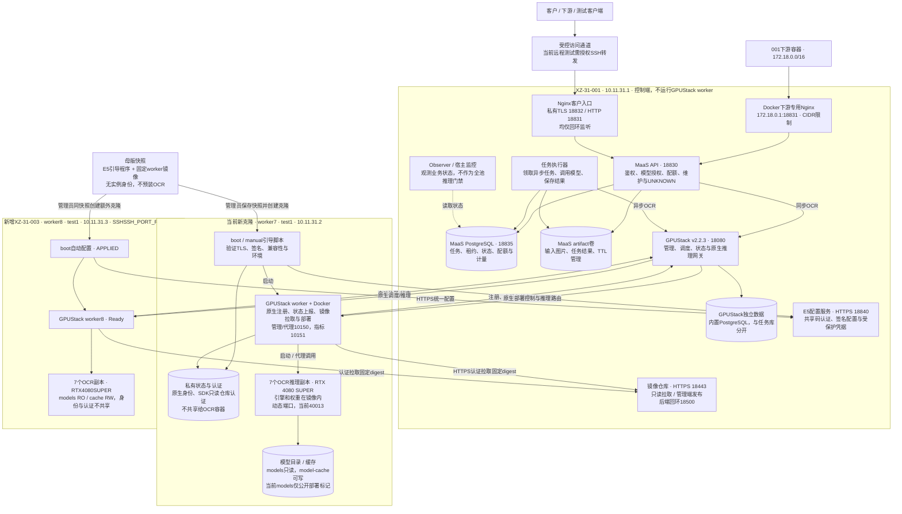
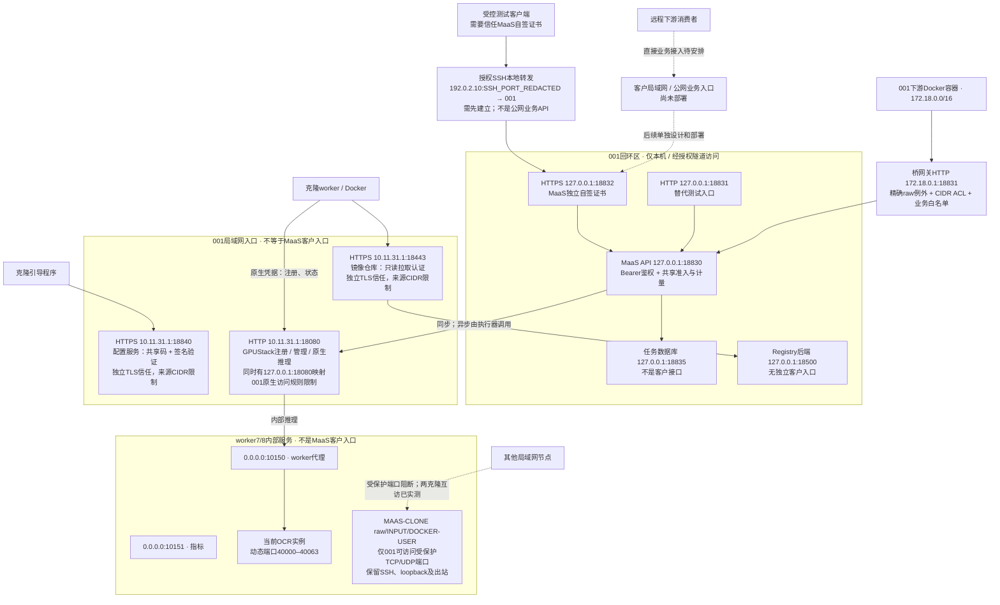

# 当前系统架构与服务暴露

> **2026-10-29网关后续修复**：已稳定复现控制端防火墙误丢弃落入受保护端口范围的出站返回包；将早期过滤迁至conntrack之后的mangle/PREROUTING，并仅允许ESTABLISHED/REPLY。26项本地回归、15项隔离内核检查、三轮副本重建15次OCR、实际入站隔离及一笔异步单计量均通过。MaaS已恢复接单（generation46）、UNKNOWN=0、监控正常；四模型副本和四候选executor保留，未重启VM/Docker/worker。原始单次503缺少源端口证据，Issue #1保持开放观察；母版/克隆网络文件未更新，E3剩余矩阵未自动续跑。[详细报告](../../results/maas-gateway-503-followup-20261029/REPORT.md)。

> 2026-10-28母版补充：SSH_PORT_REDACTED/tower已安装隔离文件并enable，未对母版应用宿主规则。新快照与独立克隆启动仍待管理员安排；当前worker7/8规则不变。[实际部署](../../results/maas-e5-template-network-20261028/REPORT.md)。

2026-10-28更新：001控制端、SSH_PORT_REDACTED/worker7及SSH_PORT_REDACTED/worker8同时在线，14个OCR副本各7个。结合前次入口监听核对及本轮双克隆证据；实线表示主要调用/控制关系，响应沿原连接返回；第二图虚线表示非客户调用路径或尚未建立的入口。当前两克隆网络边界和全局维护已验收；母版快照尚未更新。当前GPUStack为v2.2.3，E8升级未实施。

## 1. 整体组件架构

当前客户逻辑模型仍为ocr.default，业务revision为ocr-registry-r1；原生model18/route17目标14，instance103–109在worker7、110–116在worker8，各7个且全部running。母版只交付镜像，不是运行时配置源，也不需要保持在线。MaaS输入/结果目前在001的artifact卷，不是NFS或仅保留在worker。自建collector已退役，GPUStack自身资源采集保留。

## 2. 重点：服务暴露与访问边界

TLS18832与HTTP18831是两个平行Nginx入口，都直接转发18830，并非18832再转发18831。克隆访问配置服务和仓库的信任，与消费者访问MaaS的信任是三条不同通信链。原生GPUStack注册和推理入口当前仍是HTTP18080，不能画成全链路HTTPS。

## 3. 地址、用途与暴露状态

| 位置/端口 | 用途 | 当前实际边界 |
|---|---|---|
| 001 127.0.0.1:18832（同时::1） | MaaS客户HTTPS接口 | 自签证书，仅回环；远程测试需授权转发，尚未新增LAN/公网客户监听 |
| 001 127.0.0.1:18831（同时::1） | MaaS客户HTTP测试入口 | 仅回环，独立于TLS入口 |
| 001 172.18.0.1:18831 | 同机下游容器HTTP入口 | 仅指定Docker桥/172.18.0.0/16允许，仍须MaaS Bearer；原API内部端口及原生GPUStack未向该网段放开 |
| 001 127.0.0.1:18830 | MaaS API内部监听 | 回环，正常客户路径经过Nginx白名单 |
| 001 127.0.0.1:18835 | MaaS PostgreSQL | 回环，客户不直接访问 |
| 001 10.11.31.1:18840 | E5配置HTTPS | LAN来源规则、共享码；返回签名配置和受保护凭据，不是OCR接口 |
| 001 10.11.31.1:18443 → 127.0.0.1:18500 | Registry HTTPS → HTTP存储 | 前端LAN限定、reader/publisher分权；后端仅回环，不是客户图片下载接口 |
| 001 10.11.31.1及127.0.0.1:18080 | GPUStack原生HTTP入口 | 内部注册/管理/推理及受控运维；客户直用会绕过MaaS业务层，不作为消费者配置入口 |
| 当前worker7/8 0.0.0.0:10150、10151 | worker代理与指标 | 仅001从指定LAN接口放行，其他来源按IPv4/IPv6规则阻断；SSH不变 |
| 当前worker7/8 40000–40063 | 当前OCR动态实例端口 | 仅001可访问；两克隆互访实际模型端口均受阻，非客户API |
| 公网192.0.2.10:SSH_PORT_REDACTED / :SSH_PORT_REDACTED / :SSH_PORT_REDACTED | 已知SSH映射到001 / worker7 / worker8 | 运维入口，不能将SSH映射等同于已开放客户API；供应商其他映射未做完整核验 |

2026-10-28规则已应用到当前两克隆：raw pre-DNAT、INPUT及存在的DOCKER-USER覆盖，001管理/指标/模型健康可达；克隆间直连实测阻断。全局维护停止/恢复后仍有效。未全量扫描供应商公网映射或第三方LAN；IPv6规则安装和隔离内核验证通过，但未做IPv6真实模型调用。当前unit已enable及bootstrap依赖已配置，未做VM重启/新快照跨启动验证；未来克隆仍需母版overlay发布。

2026-10-27兼容门面上线后，当前客户路径包括/ocr、/v1/ocr、/v1/chat/completions，以及/maas/v1/artifacts、tasks、查询/取消和capabilities。POST /ocr兼容门面已上线，文生图仍未提供；网络监听和worker ACL状态没有因兼容适配而改变。

2026-10-27同机下游接入更新：新增独立maas-container-http入口，不替换原HTTP/TLS进程；只在172.18.0.1监听18831，持久raw规则仅放指定桥接来源到该目的地址和端口。已从下游后端network namespace验证401/200及路径限制，其他桥/内部API/原生管理仍阻断。下游业务渠道须自行更新endpoint，未测试公网或VM重启。见[报告](../../results/maas-container-http/REPORT.md)。

2026-10-28额外克隆正常扩容通过：新worker8无需手动安装/apply/pull/load即补齐7个实例；私有MaaS网关真实覆盖两GPU，异步/结果/单事件通过。该扩容阶段仅取证；随后已部署两克隆MAAS-CLONE链并通过全局维护，见下方最新记录。参见[本轮报告](../../results/maas-e5-dual-clone-20261028/REPORT.md)。

2026-10-28维护与网络验收：schema-v2绑定worker7/8、model18、route17；104.875秒全局窗口验证实际GPU停止、14副本7/7恢复、排队任务单次执行与唯一计量。四个MaaS容器ID和两克隆boot ID/worker容器ID保留，监控无告警和UNKNOWN。详见[验收报告](../../results/maas-topology-20261028/REPORT.md)和[当前运维手册](P4-MAINTENANCE.md)。E1未上线，下一步服务认证契约。
