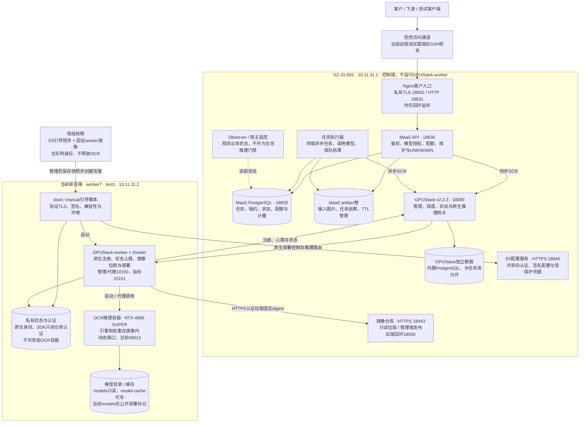
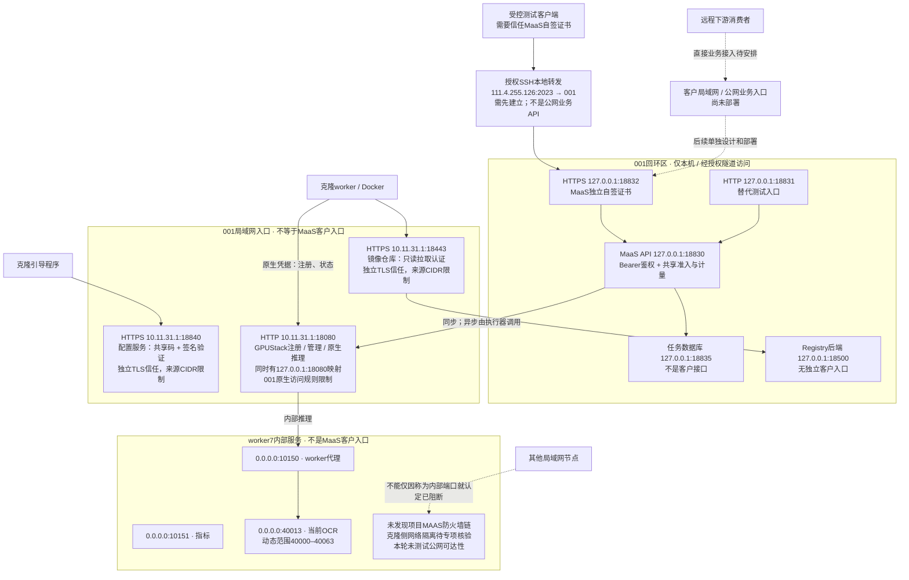

# 当前系统架构与服务暴露

2026-10-27。按最新部署、001与16487克隆的监听地址及仓库源码核对。实线表示主要调用/控制关系，响应沿原连接返回；第二图虚线表示尚未建立的入口或待核验的边界。当前GPUStack为v2.2.3，E8升级未实施。

## 1. 整体组件架构

当前客户逻辑模型仍为ocr.default，业务revision为ocr-registry-r1；原生model18/route17/instance103落在worker7。母版只交付镜像，不是运行时配置源，也不需要保持在线。MaaS输入/结果目前在001的artifact卷，不是NFS或仅保留在worker。自建collector已退役，GPUStack自身资源采集保留。

## 2. 重点：服务暴露与访问边界

TLS18832与HTTP18831是两个平行Nginx入口，都直接转发18830，并非18832再转发18831。克隆访问配置服务和仓库的信任，与消费者访问MaaS的信任是三条不同通信链。原生GPUStack注册和推理入口当前仍是HTTP18080，不能画成全链路HTTPS。

## 3. 地址、用途与暴露状态

| 位置/端口 | 用途 | 当前实际边界 |
|---|---|---|
| 001 127.0.0.1:18832（同时::1） | MaaS客户HTTPS接口 | 自签证书，仅回环；远程测试需授权转发，尚未新增LAN/公网客户监听 |
| 001 127.0.0.1:18831（同时::1） | MaaS客户HTTP测试入口 | 仅回环，独立于TLS入口 |
| 001 127.0.0.1:18830 | MaaS API内部监听 | 回环，正常客户路径经过Nginx白名单 |
| 001 127.0.0.1:18835 | MaaS PostgreSQL | 回环，客户不直接访问 |
| 001 10.11.31.1:18840 | E5配置HTTPS | LAN来源规则、共享码；返回签名配置和受保护凭据，不是OCR接口 |
| 001 10.11.31.1:18443 → 127.0.0.1:18500 | Registry HTTPS → HTTP存储 | 前端LAN限定、reader/publisher分权；后端仅回环，不是客户图片下载接口 |
| 001 10.11.31.1及127.0.0.1:18080 | GPUStack原生HTTP入口 | 内部注册/管理/推理及受控运维；客户直用会绕过MaaS业务层，不作为消费者配置入口 |
| 新克隆 0.0.0.0:10150、10151 | worker代理与指标 | 全IPv4接口监听；没有检测到项目MAAS链，不能写成已强制阻止其他LAN节点直连 |
| 新克隆 0.0.0.0:40013 | 当前OCR推理实例 | 动态端口；不是稳定客户API，网络可达性与ACL需专项确认 |
| 公网111.4.255.126:2023 / :16487 | 已知SSH映射到001 / 当前克隆 | 运维入口，不能将SSH映射等同于已开放客户API；供应商其他映射未做完整核验 |

001和新克隆分别读取监听信息；新克隆filter/raw表中未发现MAAS链，INPUT策略为ACCEPT。本轮不是完整网络安全审计，未测试第三方LAN/公网直连，也没有修改ACL。图中“非客户入口”描述接口职责，不声称底层网络一定不可达。需要后续核验并落地克隆侧管理/推理端口ACL，不能把001已有规则视为会自动复制到所有克隆。

当前已对客户提供的路径是/v1/chat/completions，以及/maas/v1/artifacts、tasks、查询/取消和capabilities。消费者契约中的POST /ocr兼容门面及文生图入口尚未实现；网络/证书接通不会自动补齐协议差异。
