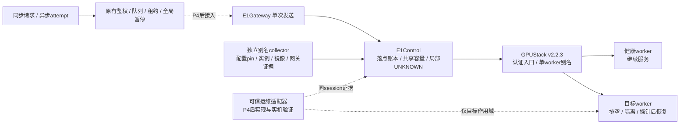

# E1：逐 worker 隔离候选设计

> **2026-11-18 用户已选定首阶段方式**：假设管理工具调用 Ubuntu 正常关机命令，由 worker 宿主机发送一次关机事件；通知总等待预算最多 1 秒，失败或超时照常关机，不重试、不等待推理排空。供应商回调不再是此路径的前置条件。当前已确定方案，发送器、接收接口与系统集成尚未实现或部署；后文完整排空仍是独立后续阶段。

> **2026-11-17 新增需求**：供应商或云平台通过指令关闭推理节点前，MaaS 应收到通知，识别即将消失的 worker 及其模型服务副本。用户确认暂不清楚供应商名称、通知接口及等待能力；当前完成方案登记，未实现或部署通知链路。沿用 [Issue #2](https://github.com/WTaoGitHub/cybercafe-maas/issues/2)，不重复新建增强项。下文原候选中的 001 控制端保护属于历史角色；当前 XZ-31-001 允许按普通 worker 注册，母版保护及 001/002 禁止整机重启的约束继续有效。

状态：本地开发，不部署。P4服务器、正式Compose、数据库迁移、collector、API与执行器入口保持原样，今晚耐久测试仍验证P4版本。E1本地通过不等于GPUStack实机验收。

## 供应商关机预告与优雅退出（2026-11-17，待对接）

### 已选方式：一次通知，总等待预算最多 1 秒（2026-11-18）

- **触发与顺序**：宿主机在正常系统关机事务中运行通知，安排在 Docker、实际网络服务停止之前。通知单元须已随开机进入可执行停止动作的状态，不能依赖 bootstrap 已成功注册才启用；没有当前 worker 身份时直接跳过。普通服务停止/重启、worker 容器停止不发送整机关机事件。不替换 Ubuntu 的 `shutdown` 命令。
- **一次发送**：使用当前启动绑定的 worker ID、集群、GPU UUID、启动会话及事件 ID，向经过认证的 MaaS 接口发送一次 HTTPS 请求。TLS 校验继续生效，不自动重试、不跟随重定向，不使用旧退役插件。关机阶段复用启动时准备的身份和配置，不临时申请凭据或调用 Docker/GPU 扫描。
- **总预算 1 秒**：从通知停止动作开始计算，预算包含本地准备、DNS、TCP/TLS、发送和响应等待；不能给每个阶段各分配 1 秒。收到持久接收 ACK 可提前返回，连接失败、拒绝、超时或其他错误均结束本次通知；MaaS 无权要求延长关机等待。不增加排空等待、延迟锁或无限重试。此预算只约束通知新增的等待，不承诺整机关机总时长或实时调度精度。
- **系统兜底**：候选使用单个同步 `ExecStop`，由 systemd 为整个通知进程组设置 `TimeoutStopSec=1s`、`TimeoutStopFailureMode=kill` 和 `KillMode=control-group`，超时直接结束通知，避免默认 TERM 宽限期再次增加等待。正常错误不成为关机前置失败，不配置额外等待的 `ExecStopPost`、失败恢复任务或重启策略；不在停止动作中用 `&` 留后台发送进程。须按目标 Ubuntu/systemd 版本核对支持与实际行为，当前未生成或安装该单元。依据：[停止动作与超时](https://www.freedesktop.org/software/systemd/man/latest/systemd.service.html#TimeoutStopFailureMode=)、[停止顺序](https://www.freedesktop.org/software/systemd/man/latest/systemd.unit.html#Before=)。
- **接收语义**：MaaS 持久记录“即将退出”与当前受影响副本，ACK 仅代表事件已保存。首阶段不把通知接收与路由撤出、调度隔离、容量调整或排空捆绑为关机条件；这些仍按下文 E1 后续集成推进。即使客户端等待 ACK 超时，服务端也可能已经收下事件，靠事件 ID 去重，不重发或撤销旧记录。
- **丢失兜底**：允许通知丢失。无通知不能推断节点仍在线，超时不能推断服务端未接收；GPUStack worker/实例事件及周期对账继续确认实际状态，未收到预告照样能发现失联。不把预告当作实际离线，不提前结束 E17 在线时长、不清除 UNKNOWN，也不承诺请求无损完成。

### 通知来源与能力前提

本次按上述 Ubuntu 正常关机路径推进方案，不依赖供应商提供回调；实际管理工具是否走此流程仍待只读取证或供应商确认。供应商控制端的提前预告作为其他来源保留：需要确认事件是在指令下发前、客户机开始关机时还是已经关机后产生，以及认证、截止时间、延迟/取消和失败语义。不能仅凭“指令已下发”就认定有足够排空窗口；“心跳已丢失”只作事后故障发现。供应商允许更长等待也不自动扩大本次 1 秒预算。

如果平台没有回调，但通过客户机正常关机流程执行，可评估在网络和 worker 仍可用时由节点钩子发送同类预告；必须先确认该流程确实执行钩子及可用时间，不能覆盖强制断电、崩溃或网络先断开的情况。普通 worker 容器停止、服务重启不自动认定为整机关机。晚期 `/usr/lib/systemd/system-shutdown/` 钩子执行时服务已停止，不适合依赖网络通知；依据 [systemd 官方说明](https://www.freedesktop.org/software/systemd/man/latest/systemd-poweroff.service.html)。当前不安装任何关机钩子。

若两类提前通知都不可获得，则保留 worker/实例事件订阅和周期对账作为故障检测，只能报告已观测到的失联，不能承诺“马上消失”的提前感知或无损关机。

### 接收与查询的最小契约

本机通知按当前启动会话设计，发送总等待预算已固定为 1 秒；接收接口路径和节点专用认证方式在实现时确认，不将批次共享引导码当作可冒充任意 worker 的事件凭据。首阶段只需经过认证的通知接收、持久记录和运维查询，不增加消息队列或 MaaS 发起整机关机的功能。以下是对接所需语义，尚非已提供的 API：

| 信息 | 用途与校验 |
|---|---|
| 来源、事件 ID、关机操作 ID/顺序 | 按来源和事件 ID 去重；关联预告/取消，处理乱序与重放，同一事件的冲突内容拒绝覆盖 |
| worker 与本次运行身份 | 本机来源绑定集群、worker ID、GPU UUID 与当前启动会话；外部来源另需供应商资源映射。不能仅按主机名/IP 或复用 GPU UUID 匹配旧事件 |
| 事件类型与发生时间 | 区分关机预告、取消和实际状态；过期、晚到或无法绑定当前运行身份的通知保留待核对，不直接隔离新会话 |
| 关机截止时间（如供应商提供） | 记录剩余窗口；未提供时标为未知，不伪造等待时间，超时不等于已关机 |
| MaaS 接收时间与处理结果 | 成功回复前持久化事件和解析结果；区分已接收、身份待核对、退出处理中、排空已证实与已观测离线 |

由服务端读取 GPUStack 当前实例，形成该事件影响的 worker→模型部署→实例清单，并在后续对账中更新；不信任通知提交的副本清单，也不混淆逻辑模型与原生部署 ID。无法确认映射时显式记录“影响范围待确认”。外部来源的资源/VM 关联沿用 [E5.F3 / Issue #16](https://github.com/WTaoGitHub/cybercafe-maas/issues/16)；本机来源核对当前启动会话。两者均不能把延迟旧事件套用到新接续 worker。

入口限制请求大小、执行时间、调用来源与资源作用域，校验认证和重放保护；消费者 API key 无权上报关机事件。不记录凭据及原始私有回调日志。接收 ACK 只确认消息已保存，不能作为排空或允许断电的凭证。

### 收到通知后的服务行为与现有模块衔接

1. **首阶段：可感知、可查询。** 持久记录关机意图、身份和受影响副本；即使 worker 尚为 Ready，也可查询其即将退出状态。现有 GPUStack watch 继续提供实际状态，通知接收不伪造 native offline，也不提前终止 E17 在线时长。
2. **E1 正式集成后：撤路与排空。** 当前会话进入退出状态后禁止向其新增模型调度，撤出新推理请求路由；已接受请求继续完成。仅设置 GPUStack maintenance 不能证明撤路，必须核对原生路由及所有受控入口。即使剩余副本不足，也保留关机意图并报告降级，不能因旧候选 `begin` 的剩余容量检查失败而继续把目标视为正常容量。
3. **按模型重新估算容量。** [副本调节器 / Issue #39](https://github.com/WTaoGitHub/cybercafe-maas/issues/39) 的规划、发送前复核与调度隔离须一致排除退出节点；同步/异步准入与 [动态并发 / Issue #60](https://github.com/WTaoGitHub/cybercafe-maas/issues/60) 使用剩余可服务副本。其他 worker 继续服务；无剩余副本的模型按现有有界排队/截止时间规则处理或明确不可用，不全局暂停、不把模型目标归零。尚在排空的实例仍保留实际资源占用，不能凭预告释放显存或触发破坏性缩容。
4. **截止、取消与恢复。** 到期未完成排空时记录未完成和在途/UNKNOWN，不自动清除、重放或宣告安全断电；是否继续关机由供应商协议决定。实际离线与排空分别记录。取消预告或节点重新上线后重新核对当前会话、原生健康及真实探针，才能解除退出隔离；重复 Ready 心跳不能取消关机意图。恢复不使用旧退役插件，也不将临时关机当作永久退役。

当前 `maas_platform/e1/` 为独立本地候选，尚未接入正式 API/执行器；`gpu_daily_watch.py` 订阅的是 GPUStack worker/实例事件，尚无供应商预告来源。实施须覆盖接收认证/持久存储/查询、E5 身份映射、GPUStack 调度/撤路适配器、E1 同步/异步入口、调节器规划及最终写前检查、并发准入与对应测试；不能仅新增一个可接收 HTTP 的端点就宣称优雅关机完成。原候选的单 worker 别名方案仍须按当前 GPUStack 信任边界复核，本次不将其直接部署。

### 实施顺序与验收

- 先只读核对正常 Ubuntu 关机路径、systemd 版本及 Docker/网络停止顺序，确定节点专用认证、当前启动身份与接收接口。供应商事件样例、认证、资源映射及等待/取消语义仅作为外部来源的对接前提，不再阻塞本机通知方案；当前仍不猜测厂商 API 或操作真实关机。
- 在本地替身或独立可销毁环境验证一次成功发送、连接拒绝、DNS/TLS/响应停滞、HTTP 错误、丢失 ACK 和发送进程不退出：通知受整体 1 秒预算约束，无重试、无额外 TERM 宽限期、无后台遗留，失败后继续正常停止流程。测量实际新增等待及调度误差，不能只检查单个 socket 超时参数。普通服务重启及无身份节点不误报。
- 随后在本地/独立环境验证接收持久性、接收进程重启后可查询、重复/冲突/乱序/过期/伪造事件拒绝或安全待核对；旧会话通知不影响同 GPU 新会话，未知资源不能影响其他 worker。
- 验证 Ready 期间收到预告即可查询退出节点及当前受影响副本；进程重启、重复心跳和断订阅后的完整对账不会丢失意图；取消与实际离线分别更新，不伪造 E17 在线结果。
- 完成 E1 与调节器/准入集成后，在多 worker、多模型持续流量中验证撤路时间、禁止新增调度、在途排空、剩余容量降级、零剩余副本、截止超时/UNKNOWN及恢复；记录错误率和耗时，不预先承诺零中断。
- 无回调、迟到通知、通知发送失败和强制断电仅在本地模拟或另行获准的可销毁环境验证；XZ-31-001/002 不执行整机关机、重启或等效操作。上述验收当前均为待办，文档核对不算运行验证。

## 路由决策

GPUStack v2.2.3的维护状态用于调度过滤，不能独立证明所有既有模型路由已经撤销，更不能证明GPU进程结束。当前通用模型入口还有跨实例重试，任务层无法据此缩小UNKNOWN范围。

候选方案复用GPUStack的认证、模型部署、worker_selector与模型路由，为每个模型/worker创建独立别名及独立不可变pin。每个别名必须唯一匹配一个worker、只有一个本地running实例、相同语义revision和内容镜像，禁止分布式实例、fallback及网关重试。框架只在已验证别名中选路，不直接使用worker地址，不将内部 `X-GPUStack-Model-Instance` 当作对外选路接口。

这些是未来部署的必要条件，不是假定现有别名已经满足条件。别名会改变模型配置及资源占用，需要在P4验收后单独设计迁移窗口和实机容量验证；不能直接把现有多worker pin改成单worker。

源码依据来自本机 `/Users/4paradigm/dev/gpustack` 的 **v2.2.3 tag**（不使用当前main的额外能力）：

- `gpustack/policies/worker_filters/status_filter.py`：调度候选要求READY。
- `gpustack/policies/worker_filters/label_matching_filter.py`：复用worker标签选择。
- `gpustack/server/controllers.py` 的模型registry构建：收集有地址且RUNNING的模型实例；不能把单个maintenance操作当作完整撤路协议。
- `gpustack/gateway/utils.py`：内部instance header由网关注入，不是本方案依赖的公开控制API。
- `gpustack/server/worker_instance_cleaner.py`：维护状态影响清理行为，不代表停止推理进程。

## 拓扑与剩余容量

新增 `maas_platform/e1/topology.py` 独立验证每个别名，沿用现有VersionPin配置与镜像校验，不削弱P4 collector。要求新鲜的实际网关目标和禁重试证据。一次刷新只发布本轮验证成功的子集，不保留失败别名的旧证明；模型1的某别名失败不撤销模型2的健康别名。

容量来自显式批准的slots（首版每别名1），按逻辑模型汇总健康别名；同时仍须受全局、项目额度限制。slots是并发准入预算，不是性能推算。没有健康别名时仅对应模型不可执行，结果查询不受影响。

## 开发与发布隔离

E1代码独立模块，默认不导入现有P4服务路径；仅执行本地测试。P4后必须完成入口对接、单worker别名实际部署/撤路证据、所有旁路封闭和持续流量故障演练，才能启用局部UNKNOWN隔离。未关联的旧请求继续全局保守隔离。

## 请求落点账本与节点维护

候选 `E1Control` 使用001单控制端上的私有JSON journal与稳定flock锁，原子替换及fsync；每次发送前记录同步/异步attempt唯一token、project、逻辑模型、revision、别名、worker、instance与截止时间。它不是任务队列或计费库；PostgreSQL仍负责这两项。该低吞吐候选不支持多控制端/网络文件系统，性能须实测后决定是否迁入同一PostgreSQL事务。

- 同步/异步和恢复探针共享全局、项目、worker、别名容量；重复token永不再次发起请求。外层任务领取额度仍须保留，不能把两套额度相加。
- HTTP/进程超时或崩溃后的过期intent转UNKNOWN，占据容量并隔离潜在worker。没有实际落点的旧通用入口活动继续全局隔离。迟到完整响应可确认完成；其他UNKNOWN解除必须有真实终止证据。
- 单实例故障可只隔离model/worker组合；worker故障隔离全部相关别名。新鲜collector证明不会自动取消故障隔离，恢复须显式探针和防抖。
- `begin`在锁内关闭目标新准入并检查每个受影响模型尚有健康副本；现有请求继续完成，其他模型/worker可继续接单。保护控制端001，禁止用002的停机流程维护001。
- `stop`要求目标无在途/UNKNOWN、无未定位活动，并有同session的新鲜撤路/防旁路/禁止调度证据。先持久化STOPPING再调用仅作用于目标的外部hook；worker、实例和GPU空闲三项实际证据齐备才记STOPPED，异常记STOP_UNCONFIRMED。
- `recover`保持目标隔离，调用幂等恢复hook，取得恢复后新版本/镜像证明与真实探针才重新准入。探针在锁外执行，不阻塞健康节点；探针超时也记录UNKNOWN，不能自动清除。单model故障有单独恢复路径。
- journal保留全部attempt用于防重，最多10000条，满后明确拒绝，不删除历史token冒险重放。事件环最多1000条；正式上线前需要归档/保留策略和吞吐实测。这是明确的候选限制。

外部hook是可信运维适配器，不接收用户shell命令。当前只接本地测试替身，不提供可操作001/002的实现。其未来部署必须证明GPUStack/UI/直连旁路同受边界约束，hook不可用时不宣告节点已停。

## 候选推理传输

`E1Gateway` 在逻辑模型鉴权后先持久化intent，再通过GPUStack认证入口发送已验证别名；同步/异步复用同一账本，不透传客户路由header，不直连worker，不做应用重试。完整接收被认可的HTTP终态才确认完成，超时/取消/异常状态/超限或编码不明保留UNKNOWN；JSON内容错误与远端是否已结束分别判断。它不创建任务、不计费、不替代现有TaskService。

**尚未接入P4 API/执行器。** 后续适配必须将任务attempt/sync token与此账本一一绑定；在发送前保留原PostgreSQL租约/取消/全局暂停检查，失败时同步两侧状态，旧通用请求UNKNOWN继续阻塞全局。只有所有入口完成迁移和旁路封闭后，才能启用局部隔离承诺。现阶段不会因这些本地模块的存在改变正式UNKNOWN行为。

## 组件图



实线表示候选模块的控制/调用关系，不表示已部署；左侧P4入口及右侧真实运维适配器尚未对接。

## 路线图与后续门槛

| 工作包 | 当前状态 | 完成门槛 |
|---|---|---|
| E1-A 路由契约/健康子集 | 本地实现与测试完成 | 独立别名、不可变pin、单worker、禁重试、逐别名撤销证明 |
| E1-B 落点/容量/状态机 | 本地实现与测试完成 | 持久意图、共享额度、故障最小隔离、排空/停止/恢复与UNKNOWN边界 |
| E1-C 候选HTTP传输 | 本地实现与测试完成 | 鉴权前置、落点后单次发送、取消/超时保留UNKNOWN |
| E1-D 正式请求路径对接 | 待P4通过后开发、独立测试 | 原任务/同步token绑定、租约/取消/全局暂停双侧一致；旧UNKNOWN全局保护；验证计量不重复及跨项目权限 |
| E1-E GPUStack及运维适配器 | 待P4后部署窗口 | 别名实际目标/禁重试可观测；只操作目标alias与worker；防旁路；真实停止/恢复及幂等补偿 |
| E1-F 持续流量实机验收 | 未执行 | 多模型流量下维护/失联/实例崩溃/UNKNOWN/恢复失败/防抖，记录错误率、延迟、容量与GPU退出证据 |

E1-D必须先在本地/独立环境解决跨journal与PostgreSQL的崩溃一致性，不能把同一个请求登记两次或漏登记。只有确证所有实际发送具有持久落点，才允许把原有全局UNKNOWN降为局部；否则继续全局保守隔离。E1-E需实现真实hooks，当前本地布尔证据仅用于测试契约，不是实机证明。

未来部署顺序：P4最终验收 → 独立保存P4基线与备份 → 本地/独立环境验证D → 受控窗口迁移现有多worker部署到单worker别名（避免直接叠加导致显存超额）→ 安装观测/运维适配器并验证旁路 → 001承载持续流量、002演练 → 失败回退P4并清理候选别名。保护001控制端，整机维护不纳入002演练。

本地复现（Python3.11+）：

```sh
.venv-maas/bin/python -m pytest tests/maas/test_e1_topology.py tests/maas/test_e1_control.py tests/maas/test_e1_gateway.py -q
.venv-maas/bin/python scripts/maas/e1_local_acceptance.py
```

脚本使用httpx本地MockTransport和临时journal，不发外部HTTP，不操作SSH/Docker/GPU，不读取任何正式密钥。验收摘要写入 `results/maas-e1-local/acceptance.json`。
