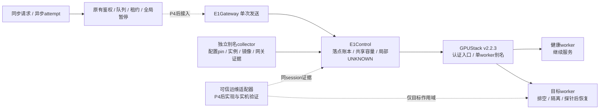

# E1：逐 worker 隔离候选设计

状态：本地开发，不部署。P4服务器、正式Compose、数据库迁移、collector、API与执行器入口保持原样，今晚耐久测试仍验证P4版本。E1本地通过不等于GPUStack实机验收。

## 路由决策

GPUStack v2.2.3的维护状态用于调度过滤，不能独立证明所有既有模型路由已经撤销，更不能证明GPU进程结束。当前通用模型入口还有跨实例重试，任务层无法据此缩小UNKNOWN范围。

候选方案复用GPUStack的认证、模型部署、worker_selector与模型路由，为每个模型/worker创建独立别名及独立不可变pin。每个别名必须唯一匹配一个worker、只有一个本地running实例、相同语义revision和内容镜像，禁止分布式实例、fallback及网关重试。框架只在已验证别名中选路，不直接使用worker地址，不将内部 `X-GPUStack-Model-Instance` 当作对外选路接口。

这些是未来部署的必要条件，不是假定现有别名已经满足条件。别名会改变模型配置及资源占用，需要在P4验收后单独设计迁移窗口和实机容量验证；不能直接把现有多worker pin改成单worker。

源码依据来自本机 `/Users/4paradigm/dev/gpustack` 的 **v2.2.3 tag**（不使用当前main的额外能力）：

- `gpustack/policies/worker_filters/status_filter.py`：调度候选要求READY。
- `gpustack/policies/worker_filters/label_matching_filter.py`：复用worker标签选择。
- `gpustack/server/controllers.py` 的模型registry构建：收集有地址且RUNNING的模型实例；不能把单个maintenance操作当作完整撤路协议。
- `gpustack/gateway/utils.py`：内部instance header由网关注入，不是本方案依赖的公开控制API。
- `gpustack/server/worker_instance_cleaner.py`：维护状态影响清理行为，不代表停止推理进程。

## 拓扑与剩余容量

新增 `maas_platform/e1/topology.py` 独立验证每个别名，沿用现有VersionPin配置与镜像校验，不削弱P4 collector。要求新鲜的实际网关目标和禁重试证据。一次刷新只发布本轮验证成功的子集，不保留失败别名的旧证明；模型1的某别名失败不撤销模型2的健康别名。

容量来自显式批准的slots（首版每别名1），按逻辑模型汇总健康别名；同时仍须受全局、项目额度限制。slots是并发准入预算，不是性能推算。没有健康别名时仅对应模型不可执行，结果查询不受影响。

## 开发与发布隔离

E1代码独立模块，默认不导入现有P4服务路径；仅执行本地测试。P4后必须完成入口对接、单worker别名实际部署/撤路证据、所有旁路封闭和持续流量故障演练，才能启用局部UNKNOWN隔离。未关联的旧请求继续全局保守隔离。

## 请求落点账本与节点维护

候选 `E1Control` 使用001单控制端上的私有JSON journal与稳定flock锁，原子替换及fsync；每次发送前记录同步/异步attempt唯一token、project、逻辑模型、revision、别名、worker、instance与截止时间。它不是任务队列或计费库；PostgreSQL仍负责这两项。该低吞吐候选不支持多控制端/网络文件系统，性能须实测后决定是否迁入同一PostgreSQL事务。

- 同步/异步和恢复探针共享全局、项目、worker、别名容量；重复token永不再次发起请求。外层任务领取额度仍须保留，不能把两套额度相加。
- HTTP/进程超时或崩溃后的过期intent转UNKNOWN，占据容量并隔离潜在worker。没有实际落点的旧通用入口活动继续全局隔离。迟到完整响应可确认完成；其他UNKNOWN解除必须有真实终止证据。
- 单实例故障可只隔离model/worker组合；worker故障隔离全部相关别名。新鲜collector证明不会自动取消故障隔离，恢复须显式探针和防抖。
- `begin`在锁内关闭目标新准入并检查每个受影响模型尚有健康副本；现有请求继续完成，其他模型/worker可继续接单。保护控制端001，禁止用002的停机流程维护001。
- `stop`要求目标无在途/UNKNOWN、无未定位活动，并有同session的新鲜撤路/防旁路/禁止调度证据。先持久化STOPPING再调用仅作用于目标的外部hook；worker、实例和GPU空闲三项实际证据齐备才记STOPPED，异常记STOP_UNCONFIRMED。
- `recover`保持目标隔离，调用幂等恢复hook，取得恢复后新版本/镜像证明与真实探针才重新准入。探针在锁外执行，不阻塞健康节点；探针超时也记录UNKNOWN，不能自动清除。单model故障有单独恢复路径。
- journal保留全部attempt用于防重，最多10000条，满后明确拒绝，不删除历史token冒险重放。事件环最多1000条；正式上线前需要归档/保留策略和吞吐实测。这是明确的候选限制。

外部hook是可信运维适配器，不接收用户shell命令。当前只接本地测试替身，不提供可操作001/002的实现。其未来部署必须证明GPUStack/UI/直连旁路同受边界约束，hook不可用时不宣告节点已停。

## 候选推理传输

`E1Gateway` 在逻辑模型鉴权后先持久化intent，再通过GPUStack认证入口发送已验证别名；同步/异步复用同一账本，不透传客户路由header，不直连worker，不做应用重试。完整接收被认可的HTTP终态才确认完成，超时/取消/异常状态/超限或编码不明保留UNKNOWN；JSON内容错误与远端是否已结束分别判断。它不创建任务、不计费、不替代现有TaskService。

**尚未接入P4 API/执行器。** 后续适配必须将任务attempt/sync token与此账本一一绑定；在发送前保留原PostgreSQL租约/取消/全局暂停检查，失败时同步两侧状态，旧通用请求UNKNOWN继续阻塞全局。只有所有入口完成迁移和旁路封闭后，才能启用局部隔离承诺。现阶段不会因这些本地模块的存在改变正式UNKNOWN行为。

## 组件图



实线表示候选模块的控制/调用关系，不表示已部署；左侧P4入口及右侧真实运维适配器尚未对接。

## 路线图与后续门槛

| 工作包 | 当前状态 | 完成门槛 |
|---|---|---|
| E1-A 路由契约/健康子集 | 本地实现与测试完成 | 独立别名、不可变pin、单worker、禁重试、逐别名撤销证明 |
| E1-B 落点/容量/状态机 | 本地实现与测试完成 | 持久意图、共享额度、故障最小隔离、排空/停止/恢复与UNKNOWN边界 |
| E1-C 候选HTTP传输 | 本地实现与测试完成 | 鉴权前置、落点后单次发送、取消/超时保留UNKNOWN |
| E1-D 正式请求路径对接 | 待P4通过后开发、独立测试 | 原任务/同步token绑定、租约/取消/全局暂停双侧一致；旧UNKNOWN全局保护；验证计量不重复及跨项目权限 |
| E1-E GPUStack及运维适配器 | 待P4后部署窗口 | 别名实际目标/禁重试可观测；只操作目标alias与worker；防旁路；真实停止/恢复及幂等补偿 |
| E1-F 持续流量实机验收 | 未执行 | 多模型流量下维护/失联/实例崩溃/UNKNOWN/恢复失败/防抖，记录错误率、延迟、容量与GPU退出证据 |

E1-D必须先在本地/独立环境解决跨journal与PostgreSQL的崩溃一致性，不能把同一个请求登记两次或漏登记。只有确证所有实际发送具有持久落点，才允许把原有全局UNKNOWN降为局部；否则继续全局保守隔离。E1-E需实现真实hooks，当前本地布尔证据仅用于测试契约，不是实机证明。

未来部署顺序：P4最终验收 → 独立保存P4基线与备份 → 本地/独立环境验证D → 受控窗口迁移现有多worker部署到单worker别名（避免直接叠加导致显存超额）→ 安装观测/运维适配器并验证旁路 → 001承载持续流量、002演练 → 失败回退P4并清理候选别名。保护001控制端，整机维护不纳入002演练。

本地复现（Python3.11+）：

```sh
.venv-maas/bin/python -m pytest tests/maas/test_e1_topology.py tests/maas/test_e1_control.py tests/maas/test_e1_gateway.py -q
.venv-maas/bin/python scripts/maas/e1_local_acceptance.py
```

脚本使用httpx本地MockTransport和临时journal，不发外部HTTP，不操作SSH/Docker/GPU，不读取任何正式密钥。验收摘要写入 `results/maas-e1-local/acceptance.json`。
