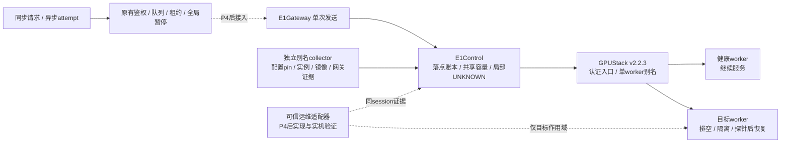

# E1：逐 worker 隔离候选设计

> **2026-11-18 最新范围**：用户明确关机事件通知模块仅负责 **worker 发送事件、MaaS 保存事件、MaaS 删除保留超过 48 小时的事件**。此前加入本模块的退出状态、重新上线、模型副本关联与撤路/排空设计不再属于本模块职责。MaaS 接收、Bootstrap 签发和母版客户端已部署，真实 Ubuntu/systemd 关机验收按用户决定保留待办。沿用 [Issue #2](https://github.com/WTaoGitHub/cybercafe-maas/issues/2)。

> 下方原 E1 候选中的 001 控制端角色属于历史；XZ-31-001 当前可按普通 worker 注册。母版保护及 XZ-31-001/002 禁止整机重启与等效操作的约束继续有效。

## 长期 UNKNOWN 主动核查与结清

2026-11-25 设计并实现，待三台测试 GPU 实机验收。对应 E1 的突发故障隔离，首轮适用带强制执行守卫的 PP-OCRv4，同步和异步共用证据规则。目标是在原回执丢失、原推理进程退出时也能核实占用已经结束。结清的是后台活动。异步任务继续保留原失败结果，成功计量仍以原成功提交为准。[增强登记](ENHANCEMENTS.md#长期-unknown-主动核查与结清) · [Issue #2](https://github.com/WTaoGitHub/cybercafe-maas/issues/2)

在真实 GPU 的 PP 容器替换试验中，替换进程以自身身份提交旧请求的结束回执收到 409。重送原进程保存的签名事件后，原活动结清。未保存回执的用例仍停在 `UNKNOWN`。本子项补充「原回执查无记录时如何证明执行已经停止」，复用已有回执、派发和隔离实现。[容器替换验证](../../results/maas-pg-finish-delivery-20261125/REPORT.md) · [回执与准入现状](../../deploy/maas/INFERENCE-QUARANTINE.md)

### 证据与结清规则

| 主动核查结果 | 对原后台活动的处理 |
|---|---|
| 找到原 token 对应的可信结束回执 | 沿用现有回执路径结清为 `COMPLETED`，保存原证据引用。 |
| 原进程确认该 token 仍在执行 | 保持 `UNKNOWN` 和相应隔离，记录最近一次核查。首轮以只读核查和等待为主。后续如接入引擎级取消，须取得该 token 已停止且执行资源已归还的确认。 |
| 宿主机运行时证明原容器及承载本次推理的进程组已彻底退出，且旧 token 已无法在任何可达落点获权 | 结清为 `RESOLVED`，标明「原执行已终止」，保存可审计的证据引用。GPU 实际结束时间缺失时保留空值。 |
| worker 失联、仅有新的 Ready 状态或不同进程标识，查询超时、查无记录、证据身份冲突或可能落点不完整 | 保留 `UNKNOWN` 和必要隔离，退避后再查并向运维展示待核原因。历史样本缺少原运行身份时，可依据经运维查实的同一 VPC 启动会话已终止等证据走现有人工入口。 |

### 实现边界

1. **获权时保存实际运行身份。** 沿用原 token、路由、GPU UUID、守卫进程实例和派发时的执行范围，补充经受信宿主机核对的 worker 启动会话、容器 ID 及进程组身份。进程组需覆盖引擎子进程和实际执行路径。测试记录必须证明这个 PP 后端的执行不会脱离该运行范围。历史活动缺少绑定、守卫出现冲突或网关可能存在未经授权的旁路时，保留人工核查。
2. **超过等待窗口主动查证。** 使用首次转为 `UNKNOWN` 的时间计算等待时长。优先查询现有结束回执，再向受信 worker 宿主机查询原运行身份。首轮由宿主机侧复用已有 worker 管理通道提供只读证明，查询和事件记录限制在本 worker 和具体运行实例。终止证明应从运行时或进程组取得并持久登记，签名绑定原启动会话、容器、进程组、GPU、事件时间和证据 ID。用随机挑战绑定查询应答，以固定来源验证证据。新进程可转交已保存的原始证据，回答自身为空时继续等待。GPUStack 实例列表用于定位，现有「请求关机」事件只作为核查线索。
3. **限制核查开销。** 复用已有对账循环。按原运行实例合并查询，设定全局与逐 worker 并发上限，失败按上限退避。将最近证据、下次查询时间和持久任务状态绑定原活动，控制进程重启后续查。试点初值为进入 `UNKNOWN` 后 30 秒开始查。可达的 worker 每 30 秒复查，失联时退避到最多 5 分钟。worker 恢复或收到终止事件时，提前安排一次核查。连续 15 分钟无法证实时进入人工核查清单。网络和宿主机查询放在数据库事务外。
4. **原子核对并只释放一次。** 写入模式在现有准入锁内锁定原活动，重新验证状态、不可变身份、可信证据和全部可达落点的守卫约束。旧 token 保持不可获权。原回调、主动查证、运维结清或多个对账执行者并发时，首次有效提交释放占用，后续证据可以附到审计记录。沿用 `RESOLVED` 的释放路径，无需生成业务成功记录。自动取消、停止或重启容器属于独立操作授权。XZ-31-001 和 XZ-31-002 禁止 VM 级重启及等效操作。
5. **健康容量独立恢复。** 已证实落在 A 卡的未决活动只隔离 A 卡。首轮复用经过验证的逐 GPU 路由，让 B、C 在实际同步预留和剩余异步额度内继续接单。聚合路由须读回 Higress 实际生效的全部目标及重试落点，确认剔除了 A 后才能开放这条聚合路由。A 卡上所有相关活动均结清，并通过现有就绪、进程身份和路由复核后，才将其额度加回。展示等待原因、最后查询时间、证据来源和隔离期间的实际可用额度。

### 实施与验收

先用 PP-OCRv4 开启只读核查，逐条比对主机记录、守卫身份和数据库活动。通过隔离测试后再为一条试点路由打开自动结清。出现误结清、重复释放或额度与账本不符时，关闭写入模式，保留只读核查与现行隔离。现有完成回执继续走原路径。

| 验收场景 | 通过条件 |
|---|---|
| 缺失回执，原 PP 推理容器与进程组已确认退出 | 对应活动自动变为 `RESOLVED`。原任务无重放、无新增成功计量。建议在独立环境各测至少 10 笔同步和异步请求。worker 可达且可信终止证据可查后，试点结清时延 P95 目标为 60 秒以内。另测长时间失联后重新发现证据的耗时。 |
| 原执行仍在运行，或证据缺失、过期、错配和冲突 | 误结清和误加额度均为 0。覆盖同一 GPU 上的新进程、借用旧证据、只有关闭通知、同卡多个未决活动，以及 GPUStack 已删除实例记录但宿主机进程仍存活。 |
| 探查与迟到的原始回执或人工处置竞争，随后对账进程重启 | 每笔最多释放一次，保留证据来源，重启后未决活动继续核查。控制端断连期间保持必要的隔离与队列边界。 |
| 三张测试 GPU 中 A 在线但有长时间 `UNKNOWN` | A 的后续执行授权为 0。B、C 在各层剩余限额内完成新的真实同步及异步请求。聚合路由仍可命中 A 时保持停发。A 取得终止证据并通过健康复核后额度恢复。 |

### 本地实施记录

迁移 018、PP 宿主机证明服务、签名运行时挂载、控制端查证及逐路由写入已实现。控制端复用私有执行回调通道下发核查，worker 发起 HTTPS 领取请求。控制端默认仅登记证据。实际运行的进程组、容器启动时间、同一启动会话及 GPU 上的原计算进程均可核验时，才接受原执行终止。原进程仍在时，当前提供的是进程存在证据，单次推理结束仍依赖该 token 的原回执。

隔离 PostgreSQL 与模拟 Docker、cgroup、NVIDIA 证据覆盖同步、异步各 10 笔结清、已发挑战的重放、签名错配、终态回执竞态和固定 GPU 路由绕行。相关回归 141 项通过，包括独立 PostgreSQL 的真实停启验证。worker bundle 的 50 个受清单保护的文件已校验。真实 Linux Docker 及 GPU 核查、三卡同步和异步派发、P95 目标及正式启用待实验。[部署及回退说明](../../deploy/maas/INFERENCE-QUARANTINE.md#长期-unknown-的原宿主机核查) · [可复用隔离库验收](../../tests/maas/test_runtime_recovery.py)

## worker 关机事件通知（2026-11-18）

本模块的独立[设计与开发实施方案](WORKER-SHUTDOWN-EVENTS.md)已完成，发送、接收和清理代码及部署均待实施。只负责三项：

1. **worker VPC 发送**：正常 Ubuntu 关机时一次 HTTPS 通知，总等待预算最多 1 秒；失败/超时照常关机，不重试。
2. **MaaS 保存**：认证与校验后提交事件记录；每次关机新生成 UUID v4 作为 `event_id`，同一 VPC 多次关机分别保存，不按 worker/GPU/启动身份去重。数据库主键意外冲突返回 409，不覆盖旧事件。
3. **MaaS 删除**：按服务端接收时间保留 48 小时；API 启动后先清一批、此后每 60 秒有界删除最多 500 条到期记录，停机恢复后补清理。

接口为 `POST /maas/internal/worker-shutdown-events`，复用现有 FastAPI/PostgreSQL。节点范围凭据随已有 Bootstrap 启动响应准备，关机时不再访问发证或 GPUStack 认证接口；首次只支持既有 GPU UUID/启动会话身份，不改变注册校验。事件只包含节点/启动信息和发生/接收/到期时间，不维护 worker 或副本状态，不做恢复、撤路、排空、调度和容量调整。

SD01 协议/认证、SD02 接收/存储/清理、SD03 发送/systemd、SD04 凭据准备与镜像/bundle，以及 SD05 本地 HTTPS/数据库联调和部署材料均已完成。文件范围、验收证据、发布及回退见[独立方案](WORKER-SHUTDOWN-EVENTS.md)。MaaS、Bootstrap 和母版上的安装与现场 HTTPS 验证通过。新快照、克隆首启和实际 Ubuntu/systemd 关机验收待办。XZ-31-001/002 不执行整机关机、重启或等效操作。下方原 E1 路由与排空工作包独立推进，不作为通知模块前置。

## 路由决策

GPUStack v2.2.3的维护状态用于调度过滤，不能独立证明所有既有模型路由已经撤销，更不能证明GPU进程结束。当前通用模型入口还有跨实例重试，任务层无法据此缩小UNKNOWN范围。

候选方案复用GPUStack的认证、模型部署、worker_selector与模型路由，为每个模型/worker创建独立别名及独立不可变pin。每个别名必须唯一匹配一个worker、只有一个本地running实例、相同语义revision和内容镜像，禁止分布式实例、fallback及网关重试。框架只在已验证别名中选路，不直接使用worker地址，不将内部 `X-GPUStack-Model-Instance` 当作对外选路接口。

这些是未来部署的必要条件，不是假定现有别名已经满足条件。别名会改变模型配置及资源占用，需要在P4验收后单独设计迁移窗口和实机容量验证；不能直接把现有多worker pin改成单worker。

源码依据来自本机 `/Users/4paradigm/dev/gpustack` 的 **v2.2.3 tag**（不使用当前main的额外能力）：

- `gpustack/policies/worker_filters/status_filter.py`：调度候选要求READY。
- `gpustack/policies/worker_filters/label_matching_filter.py`：复用worker标签选择。
- `gpustack/server/controllers.py` 的模型registry构建：收集有地址且RUNNING的模型实例；不能把单个maintenance操作当作完整撤路协议。
- `gpustack/gateway/utils.py`：内部instance header由网关注入，不是本方案依赖的公开控制API。
- `gpustack/server/worker_instance_cleaner.py`：维护状态影响清理行为，不代表停止推理进程。

## 拓扑与剩余容量

新增 `maas_platform/e1/topology.py` 独立验证每个别名，沿用现有VersionPin配置与镜像校验，不削弱P4 collector。要求新鲜的实际网关目标和禁重试证据。一次刷新只发布本轮验证成功的子集，不保留失败别名的旧证明；模型1的某别名失败不撤销模型2的健康别名。

容量来自显式批准的slots（首版每别名1），按逻辑模型汇总健康别名；同时仍须受全局、项目额度限制。slots是并发准入预算，不是性能推算。没有健康别名时仅对应模型不可执行，结果查询不受影响。

## 开发与发布隔离

E1代码独立模块，默认不导入现有P4服务路径；仅执行本地测试。P4后必须完成入口对接、单worker别名实际部署/撤路证据、所有旁路封闭和持续流量故障演练，才能启用局部UNKNOWN隔离。未关联的旧请求继续全局保守隔离。

## 请求落点账本与节点维护

候选 `E1Control` 使用001单控制端上的私有JSON journal与稳定flock锁，原子替换及fsync；每次发送前记录同步/异步attempt唯一token、project、逻辑模型、revision、别名、worker、instance与截止时间。它不是任务队列或计费库；PostgreSQL仍负责这两项。该低吞吐候选不支持多控制端/网络文件系统，性能须实测后决定是否迁入同一PostgreSQL事务。

- 同步/异步和恢复探针共享全局、项目、worker、别名容量；重复token永不再次发起请求。外层任务领取额度仍须保留，不能把两套额度相加。
- HTTP/进程超时或崩溃后的过期intent转UNKNOWN，占据容量并隔离潜在worker。没有实际落点的旧通用入口活动继续全局隔离。迟到完整响应可确认完成；其他UNKNOWN解除必须有真实终止证据。
- 单实例故障可只隔离model/worker组合；worker故障隔离全部相关别名。新鲜collector证明不会自动取消故障隔离，恢复须显式探针和防抖。
- `begin`在锁内关闭目标新准入并检查每个受影响模型尚有健康副本；现有请求继续完成，其他模型/worker可继续接单。保护控制端001，禁止用002的停机流程维护001。
- `stop`要求目标无在途/UNKNOWN、无未定位活动，并有同session的新鲜撤路/防旁路/禁止调度证据。先持久化STOPPING再调用仅作用于目标的外部hook；worker、实例和GPU空闲三项实际证据齐备才记STOPPED，异常记STOP_UNCONFIRMED。
- `recover`保持目标隔离，调用幂等恢复hook，取得恢复后新版本/镜像证明与真实探针才重新准入。探针在锁外执行，不阻塞健康节点；探针超时也记录UNKNOWN，不能自动清除。单model故障有单独恢复路径。
- journal保留全部attempt用于防重，最多10000条，满后明确拒绝，不删除历史token冒险重放。事件环最多1000条；正式上线前需要归档/保留策略和吞吐实测。这是明确的候选限制。

外部hook是可信运维适配器，不接收用户shell命令。当前只接本地测试替身，不提供可操作001/002的实现。其未来部署必须证明GPUStack/UI/直连旁路同受边界约束，hook不可用时不宣告节点已停。

## 候选推理传输

`E1Gateway` 在逻辑模型鉴权后先持久化intent，再通过GPUStack认证入口发送已验证别名；同步/异步复用同一账本，不透传客户路由header，不直连worker，不做应用重试。完整接收被认可的HTTP终态才确认完成，超时/取消/异常状态/超限或编码不明保留UNKNOWN；JSON内容错误与远端是否已结束分别判断。它不创建任务、不计费、不替代现有TaskService。

**尚未接入P4 API/执行器。** 后续适配必须将任务attempt/sync token与此账本一一绑定；在发送前保留原PostgreSQL租约/取消/全局暂停检查，失败时同步两侧状态，旧通用请求UNKNOWN继续阻塞全局。只有所有入口完成迁移和旁路封闭后，才能启用局部隔离承诺。现阶段不会因这些本地模块的存在改变正式UNKNOWN行为。

## 组件图



实线表示候选模块的控制/调用关系，不表示已部署；左侧P4入口及右侧真实运维适配器尚未对接。

## 路线图与后续门槛

| 工作包 | 当前状态 | 完成门槛 |
|---|---|---|
| E1-A 路由契约/健康子集 | 本地实现与测试完成 | 独立别名、不可变pin、单worker、禁重试、逐别名撤销证明 |
| E1-B 落点/容量/状态机 | 本地实现与测试完成 | 持久意图、共享额度、故障最小隔离、排空/停止/恢复与UNKNOWN边界 |
| E1-C 候选HTTP传输 | 本地实现与测试完成 | 鉴权前置、落点后单次发送、取消/超时保留UNKNOWN |
| E1-D 正式请求路径对接 | 待P4通过后开发、独立测试 | 原任务/同步token绑定、租约/取消/全局暂停双侧一致；旧UNKNOWN全局保护；验证计量不重复及跨项目权限 |
| E1-E GPUStack及运维适配器 | 待P4后部署窗口 | 别名实际目标/禁重试可观测；只操作目标alias与worker；防旁路；真实停止/恢复及幂等补偿 |
| E1-F 持续流量实机验收 | 未执行 | 多模型流量下维护/失联/实例崩溃/UNKNOWN/恢复失败/防抖，记录错误率、延迟、容量与GPU退出证据 |

E1-D必须先在本地/独立环境解决跨journal与PostgreSQL的崩溃一致性，不能把同一个请求登记两次或漏登记。只有确证所有实际发送具有持久落点，才允许把原有全局UNKNOWN降为局部；否则继续全局保守隔离。E1-E需实现真实hooks，当前本地布尔证据仅用于测试契约，不是实机证明。

未来部署顺序：P4最终验收 → 独立保存P4基线与备份 → 本地/独立环境验证D → 受控窗口迁移现有多worker部署到单worker别名（避免直接叠加导致显存超额）→ 安装观测/运维适配器并验证旁路 → 001承载持续流量、002演练 → 失败回退P4并清理候选别名。保护001控制端，整机维护不纳入002演练。

本地复现（Python3.11+）：

```sh
.venv-maas/bin/python -m pytest tests/maas/test_e1_topology.py tests/maas/test_e1_control.py tests/maas/test_e1_gateway.py -q
.venv-maas/bin/python scripts/maas/e1_local_acceptance.py
```

脚本使用httpx本地MockTransport和临时journal，不发外部HTTP，不操作SSH/Docker/GPU，不读取任何正式密钥。验收摘要写入 `results/maas-e1-local/acceptance.json`。
