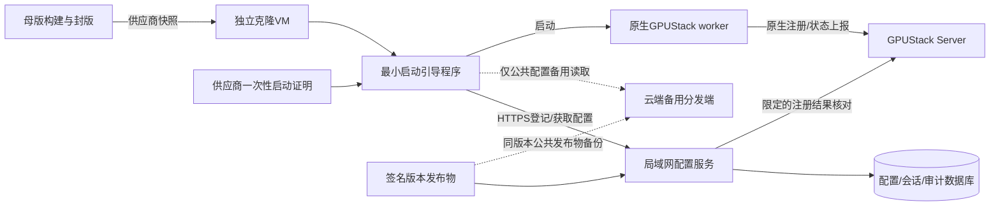

# E5：克隆节点启动配置与GPUStack自动注册

2026-10-23修订四，当前实施基线。最新实验拓扑与实施顺序见 [测试环境部署计划](E5-TEST-DEPLOYMENT.md)。**最高优先级；设计已收敛，环境取证部分完成，配置/登记服务及引导程序尚未实现、未部署、未完成克隆验收。** P4在既定两节点私有试点范围已通过。此文替代之前扩大到运行期动态管理的设想；历史调查保留在 [调研记录](E5-RESEARCH-20261023.md)。

## 目标与部署前提

目标只有一个：**克隆节点启动后，取得适用且可信的启动配置，顺利运行原生GPUStack worker并自动注册。** 配置服务不管理后续模型任务，也不自动升级正在运行的节点。

- tower-mNST8iPdv是镜像构建/交付母版，可以不参与生产运行。克隆不得依赖tower在线，tower到生产Server不通不作为生产接入阻塞项。
- 001/002来自上一版母版；新版tower增加580.95.05驱动、CUDA Toolkit13.0与NVIDIA Container Toolkit1.20.1。不能要求旧克隆包含新版依赖，也不能用母版通过检查替代新快照克隆验收。
- 新VM启动绑定GPU，关闭即消亡，同一GPU可能在另一个VM再次出现。稳定GPU资源关联与临时VM会话分开，不强求复用同一个原生worker记录。
- 001/002永久禁止VM重启及间接重启，现阶段仅只读参考。新镜像启动验证使用独立新克隆，不能在这两台做镜像还原或升级启动实验。用户已指定计划将001改为Server-only并部署LAN配置服务，移除worker仅涉及受控模型/容器角色切换，不改变永久禁止VM重启约束；该切换尚未执行。

## 职责与范围

| 组件 | 本期职责 | 明确不承担 |
|---|---|---|
| 母版/构建工具 | 固定版本驱动及容器依赖、worker镜像/离线包、最小引导程序、可信CA与配置服务地址、封版manifest | 生产节点、长期凭据仓库、运行时配置主源 |
| 克隆引导程序 | 启动条件检查、可信会话登记、配置验证、启动worker、一次注册核对、启动结果回报 | 持续设备Agent、模型调度、系统自动修复 |
| 配置服务 | 启动配置匹配、配置版本分发、登记授权、会话/原生worker关联与启动审计 | 节点健康仲裁、请求前预检、每次推理依赖 |
| PostgreSQL | 配置发布元数据、登记事务/幂等、会话互斥、审计；独立schema及最小权限 | GPUStack状态的另一个全量副本 |
| GPUStack v2.2.3 | 原生worker注册、资源上报、健康、模型部署、调度与推理路由 | 由E5替代其原生生命周期管理 |
| NFS/内网镜像源 | 可选只读模型与固定摘要发布物分发 | worker身份目录、设备私钥、整个Docker data-root |

不恢复collector、全池SSH轮询或逐请求版本证明；不接入参考项目整套Agent、部署器和隧道。第一版不做运行中自动拉取/热更新、不做Docker/驱动自动升级、不加消息队列、不承诺双活控制面。

## 组件图与控制流程

母版只负责把引导程序带到克隆；运行链路为克隆→局域网配置服务→GPUStack。云端不直接连接LAN worker；云端公共配置可达不意味着云端能签发有效本地登记凭据。

启动步骤：

1. 读取image_id、bootstrap协议版本及当前启动标识，检测快照中的实例状态污染。
2. 有界检查GPU可见性、完整UUID、驱动/用户态库、Docker及NVIDIA runtime、配置服务与原生Server网络；只检查，不安装、重启或重载。
3. 完成可信登记，原子预留本次VM会话；同GPU活动会话冲突时拒绝新会话覆盖。
4. 获取适用于site、镜像、架构及GPU条件的配置，校验TLS、发布签名、版本/摘要及本地允许的配置字段。
5. 准备固定摘要worker镜像及配置；禁止任意shell命令、在线执行“最新版”脚本和请求携带的自选Server/cluster覆盖受信策略。
6. 原子写本次会话配置至受限目录，启动原生worker；网络就绪排序之外，必须显式检查引导成功，不能仅靠Before就让登记失败的worker启动。
7. 有界核对原生注册结果及会话关联，回报启动成功/失败阶段、config_revision、image_id和worker_id；成功后引导退出，GPUStack继续管理运行。

注册成功不等于模型已部署或可推理，不把启动回报升级为第二套健康结论。启动回报失败不停止已成功运行的worker；保存脱敏结果供以后管理员检查/重报，不常驻高频重试。

## 两种触发方式与统一本机入口

2026-10-23用户明确：**克隆开机默认拉取并应用配置；管理员也可以SSH登录克隆，在本机运行脚本再次拉取并应用。** 两种方式调用同一引导实现、配置校验和应用流程，不维护两套逻辑。不是配置服务器远程SSH执行，也不增加后台定时更新。

拟定入口（**尚未实现，当前不可执行**）：`/opt/maas/bin/maas-worker-bootstrap.sh`。脚本为固定版本本地包装器，不在线下载并执行任意脚本。

| 调用方式 | 拟定命令/行为 |
|---|---|
| 开机默认 | systemd在网络和Docker可检查后调用 `maas-worker-bootstrap.sh apply --trigger boot`，成功才允许worker启动 |
| 管理员手动 | SSH登录后以root/sudo执行 `sudo /opt/maas/bin/maas-worker-bootstrap.sh apply --trigger manual`，拉取当前适用revision并应用 |
| 本地查看 | `sudo /opt/maas/bin/maas-worker-bootstrap.sh status`，仅输出脱敏应用版本、会话/worker关联与最后阶段；此结果不是GPUStack实时健康 |

`--trigger`只用于审计，不改变权限、签名或凭据要求；手动入口不允许绕过GPU身份、会话冲突、TLS和兼容检查。管理员SSH认证不自动等于配置服务的登记认证，脚本仍需合法本机会话或受支持的新登记证明；过期/缺失凭据明确报错，不使用母版共享秘密替代。

### 拉取与应用规则

- 每次开机执行均向服务端取得当前适用配置；新的VM启动创建新会话。同次启动内的手动执行及失败重试复用会话、请求记录，不因为重新拉取而新增worker或消耗第二次启动证明。
- boot与manual共用进程锁及持久操作记录；并发调用返回BOOTSTRAP_BUSY，不允许两个进程同时写配置/注册。中途退出后按操作记录与原生状态恢复，REGISTRATION_UNCERTAIN先对账。
- 同revision且本地内容摘要/实际worker关联一致时返回UNCHANGED；不能只看“已完成”marker跳过服务端拉取，也不能只看revision而忽略本地文件损坏。
- 配置文件先写受限临时文件，校验后原子替换；只有应用和原生核对完成后才提交applied_revision，启动结果回报失败单独记录，不把运行成功误报为尚未应用。
- 不影响运行进程的本地启动元数据可以直接落盘。修改Server/cluster、会话凭据、镜像、worker启动参数或挂载等生效需替换/重启worker的变更，必须识别为NEEDS_MAINTENANCE。
- worker尚未运行时，条件和授权满足即可启动并应用。已有worker运行且需重启时，脚本先返回待维护原因，**不直接停容器或重启Docker**；管理员按既有维护流程排空并停止相关模型执行，确认在途/UNKNOWN边界后，再执行相同apply命令。没有逐worker排空能力时不能以本脚本冒充E1，应沿用现有受控维护范围。
- 只看到worker进程停止不足以证明推理容器停止；须使用既有维护结果和原生实例核对。检查不通过时不应用破坏性变更；本脚本不新增自动排空/副本归零/强制抢占功能。
- 在准备阶段失败保留上次已应用配置；涉及原生注册或凭据变化后的失败进入明确待核对状态，不盲目切旧凭据、重复注册或重放任务。不自动重启VM、Docker引擎或解除UNKNOWN。

脚本退出码映射稳定错误分类，区分成功APPLIED/UNCHANGED与BOOTSTRAP_BUSY、DEPENDENCY_UNSATISFIED、AUTH_REQUIRED、CONFIG_INVALID、RESOURCE_CONFLICT、NEEDS_MAINTENANCE、REGISTRATION_UNCERTAIN；具体数值在实现时冻结。日志记录trigger、image_id、目标/applied revision、阶段/耗时与脱敏错误，禁止输出秘密。

新增验收：开机自动取得当前revision；手动取得新revision；相同revision幂等；boot/manual并发互斥；运行中有影响的变更被挡在维护前；完成维护后同一命令可应用；中途失败/注册响应丢失可恢复且不重复建worker。首版手动触发能力是当前范围，运行中周期自动更新仍不在范围内。

## 必需功能和启动配置契约

| 功能 | 本期行为与边界 |
|---|---|
| 启动配置下发 | Server URL、cluster标识、worker镜像摘要、worker启动参数、模型挂载定义；不同镜像版本选不同兼容配置 |
| 会话登记与凭据发放 | 新VM独立会话，秘密不从母版继承；不把GPU UUID作为认证；原生凭据作用域能力验证是生产门槛 |
| 条件检查 | 逐项输出稳定错误码，GPU或runtime缺失时停止引导；不自动切换MAC/machine-id资源身份 |
| 幂等与冲突 | 本次引导重试不重复创建worker；同request_id不同请求体冲突；同GPU活动会话不静默覆盖 |
| 配置兼容性 | image_id、架构、bootstrap协议、GPU条件及必要驱动/runtime最低要求匹配；不兼容则明确失败 |
| 启动结果 | 阶段、错误码、版本、worker映射及耗时；无明文token/批次码/供应商ACK内容，不另建资源指标平台 |
| 退避与错峰 | 启动随机延迟、有界指数退避+jitter；等待用单调时钟，最终超时后不启动新worker |
| 签名与受控回退 | 发布物签名/摘要校验；配置revision不可变；回退为管理员发布的新revision指向先前内容，避免自动接受旧版本 |

建议配置manifest包含：schema_version、config_revision、site_id、image_id及兼容范围、architecture、worker_image_digest、server_url、cluster_id、允许的worker参数、模型只读挂载、校验要求和签名key_id。manifest不含管理员密钥或可无限使用的cluster注册秘密。TLS CA与发布验证公钥来自母版可信根，密钥轮换需预置重叠信任或受控镜像更新，不能接受响应中的任意新信任根。

母版版本与配置revision分别追踪。第一版只支持明确允许的版本组合；未知image_id不自动套用最新配置。旧001/002和新母版属于不同版本，不作为必须同时迁移的对象。

## 登记、身份与GPUStack原生能力边界

以(site_id, 完整GPU UUID)关联资源，保存标识来源与可信资产映射；session_id/generation代表本次VM。boot_id、供应商swbootid、hostname/IP是关联线索，不是凭据；缺少UUID稳定性证明时不承诺跨VM稳定物理身份。

建议最小数据表：image_release、config_release、gpu_resource、vm_session、bootstrap_proof、bootstrap_operation与bootstrap_event。配置发布按站点/镜像明确指定，不提供任意URL下载执行。

登记事务锁资源、检查启动证明有效性/消费状态、预留会话及操作ID。批次ID只标识镜像/来源，非认证；可选批次限量属于登记准入，不是推理配额，不必引入完整配额产品。一次性证明优先由供应商启动时可信注入；不具备时保留人工批准受限试点，不能静默降级成母版共享长期密钥。

重复登记需同一可信实例重新认证并核对规范化请求体。HTTP token仅存hash；响应丢失时用短期加密封套或重新认证后轮换恢复，不承诺从hash恢复旧token。原生秘密如必须转发，使用独立受控秘密存储，不进公共配置、Git或日志。

原生注册与DB事务不是一个事务。原生请求超时进入REGISTRATION_UNCERTAIN，按会话唯一worker名核对后补偿，不盲目再次注册。worker_id由Server关联核对，不能只信客户端自报。注册超时后若原生worker已运行，不直接重建/杀掉它；进入可审计待处理状态。

同VM内进程恢复使用本次启动request_id和会话目录；新VM不能因旧marker/同GPU跳过登记或复用旧凭据。资源租约超时、HTTP token到期、DB会话撤销均不证明原生worker或GPU执行停止；没有原生清理证据时新冲突进入人工处置，第一版不自动抢占、不自动批量删除旧worker。人工关闭会话须保留旧任务和UNKNOWN证据。

复用223的Server URL+cluster注册机制；空Server必须预建cluster。worker启动重新注册并保存UUID/token；external_id不能任填GPU UUID首次创建。**尚未证明原生支持逐VM受限/短期注册凭据与即时撤销**，不能把共享cluster token称为单GPU凭据。优先验证原生能力；受控代理或管理端绑定只作候选，不预先承诺。未完成原生绑定/调度隔离验证时，仅使用无模型独立测试cluster，不能靠配置服务的“未批准”状态阻止原生调度。

## 最小内部接口（设计草案，尚未实现）

| 接口 | 语义 |
|---|---|
| POST /bootstrap/v1/sessions | 启动证明、request_id、image/site、GPU与当前地址；预留会话并返回适用配置引用及受控会话凭据 |
| GET /bootstrap/v1/configs/{revision} | 获取不可变签名公共配置；私有内容需授权，不在URL放秘密 |
| GET /bootstrap/v1/sessions/{id} | 本会话授权后恢复本次引导状态，禁止读取他人秘密 |
| POST /bootstrap/v1/sessions/{id}/result | 幂等提交启动阶段和原生worker关联，Server独立核对注册结果 |

正式管理端的批准、撤销、关闭和发布工具另行采用受限管理接口/CLI，不对普通worker开放。旧/enrollment接口只是早期草案，不提供兼容承诺。本期无配置长轮询、定期健康上报或运行中升级接口。

## 局域网主源、云端备用及断网策略

第一版局域网配置服务为唯一会话/凭据签发权威；本地公共配置可镜像到云端，正式自动切云备用列为后续能力。主备分发相同不可变签名revision；备用端不得自行发布不同配置或回退旧版本。云端仅公共发布物，无母版/管理员/注册秘密。

- 全新克隆：登记权威不可达，即使能从云端读取公共manifest也不能启动新worker；有限重试后报告失败。
- 同次引导中断：有可校验缓存且会话仍被权威确认有效时恢复；不能把快照遗留缓存当本次有效会话。
- 已成功注册节点：配置服务宕机不停止原生worker，不影响已有推理；原生worker本身恢复仍服从GPUStack机制，不承诺永远不需要原生凭据。
- 第一版不自动更新运行中节点。管理员SSH运行本机apply脚本触发重新拉取/应用；同次会话复用，涉及worker重启的变更先返回NEEDS_MAINTENANCE，按既有维护条件处理后再apply，不借此更新系统依赖。
- 若以后要求LAN全损仍允许新克隆注册，必须增加唯一签发权威切换、证明重放防护与一致性方案，单纯备份文件不算注册容灾。

## 系统更新边界

配置服务只选择和交付适用启动配置/固定worker镜像；不负责自动安装或升级NVIDIA驱动、内核、Docker及Container Toolkit。条件不符时报告DEPENDENCY_UNSATISFIED，修复走母版构建或独立维护。

可随时发布新配置，但第一版只影响后续启动/明确批准的重新引导，已运行节点保持原配置。worker镜像升级也不在处理任务时自动切换。不得因失败回退触发VM重启；001/002的永久禁重启约束高于所有恢复机制。

## 当前证据、风险与预案

| 已知事实/不确定性 | 对设计的影响 |
|---|---|
| tower宿主580/CUDA13探针成功、Docker识别NVIDIA runtime；GPU容器未验收 | 新版母版基础部分通过，仍需新快照的独立GPU容器/worker测试 |
| 001/002旧母版与tower新母版存在相同machine-id/SSH公钥 | 构建及首启须明确身份初始化责任，不现在删除管理员管理密钥 |
| tower已有CyberCafe provision/Agent并开机执行 | 封版清点启动所有者，避免两套程序同时改Docker；不在本轮停旧服务 |
| 供应商swbootid/ACK通道可见，cloud-init禁用 | 可研究启动注入适配器，不能把字段存在当作签名/认证成立 |
| GPU虚拟化报告None，日志gpu指纹变化 | 不等于已证PCI直通或同卡UUID不稳定；独立克隆用外部资产锚点验证，重复UUID拒绝覆盖 |
| tower到001:18080不通 | tower不是生产worker，此项仅观察；接入门槛应从实际新克隆测试双向Server/worker路径 |
| Docker Hub443探测失败 | 构建优先准备内网固定摘要镜像/离线包，不把外网拉取作为启动唯一条件 |
| 启动墙钟与日志/uptime不一致 | 用户确认昨晚重启单独记录；服务端验证凭据时间，本地有界等待用单调时钟；TLS错误不跳校验 |

完整证据见 [重启后报告](../../results/tower-post-reboot/REPORT.md)。实际快照源、字段语义、可信注入、GPU重绑定/独占和原生撤销仍需自己用独立环境验证，不只依赖供应商口头说明。

## 实施路线与验收

| 阶段 | 交付 | 验收门槛与当前状态 |
|---|---|---|
| E5.0 | 本设计、范围及参考项目取舍 | 设计完成；不代表实现 |
| E5.1 | 独立实验环境盘点、223原生注册/凭据门槛、镜像版本清单及启动注入验证方案 | 环境取证部分完成；以001控制端+真实独立新克隆为目标，Mac本地模拟为可选补充，原生/供应商能力待验证 |
| E5.2 | 配置发布/签名验证、PostgreSQL登记事务、最小HTTP接口、注册结果核对及脱敏结果 | 待实现；并发同GPU/证明重放/响应丢失/错版本/篡改/注册不确定均有明确结果 |
| E5.3 | image-prep、固定依赖/镜像清单、boot/manual统一本机脚本、systemd成功依赖及封版检查 | 待实现；临时root构建可验证，无GPU不降级身份，登记失败不启动worker |
| E5.4 | 本地同一干净镜像双VM接入独立无模型cluster | 待做；独立会话/凭据/worker；同次重试幂等，旧marker拒绝继承；CPU模拟不证明GPU |
| E5.5 | 独立获准新版快照真实GPU克隆 | 待做；新依赖继承、容器GPU、注册及Server/worker双向可达；tower离线仍能接入；外部资产锚定同卡验证 |
| E5.6 | 镜像交付、启动排障、批准/撤销、发布/回退和管理入口保留手册 | 待做；供应商与运维可复现；001按部署计划去除worker但不重启VM，002不迁移 |

首版必要失败矩阵：配置主源不可达、未知/旧image_id不兼容、无GPU/UUID、driver/runtime不匹配、签名/摘要错误、同证明多请求/同请求不同body、同GPU并发、新VM携带旧marker、原生注册成功但响应丢失、结果回报丢失、boot/manual并发、手动相同/新revision与维护门槛，以及配置服务在worker成功后离线。不得因任何失败自动重启机器、跳TLS或解除UNKNOWN。

云端备用、运行期配置更新、远程系统依赖维护、自动旧worker清理及大规模容量测试均后续单列，不作为首版启动闭环的扩张范围。E5仍优先于E1–E4/E7新增实施。

## 参考与历史入口

旧链接所指“修订二”已被当前范围替代，原文见 [历史调研](E5-RESEARCH-20261023.md)。参考项目image-prep、systemd启动和GPU UUID采集思路保留；同指纹复用旧密钥、marker跳过新VM登记、文件KV、完整Agent和动态脚本自更新不沿用。
