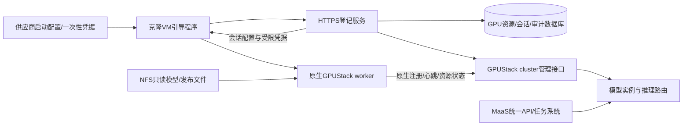

# E5 首轮调研：云网吧镜像与临时 worker 接入

2026-10-23。状态：首轮源码分析与最小验证设计已交付，未实现登记服务、未制作可交付母版、未完成克隆实测。P4限定两节点私有试点验收通过后启动；没有修改任何服务器身份、地址、凭据或部署。

## 目标与已知环境

供应商提供Ubuntu母版，tower-mNST8iPdv上的改动由快照复制到新VM；VM启动绑定一张GPU，关闭即消亡，同一GPU可能在另一VM出现。因此稳定对象是站点内GPU资源，本次VM是独立会话，不强求复活同一个GPUStack worker记录。

001/002与母版machine-id及SSH主机公钥指纹相同，不能用来唯一识别克隆。现有网络启动/写回模块只提供镜像启动线索，不能证明跨启动持久性；GPU UUID跨VM重绑定稳定性及独占性仍须供应商确认。原始证据见 [环境检查](../../results/maas-e5-environment/REPORT.md)及 [母版检查](../../results/tower-master-inspection/REPORT.md)。001/002永久禁止重启，不能用它们做启动实验。

母版已安装580.95.05、CUDA Toolkit 13.0及NVIDIA Container Toolkit。重启前快照仍加载535且NVML不匹配；2026-10-23恢复访问后确认580.95.05已加载，NVML及现有CUDA13微型内核成功，Docker已识别NVIDIA runtime。容器内GPU/模型验收尚未执行，不能把宿主CUDA成功当作整套镜像交付通过。

## GPUStack v2.2.3能力与缺口

依据本地仓库 `/Users/4paradigm/dev/gpustack` 的 `git show v2.2.3:<路径>`，只读核对，未使用main功能替代223承诺。

| 项目 | 原生行为/源码依据 | 本系统取舍 |
|---|---|---|
| 自动加入 | docs/user-guide/cluster-management.md：先创建Docker cluster，获得加入命令；worker配置Server URL和注册凭据，启动后主动注册 | 不逐台预登记worker；空Server仍需初始化cluster，不能零配置匿名发现 |
| 注册与持久状态 | gpustack/worker/worker_manager.py：读取name、external_id、本地UUID，注册后保存worker UUID/token；启动会重新注册 | 公共镜像不含已注册数据，VM使用独立会话目录 |
| 现有身份匹配 | gpustack/routes/workers.py get_existing_worker：按cluster+external_id/worker_uuid匹配，特定兼容label才按name查找；新建UUID由Server生成 | 不能只改hostname便保证隔离或身份恢复 |
| external_id | create_worker拒绝不存在的external_id | 不把任意GPU UUID写external_id就宣称能首次自动注册；需正式管理流程或不用此机制 |
| 凭据 | create_worker仅admin或SYSTEM可注册，创建/更新worker凭据和系统principal | HTTP会话token与GPUStack token分开；逐VM发放/撤销能力及最小权限待专项验证 |
| GPU、状态、调度、路由 | 原生worker上报、Server管理实例与路由 | 完全复用，不恢复自建collector，不做周期SSH全节点清单 |
| 临时生命周期 | 本轮未确认原生自动到期删除worker的完整机制 | 明确旧worker清理策略，不能把offline当删除、把停止worker当GPU空闲 |
| 旧会话隔离 | 外部数据库更新不等于撤销GPUStack凭据或停止旧推理 | 必须验证原生撤销、旧实例路由与执行终止；未证实时禁止抢占式重绑定 |

## 建议组件架构

登记服务只处理可信引导、资源与会话映射、凭据生命周期；不重复GPUStack健康、调度或请求前全池预检。数据库可复用现有PostgreSQL部署，但独立schema/权限及迁移。第一版无需增加独立数据库产品或消息队列。

## 数据与状态约束

- `gpu_resource`：resource_id、site_id、GPU UUID、供应商资产映射与审核状态；唯一键(site_id, gpu_uuid)。GPU UUID是关联线索，不是密码或认证证明。多卡/虚拟GPU后续扩展，不能假定UUID永远全球唯一。
- `vm_session`：随机session_id、resource_id、代次generation、状态、认证来源、地址、有效期、镜像版本、原生worker_id与凭据引用。地址不作主键，不复制machine-id作为身份。
- `enrollment_event`：一次性引导凭据消费、重绑定、冲突、撤销、清理审计；不记录明文token。
- 在事务内锁定资源、消费一次性引导凭据并预留会话；重复请求以引导请求ID返回同一结果，不创建多个原生worker。跨HTTP/原生API失败使用持久中间状态与对账，不能假装分布式事务。
- 同一资源已有活动会话：拒绝自动覆盖，进入冲突审核/隔离。只有可信供应商终止证明或已验证旧worker撤销、路由移除和执行停止后，才推进新代次。单纯租约超时不能证明旧VM/GPU工作已停止。
- 不为身份登记另建全节点5秒心跳。业务租约仅界定凭据有效期，资源可用状态以GPUStack为准；过期与回收采用有界低频后台处理，不自动重放UNKNOWN任务。

## 凭据与镜像交付

优先由供应商在每次启动注入短期一次性登记凭据，绑定站点及本次实例；登记后发放独立短期HTTP会话凭据。GPUStack加入凭据和worker token按原生机制使用，先验证能否按会话最小授权及撤销；不要把集群加入凭据能注册的权限误写成单GPU权限。

公共母版仅有固定版本软件、引导程序、服务端地址及可信CA，不含管理员密钥、已注册worker数据或所有克隆共享的设备私钥。引导配置/凭据写受限临时目录；token只在服务端存hash，需转发的原生秘密保存到受控秘密存储且不入Git/日志。没有可信启动注入时只能讨论受限试点站点共享凭据，必须明确其可冒充范围，不能称为可靠设备认证。

NFS v4.1/4.2用于模型和发布文件只读共享，VM本地缓存；不共享worker身份目录、Docker整个data-root或明文设备凭据。sec=sys及root_squash不能对拥有root的克隆提供强设备隔离。SSH host key、machine-id等首次启动初始化须与供应商镜像启动流程协同，不能直接删除正在使用的三台服务器密钥。

## 最小验证计划与验收

| 顺序 | 环境/任务 | 通过条件 |
|---|---|---|
| A | 供应商书面确认GPU透传/UUID稳定性、单卡独占、一次性配置注入、快照启动钩子、地址可达性 | 能确定可信身份来源；未知项保留阻塞，不能以UUID自报替代 |
| B | Mac只读确认CPU架构、虚拟化工具、磁盘空间；选择Ubuntu架构匹配base image及独立本地Server | 不触碰生产cluster；ARM VM只能验证控制面注册流程，不能证明x86/NVIDIA GPU运行 |
| C | 一份干净镜像启动两个独立本地VM，配置同一测试cluster，原生自动加入 | 两个不同worker身份/凭据，无已注册状态克隆；采集注册与就绪耗时 |
| D | 独立可销毁环境验证同一模拟GPU资源新旧会话重叠、凭据过期/重放、注册中断/重试、IP复用 | 不覆盖活动会话；无未授权注册，无重复记录；撤销在原生路由生效的边界明确 |
| E | 获准独立真实GPU克隆验证、驱动激活及CUDA容器/模型探针 | GPU UUID重新关联、旧worker收敛、真实推理可用；记录原生恢复时延及中断 |
| F | 封版检查与供应商交付 | 清除实例特有身份/秘密，校验manifest与镜像hash，克隆验收和运维回退说明齐全 |

当前只完成A前的环境证据与v2.2.3源码分析，B–F均未执行。未实现HTTP/DB登记服务、未修改worker配置、未构建镜像、未验证凭据即时撤销或会话fencing。001/002不得用于D/E重启或还原实验。母版驱动激活由管理员安排，当前不执行。

## 需供应商回答

1. GPU是PCI直通还是vGPU，UUID跨VM重绑定是否稳定，同一UUID是否可能并行呈现？
2. 每次克隆启动能否注入可信实例ID与一次性凭据/配置？支持什么启动钩子及网络可达方式？
3. 快照的首次启动身份初始化由谁负责？管理员何时可在独立环境验证新驱动和容器GPU？

下一步先确认上述信息并进行Mac只读环境盘点，再估算和实现最小登记闭环；不以本设计文档替代真实克隆验收。

## 修订二：借鉴cybercafe的启动交付机制（2026-10-23）

本节为用户接受源码评审后的实施基线；涉及旧章节的模糊表述时，以本节及下列功能契约为准。只复用启动交付机制，不接入cybercafe云管理端、Agent心跳、远程任意命令、模型部署或隧道。GPUStack仍管理worker及模型，登记服务不成为每次推理的新前置依赖。

### 参考实现与改造决定

参考仓库 `/Users/4paradigm/dev/cybercafe`，评审时提交 `f0424a6`。以下为源码分析，未运行其安装器或验证其生产安全性。

| 参考路径 | 可复用经验 | E5改造 |
|---|---|---|
| agent/install.sh --image-prep / --root | 镜像构建与实例初始化分离，可对临时根目录准备文件 | 新建独立E5镜像构建入口；固定软件版本，不复制原完整安装器 |
| agent/cybercafe-provision.service | network-online后、业务服务前执行引导 | worker须显式依赖成功引导；仅Before顺序不等于失败阻止worker，不能沿用“失败不阻塞agent”语义 |
| agent/provision.sh hw_fingerprint | /proc优先读取GPU UUID，nvidia-smi兜底 | 保存完整规范化UUID与来源；检测唯一GPU，超时停止登记，不静默用MAC/machine-id代替 |
| agent/provision.sh marker逻辑 | 识别镜像遗留实例状态 | marker只供本次会话断点恢复；同GPU的新VM仍建立新会话，不继承旧token |
| cloud/src/index.js handleDeviceProvision | HTTP领配置、批次管理、重复请求处理思路 | PostgreSQL事务登记；按VM会话发新凭据，不按GPU指纹返回旧设备密钥 |
| cloud/server.js文件KV | 原型管理端便于运行 | 不复制文件KV；串行落盘不是多步骤登记事务，也不能提供跨进程会话互斥 |

原实现中的短指纹、无硬件标识退回machine-id、批次码自报GPU、同指纹复用密钥、明文秘密日志及启动在线下载脚本执行均不沿用。批次有效期检查在原服务的旧映射复用分支之外，E5必须对所有路径重新校验授权有效性，不让幂等恢复绕过撤销或过期。

### 功能边界与组件

| 功能 | 责任组件 | 本期要求 |
|---|---|---|
| 构建/封版 | 镜像构建工具 | 安装固定版本依赖、引导与systemd单元；输出manifest/hash；检查实例秘密污染 |
| 本次启动标识 | 轻量引导程序 | 优先供应商可信实例标识；本地随机session请求标识仅用于幂等，boot_id是诊断字段而非认证 |
| GPU发现 | 引导程序 | 有界等待驱动、UUID与容器runtime就绪；单卡基线；多卡/虚拟GPU/缺失进入明确异常 |
| 批次与授权 | 登记服务 | site/image/batch关联、到期/撤销/配额；批次ID仅分类，登记证明单独传递 |
| 资源与会话 | 登记服务+PostgreSQL | GPU资源稳定，VM会话临时，generation单调；同资源活动会话不得静默覆盖 |
| worker启动 | 引导程序+原生GPUStack | 获得批准配置后才启动原生worker，独立本次会话数据目录与名称 |
| 状态与推理 | 原生GPUStack | 继续原生资源上报/实例就绪/路由，不增加SSH轮询或请求前全池证明 |
| 撤销/回收 | 登记服务原生适配器 | 有界低频处理身份生命周期；不实现另一套节点可用性监控，不提前宣称原生fencing成立 |

引导服务与worker采用成功依赖和显式就绪检查；登记失败时不启动新worker、不使用镜像残留凭据。有限次数重试采用指数退避+jitter，避免批量开机同时注册。引导进程重启只恢复本次启动的请求ID，重新授权检查；新的VM启动代次不能因marker或相同GPU跳过登记。

本期GPU关联键为(site_id, 完整GPU UUID)，并记录UUID来源和供应商确认状态；不使用SHA256前12位作为唯一权威键。读取/proc成功不代表NVML、CUDA或容器GPU可用，必须分别检查，驱动/用户态库不一致时不得宣称就绪。

### 登记与原生注册闭环

建议内部控制面API（尚未实现，**不是当前已对外提供API**）：

| 接口 | 作用及约束 |
|---|---|
| POST /enrollment/v1/sessions | 一次性启动证明+幂等请求ID+site/image/batch+GPU及地址；成功只表示会话预留，不代表模型就绪 |
| GET /enrollment/v1/sessions/{id} | 本会话认证后查看登记/原生关联进度；不返回其他会话秘密 |
| POST /enrollment/v1/sessions/{id}/revoke | 管理端撤销申请，进入REVOKING；原生撤销完成前不报告隔离成功 |

第一次创建会话在DB事务内完成：校验并消费启动证明、锁GPU资源、检查活动会话/批次配额、预留generation与会话。`bootstrap_proof`只存hash/可信引用；唯一约束覆盖(site_id, proof_id)、(site_id, request_id)和资源的活动会话。相同请求ID+相同规范化请求体允许恢复，相同ID不同请求体返回冲突；换请求ID不能重复消费同一启动证明。

一次性证明的重复请求只允许同一可信实例恢复同一会话，不能向仅知道GPU UUID或request_id的调用者重发秘密。凭据响应丢失可通过短期受保护响应封套或重新认证后轮换恢复；该策略实施前冻结，不能一方面仅存hash，另一方面承诺随时返回旧明文token。HTTP会话token仅存hash；必须转发的原生秘密用受控存储/加密封套，并限制生命周期。

原生API调用放在事务外，使用持久状态和操作ID记录进度。请求超时进入REGISTRATION_UNCERTAIN，先按本次会话唯一worker名核对Server再决定补偿；不盲目再次创建。客户端上报worker_id只是线索，服务端经原生API核对cluster、会话名称、身份关联，不能据此认领其他worker。未经可信绑定前不允许模型自动调度到新worker；第一阶段使用无模型独立测试cluster，正式方案须验证原生可用的调度隔离方式，不能假定外部DB状态会阻止GPUStack派发。

GPUStack加入凭据的逐会话作用域/短期化仍是能力缺口，不能把共享cluster注册token包装成“受限单GPU token”。优先核对原生能力；若不满足，评估受控注册代理或管理端预创建/绑定的兼容路径。未经实测不选择透明代理方案、不修改GPUStack源码、不把管理员凭据写入VM。此项是生产自动接入的前置门槛。

状态序列：REQUESTED → RESERVED → REGISTERING → REGISTERED；GPUStack就绪由原生状态展示，业务侧不重复维护健康结论。异常分别为CONFLICT、REGISTRATION_UNCERTAIN、REJECTED；撤销为REVOKING → REVOKED → CLOSED。身份凭据有效期与worker健康分离：HTTP token到期不等于worker下线，UNKNOWN任务保持原语义。

### 镜像和凭据交付契约

构建时只预置Server/enrollment URL、可信CA、site及image/batch公共标识、固定版本软件、引导程序和启动单元；**不预置可无限注册的长期批次秘密**。推荐供应商每次启动注入一次性凭据。若供应商不支持，允许继续本地模拟与设计，但生产自动纳管保持未通过；受限站点共享凭据只能作为单独明确的试点方案，不自动降级采用。

worker名采用含会话随机标识的短名称，原生worker ID映射回GPU资源；不要求不同VM沿用同一worker记录。会话目录不共享、不写NFS；同一VM内进程恢复可使用当前会话目录，新的VM不得使用镜像残留数据。NFS仅分发只读模型/发布包，固定版本并校验manifest，默认不在启动时执行下载的最新版脚本。更新采用版本化交付与受控回退。

封版扫描包括：worker UUID/token/已注册目录、session marker、bootstrap秘密、管理员和设备私钥、日志中的凭据、共享SSH host key及machine-id初始化策略。扫描不等于擅自清理当前母版；所有密钥/访问改动须单独实施计划，不能破坏管理员入口。

### 分阶段任务与验收矩阵

| 阶段 | 工作与交付 | 通过条件/依赖 |
|---|---|---|
| E5.0 设计收敛 | 本文、参考实现差距、功能/API/信任契约 | 本次完成设计；不计实现或实测通过 |
| E5.1 原生能力与环境盘点 | Mac只读盘点、223凭据/注册/撤销适配实验计划、供应商问题清单 | 独立环境与架构可行；生产凭据方案未确认时不得进入正式发布 |
| E5.2 最小登记服务 | PostgreSQL迁移、HTTP鉴权/幂等/资源互斥、原生适配器、审计 | 事务并发、配额、过期/撤销、请求体冲突、响应丢失均可验证；故障不重复建worker |
| E5.3 引导与镜像构建 | 干净image-prep、GPU探测、受限目录、systemd依赖、manifest封版 | 临时根构建验证；登记失败不启动worker；GPU未就绪不降级身份；秘密不入日志 |
| E5.4 本地双VM | 同镜像两个VM自动加入独立测试cluster，进程恢复和克隆污染验证 | 两个独立会话/凭据/worker；同GPU模拟冲突拒绝；CPU模拟不代表真实GPU能力 |
| E5.5 供应商真实GPU克隆 | 独立获准环境验证UUID重新绑定、driver/container、网络边界、撤销与旧worker收敛 | 旧会话停止证据及原生路由移除有效，真模型可用；管理员确认母版驱动激活 |
| E5.6 交付与运维 | 镜像校验、部署/升级/回退/旧记录回收及凭据轮换手册 | 供应商和运维可复现启动接入；旧worker回收有审计，不影响未完成任务证据 |

重点失败用例：同GPU两个VM并发登记、同batch不同site、已撤销/到期proof重复提交、网络响应丢失、DB提交成功而原生注册超时、进程恢复、克隆携带旧marker、GPU UUID缺失、驱动不匹配、原生token仍可用而HTTP会话已到期、原生撤销失败以及旧IP被新VM复用。所有用例在独立环境完成；001/002永久不做重启/还原实验。

E5.0已完成；E5.1在后续恢复访问后取得部分实证，最新状态见修订三；E5.2–E5.6待实施。管理员重启消息本身不作为升级成功证据，以实际探针与记录为准。

## 修订三：重启后实证与异常预案（2026-10-23）

详见 [tower重启后报告](../../results/tower-post-reboot/REPORT.md)。用户确认母版昨晚由管理员重启；机器日志/uptime时刻不一致，不能推断实际重启时间。当前580.95.05驱动、CUDA13微型内核与NVIDIA runtime识别均通过，GPU容器仍待验证。

新增实证：Virtualization Mode=None及PCI实际型号不能证明PCI直通或跨实例独占；两个boot日志GPU来源指纹不同，不足以证明同一物理GPU的UUID不稳定，需外部资产锚点。供应商cmdline的swbootid发生变化而snapshot/disk/image字段摘要一致，/run/swboot存在配置ACK，说明有启动数据通道但未证明可信注入或字段语义。cloud-init仍禁用，本地cybercafe-provision/Agent已实际开机执行；现有machine-id/SSH公钥未变化，封版须明确两套引导的所有权及身份清理责任。

E5.1新增工作：①采集供应商启动字段hash并在独立克隆验证含义，不把它当认证；②核对新worker与Server双向允许路径（当前tower到001:18080超时）；③单独验证容器GPU与受控镜像源（当前无镜像、Docker Hub443未通）；④校时前的服务端凭据有效期与本地单调时钟等待；⑤独立实验确认UUID重绑定/重复及旧会话撤销。字段不可信、资源冲突、网络失败或校时异常均拒绝新接入并可审计，不自动继承秘密或放宽TLS/网段。swappdev.service失败待管理员解释，未由本轮修复。

E5.5必须用外部可信资产记录锚定真实同卡重绑定；没有该记录时仅可证明多次观察，不能宣称UUID稳定或独占。供应商无法注入可信证明时保留人工批准受限试点方案，生产自动接入不验收。既有001/002永久不重启，本轮没有修改母版或现有服务配置。
