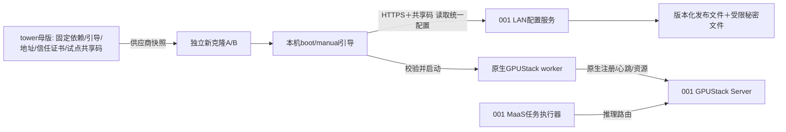

# E5：统一启动配置分发与GPUStack原生注册

2026-10-23修订六，当前实施基线。实际前置进展见 [准备记录](../../results/maas-e5-preparation/REPORT.md)：test1(ID3)已建，001原worker/本机旧OCR已停止，配置服务未部署。最高优先级；**配置读取服务已部分实现并部署001的18840；引导程序尚未实现，E5未整体验收。最新证据见 [实施报告](../../results/maas-e5-preparation/BOOTSTRAP-HTTPS.md)。** P4既定两节点私有试点验收通过不代表E5已验收。

核心决策：**同站点/批次克隆使用相同启动配置，共享码直接授权读取；不先向配置服务登记VM，不发独立会话凭据。worker身份和注册由GPUStack v2.2.3原生管理。** 此版本取代此前“登记→会话凭据→取配置”的链路。

## 范围与环境

- tower只制作新版母版快照，可以不在线，不作为配置源或生产worker。新版含580.95.05驱动、CUDA13、NVIDIA Container Toolkit；母版宿主CUDA探针通过，真实克隆容器GPU尚未验收。
- 001是临时测试控制机：保留GPUStack Server、MaaS API/网关、任务管理/执行器、数据库、结果、计量和监控，按部署计划移除GPUStack worker，新增配置服务。MaaS任务执行器不等于GPUStack worker，前者保留。
- 002为上一版镜像worker基线；旧克隆不要求拥有新镜像的依赖。001/002永久禁止VM重启及关机再启动、平台重置/重建、还原、双系统切换等间接重启。
- 正式控制面将部署到另一台稳定独立LAN机器。正式交付镜像更新地址、证书、共享码及原生cluster配置，不自动把测试克隆迁入正式环境。

首版只做启动配置读取、验证、本机应用和worker原生启动；无常驻Agent/后台自动更新/系统依赖自动修复，无自建collector、模型调度或逐请求证明。

## 组件与职责



| 组件 | 责任 |
|---|---|
| 配置服务 | 验证共享码scope/状态，按站点/批次和兼容条件返回统一版本配置；受限管理发布、基本限速与脱敏访问日志 |
| 本机引导程序 | 环境检查、固定地址读取、配置验证、幂等/互斥应用、原生worker启动和一次启动核对；结果保存在本机 |
| GPUStack | 独立worker身份、原生注册、资源/健康上报、实例调度和推理路由 |
| 母版构建工具 | 固定版本依赖/worker镜像、本机引导及systemd、信任文件和快照封版清单 |

**首版无E5独立数据库、VM登记表、GPU资源映射表、会话管理或每VM结果回报API。** 现有MaaS/GPUStack数据库不受删除或迁移。配置及授权状态可由root-only版本文件与原子发布指针实现，单实例服务；管理修改原子替换，失败保留上一版。访问日志只辅助排障，不作为可靠设备身份/登记清单。

## 配置和凭证

同一站点/批次所有克隆读取相同生效revision；若以后存在不同image版本，只做兼容校验或显式分批，不隐式下发不同机器的专属秘密。

统一配置包含：schema/config revision、允许site/batch/image与架构、GPU/driver/runtime最低条件、Server URL、固定目标cluster、worker镜像摘要、允许的启动参数和只读模型挂载。克隆不能通过请求自选其他cluster或扩大授权。

| 凭证 | 当前用途/保存 |
|---|---|
| 共享配置访问码（沿用“共享注册码”名称） | 克隆直接读取配置；不注册VM、不签发会话。root-only文件可预置母版，服务端存不可逆校验值及scope/启停/可选到期字段 |
| GPUStack注册凭据 | 由原生机制让worker加入指定测试cluster；需要时经授权HTTPS响应提供统一凭据，服务端明文仅在私有受控文件/秘密存储，不入公共manifest、Git或日志 |
| 原生worker凭据/UUID | 原生worker注册后在本克隆独立目录保存，不写母版、不共享NFS |
| TLS服务端私钥 | 只在配置服务器；母版只带公开信任证书 |

共享码和GPUStack注册凭据分别配置、分别轮换。所有持码者能读到同批配置；如果配置含原生cluster token，持码者也可取得其实际注册权限。E5的scope不能缩小原生token权限，停共享码不撤销已拿到的原生凭据。只在无业务模型独立测试cluster验证，之后是否进入业务池按原生可用能力及另行验收决定。

不把GPU UUID、IP、hostname、machine-id或随机request_id当认证，也不建立同GPU活动会话唯一约束。GPU UUID可作为本机诊断信息，但首版不上传/关联它，不能承诺防GPU冒用或跨VM资源历史。原生重复记录、重连及名称冲突行为用真实223实验说明，不靠已删除的SessionService保证。

首版仍需共享码scope、停用、脱敏和请求限速；共享码/原生token的有效期按独立策略配置，尚无用户指定默认时长。**不能再声称“最多登记N台”**：GET次数不等于VM数量，同一码无法可靠区分设备；设备数量配额/独立撤销留后续。

## 读取接口与文件发布（草案，尚未实现）

| 接口 | 行为 |
|---|---|
| GET /bootstrap/v1/config | Authorization header携带共享码；验证站点/批次授权后读取当前统一revision，返回签名配置和必要的受保护原生注册材料 |
| GET /bootstrap/v1/configs/{revision} | 可选受权历史版本读取，仅允许发布/回退策略批准的revision；不允许越scope读取任意文件 |
| GET /healthz | 最小存活检查，不暴露秘密、注册信息或完整配置 |

无POST sessions/result/revoke，旧草案不提供兼容承诺。管理端仅CLI/本地私有操作发布、停码或回退，不对普通克隆开放写接口。

可公开的manifest可签名并校验固定镜像摘要，受保护原生秘密放在单独响应字段，Cache-Control:no-store，不写共享代理缓存；实际服务不因manifest无秘密就默认匿名下发整份响应。客户端配置目录受限，秘密不得拼接进启动shell字符串/日志。TLS和发布物验证是两个独立模块，后者不提供VM身份认证。

revision不可变，切换active revision原子完成；管理员回退发布新revision指向已审核旧内容，避免被动接受任意旧文件。配置服务不下载执行外部脚本、不接受远程注入的任意命令。基本访问日志仅记录时间、scope、revision、HTTP状态/错误码及必要源地址，保留有界，不记录header/body中的秘密；不新增中央worker遥测。

## 本机启动与手动应用

拟定本地脚本 `/opt/maas/bin/maas-worker-bootstrap.sh`（尚不存在）：

- systemd默认调用 `apply --trigger boot`；网络和Docker条件可检查后拉取配置，成功应用后启动原生worker。
- 管理员SSH到克隆执行 `sudo /opt/maas/bin/maas-worker-bootstrap.sh apply --trigger manual`，每次使用共享码取当前配置，不领取会话凭据。
- `status`仅显示本机applied revision、worker启动核对状态和最近错误，不提供配置服务持有的“会话状态”。

流程：

1. 读取独立本地endpoint/信任文件与共享码文件；有界环境检查GPU/driver/NVML、Docker/NVIDIA runtime、image版本及必要网络。
2. HTTPS取同批配置，验证TLS、scope、签名/摘要和兼容性；不匹配时失败，不在线升级驱动/Docker，不退回HTTP或跳过校验。
3. 本机锁防止boot/manual并发；准备镜像与受限临时配置，校验后原子落盘。记录目标/applied revision、非秘密参数摘要与credential_version，日志不包含token。
4. 无worker时启动原生worker，由其完成注册并写入自己的状态；一次有界核对采用已验证的原生/本机证据，不给克隆GPUStack管理员权限。仅文件存在/容器running不冒充注册成功；无法确认时为REGISTRATION_UNCONFIRMED，保留进程并人工核查，不盲目重复启动。
5. 相同revision且本地配置/镜像及现有worker关联一致时UNCHANGED；同VM进程恢复保留原生数据。新克隆必须没有镜像携带的旧原生UUID/token/worker名，名称采用原生生成或含本次随机标识，不以相同批次写死同一名字。
6. 修改Server/cluster/token/镜像/参数/挂载等需重启已有worker时返回NEEDS_MAINTENANCE，管理员按现有维护流程排空、确认模型容器和UNKNOWN后再运行同一脚本；脚本不实现E1、不直接停模型/重启Docker或VM。

有限退避+jitter，等待用单调时钟。准备失败保留上次已应用配置；注册是否成功不确定时原生状态核对优先，不以删除目录/反复换worker名“修复”。启动结果/错误保存在本地，可SSH查看，不上传每VM身份资料。成功后引导退出，无自动运行期配置轮询。

新VM配置服务不可达时不启动新worker；同VM已运行worker不因取配置失败停止，原生进程恢复使用自身机制。共享码停用只阻止未来读取，不能把配置服务停用写成原生worker隔离。

## 模块化边界

普通接口/静态实现，不引入可下载插件平台：

| 模块 | 首版实现 | 后续替换点 |
|---|---|---|
| EndpointResolver | 本地文件固定001 IP | E5.F1域名/DNS或地址注入 |
| ClientCredentialProvider | root-only共享码文件 | E5.F2一次性证明/独立授权 |
| ConfigAccessAuthenticator | 校验共享码→site/batch允许范围 | 认证替换只影响访问授权，不改Launcher |
| ReleaseStore/ConfigResolver | 私有版本文件+原子active指针 | 多站点/远端备份或确有需要时数据库 |
| ReleaseVerifier | TLS信任、manifest签名/摘要、兼容检查 | 信任轮换/版本协议 |
| NativeWorkerLauncher/Probe | 固定223启动与原生注册核对、本机状态 | 原生版本适配；不管理中央会话 |

没有SessionService、资源登记/数据库或控制端注册代理依赖。未来如需每VM秘密/写状态，必须显式增加独立身份和授权，不能仅靠UUID/request_id复活旧API。

## 首版寻址与HTTPS

母版拟定 `/etc/maas/bootstrap.json` 保存 `config_service_url=https://10.11.31.1:<专用端口>`、信任证书及共享码文件引用；端口部署时核对占用后冻结，非现有18080/18832默认替代。管理员可SSH改本地地址再apply，不扫描网段、不自动向未知候选发码。配置服务地址与原生GPUStack Server URL独立。

用户选择自签名服务端证书，001保管私钥，母版预置完整公开信任证书，SAN包含10.11.31.1；校验证书、地址、notBefore/notAfter，不跳TLS。默认无限期，按 [RFC5280 §4.1.2.5](https://www.rfc-editor.org/rfc/rfc5280.html#section-4.1.2.5) 使用notAfter=9999-12-31T23:59:59Z，实施时验证库/客户端兼容，不安排周期续期。此选择不改变共享码或原生凭据的有效期。换证书/私钥/正式地址时仍需可信交付更新信任文件，不自动信任服务器返回的新公钥。

母版启动时间有不一致证据，不能因无限期证书忽略notBefore/校时；首次配置取得前时钟异常明确报错，不能关闭校验。无需域名/公网/独立CA/第三方证书；扩展需求再评估。

## 云备份配置服务预留入口

2026-10-23用户指定云备份配置服务使用 `http://configuration.cybercafe.phanlink.cn` 指代；**当前只预留接入入口，不实现或部署云服务，也不启用自动回退。** 该URL按用户原样记录，不表示DNS、HTTP响应、证书或服务存在已验证，本轮不解析或探测。

本地bootstrap配置schema预留以下字段（设计草案，尚未生成配置文件）：

```json
{
  "config_service_url": "https://10.11.31.1:<部署时确定的专用端口>",
  "cloud_backup": {
    "url": "http://configuration.cybercafe.phanlink.cn",
    "enabled": false
  }
}
```

EndpointResolver保留独立cloud_backup配置块，disabled时不解析/探测/建立连接，不建立后台健康检查，也不在LAN失败时启用。其他模块不依赖云服务；boot/manual均继续只使用LAN主入口。后续备用Provider是扩展点，不实现空壳云客户端或自动切换流程。

预留URL使用HTTP不改变首版LAN HTTPS要求。将来启用时再明确HTTPS/信任、共享码授权、配置版本一致性及允许同步的内容；不得在当前禁用HTTP入口发送共享码、GPUStack token或包含秘密的配置。不得把LAN故障静默改为向该地址明文发码。云备份部署和容灾验收均不计入当前完成项。

## 开发计划与验收状态

| 阶段 | 交付 | 门槛/状态 |
|---|---|---|
| E5.0 | 当前范围、组件、接口与部署计划 | 修订六设计完成；无代码验收 |
| E5.1 | 223原生注册/命名/重连证据，image/worker清洁基线，测试网络/软件清单 | 部分环境取证完成；不再等待供应商可信注入、GPU跨VM映射或每VM发证能力 |
| E5.2 | 无数据库配置服务、可替换共享码访问模块、版本发布/签名、限速/脱敏与管理CLI | 未实现；验证401/403、错scope/已停码/过期码、原子发布和秘密不入日志/公共文件 |
| E5.3 | boot/manual同脚本、环境检查、验证/本机幂等锁、原生启动/核对、image-prep与封版 | 未实现；同配置不重复建worker，有影响更新先维护，无中央登记/会话依赖 |
| E5.4 | 本地模拟及可选独立双VM原生注册回归 | 未做；同码可读相同revision，两克隆原生身份独立，重复apply/并发不重复启动；CPU模拟不证明GPU |
| E5.5 | 001 Server-only+配置服务、tower新快照及独立真实GPU克隆 | 未部署；详见 [部署测试方案](E5-TEST-DEPLOYMENT.md)，无需母版在线，001002不重启 |
| E5.6 | 交付/排障、停码/原生凭据轮换、配置回退及正式迁移手册 | 未实施；原P4数据保留，新拓扑单独验收 |

每独立feature本地/隔离验证后立即Git提交，不push；服务器部署先完成软件测试及维护准备。不实现因未开发接口而凑出的空壳VM登记/数据库功能。

## 后续增强与边界

- **E5.F1**：稳定域名/DNS/启动地址注入；首版固定IP，不因后续计划增加广播扫描。
- **E5.F2**：完善凭证管理与分发，必要时增加独立会话授权、一次性码/供应商证明、设备配额及审计。当前只有共享码配置读取；不声称按VM撤销、设备数量限额或同GPU防冒用。
- **E5.F3**：GPU资源—VM会话—worker身份关联及历史，待确有业务需要、可信资产来源与UUID实证后设计，届时评估数据库与写API。
- 云端公共配置备份、运行期自动更新、自动旧worker清理、系统升级及大规模测试均另列后续；含原生秘密的受保护配置不能直接当公共云备份。

旧登记/会话API、事务额度、VM结果回报及GPU冲突状态机已移出首版，历史见 [会话方案](E5-SESSION-PROPOSAL.md)及 [早期取证](E5-RESEARCH-20261023.md)。这些文档不覆盖当前决策。

## 历史链接兼容入口

<a id="首版共享注册码与可替换模块"></a>
<a id="两种触发方式与统一本机入口"></a>
<a id="首版https自签名服务端证书"></a>
<a id="修订二借鉴cybercafe的启动交付机制2026-10-23"></a>

历史链接对应的登记/会话内容已被本版统一读取方案替代；当前模块、boot/manual和HTTPS契约以本文相应章节为准。


## 2026-10-26执行边界调整：适配既有供应商环境

用户明确：网络、命名、machine-id和SSH主机密钥均为供应商环境现状，基本无法获得技术支持或网管API。当前E5试点不依赖供应商API、启动注入、离线镜像编辑、首启泛化支持或问题解释；管理员只做平台已有的人工快照/创建启动VM操作并交付访问入口。

当前决策覆盖前文将OS身份泛化和供应商确认作为试点阻塞条件的要求：保留现有machine-id、SSH主机密钥及供应商网络/命名机制，不部署新OS身份初始化模块，不改写当前系统身份。共用SSH主机密钥的安全边界和其他组件依赖machine-id的潜在影响保留记录，不将其描述为生产隔离已满足。

GPUStack223 worker.worker_uuid读取运行内存或本机data_dir/worker_uuid，不读取machine-id（依据本地v2.2.3的gpustack/worker/worker.py和gpustack/utils/uuid.py）。E5另生成随机本机worker名；因此重点保证镜像没有E5 identity.json和原生UUID/token等实例状态，再由真实A/B核对原生记录独立。相同machine-id不直接作为判定注册失败的条件，不承诺因此不存在任何平台网络副作用。

试点前检查只覆盖我们能控制和验证的范围：E5及依赖已安装、固定镜像摘要缓存、共享码/HTTPS配置有效、旧业务服务disabled、镜像无E5/原生实例身份，并处理我们旧业务中的不必要秘密与备份交付。供应商失败单元只记录现状；未证明影响相关能力时，不要求先由供应商修复才创建测试克隆。若新克隆网络、hostname、GPU或SSH确有异常，保存证据并按实际可控范围适配，不推断供应商已提供支持。

管理员制作受控试验快照并创建独立A/B后，我们验证：18840和18080可达、实际hostname不触发母版保护、自动配置拉取、两个独立原生worker、GPU可见与模型请求、重复手动apply不重复创建。先记录自动首启结果再手动恢复，不能将人工恢复成功算作无人值守通过。若首次失败，只在新克隆排查/适配；001002仍永久禁止VM重启。

正式生产系统身份泛化/SSH密钥隔离另作后续评估，不作为本轮小规模E5闭环前置；E5.F1/F2/F3的增强不默认依赖供应商API。旧离线image-prep仍保留严格清洁镜像策略，本试点采用已完成的运行中母版手动安装路径，不调用其generalization门槛，也不为适配而删除或绕过检测。


## 2026-10-26优先级更新：旧凭据清理为Nice to have

用户将清理旧CyberCafe凭据/残留明确列为低优先级后续任务[E5.F4](ENHANCEMENTS.md#e5-f4-legacy-cleanup)，暂缓执行，不再作为本轮试验快照、A/B自动注册或GPU/推理验收的前置。此前“先清理旧秘密再创建试验克隆”的顺序由本节覆盖。当前主线仍为母版→管理员快照→独立新克隆→实测接入，不等待供应商API/支持。

备份优先保存在Mac私有目录。中断后的本地核对显示归档及15个源文件校验记录已完成，母版尚未删除旧文件或秘密备份；下次开展先复核记录。本轮不继续清理。E5/原生worker实例身份不得固化的要求仍保留，与本项可选旧业务清理分开；供应商系统身份、SSH/网络及仍在使用的E5凭据不在清理范围。


## 2026-10-26后续增强：角色驱动的worker启动保护

新增[E5.F5](ENHANCEMENTS.md#e5-f5-role-based-guard)：以明确节点角色/启动许可替代固定名称与IP黑名单，继续保护控制端和母版，避免克隆复用旧002地址时误拦截。状态为后续设计/排期，未实现、未部署，不设为本轮完整改造前置；当前002复用的最小兼容修正仍需独立处理，不能因登记增强就认定保护已经修改。

方案必须处理template角色随快照继承的问题，只依赖母版→快照→克隆及我们可控流程，不预设供应商API、可信注入或独立系统身份。此保护用于运维防误操作，不是可信设备认证，也不改变001002禁止VM重启的约定。角色不明时给出可解释状态，不自动修改角色、停止服务或重启VM。完整范围与验收见增强条目。
