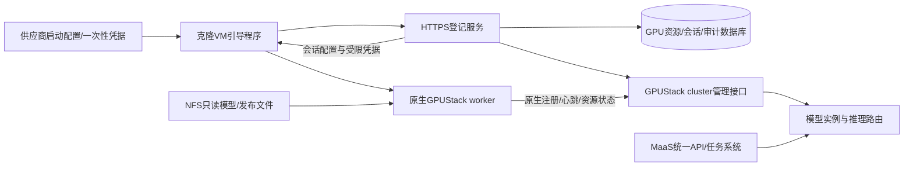

# E5 首轮调研：云网吧镜像与临时 worker 接入

2026-10-23。状态：首轮源码分析与最小验证设计已交付，未实现登记服务、未制作可交付母版、未完成克隆实测。P4限定两节点私有试点验收通过后启动；没有修改任何服务器身份、地址、凭据或部署。

## 目标与已知环境

供应商提供Ubuntu母版，tower-mNST8iPdv上的改动由快照复制到新VM；VM启动绑定一张GPU，关闭即消亡，同一GPU可能在另一VM出现。因此稳定对象是站点内GPU资源，本次VM是独立会话，不强求复活同一个GPUStack worker记录。

001/002与母版machine-id及SSH主机公钥指纹相同，不能用来唯一识别克隆。现有网络启动/写回模块只提供镜像启动线索，不能证明跨启动持久性；GPU UUID跨VM重绑定稳定性及独占性仍须供应商确认。原始证据见 [环境检查](../../results/maas-e5-environment/REPORT.md)及 [母版检查](../../results/tower-master-inspection/REPORT.md)。001/002永久禁止重启，不能用它们做启动实验。

母版已安装580.95.05、CUDA Toolkit 13.0及NVIDIA Container Toolkit；内核仍加载535，存在预期NVML版本不匹配，尚未激活新驱动、未通过GPU容器验收。管理员另行安排激活。当前不能交付为GPU推理就绪镜像。

## GPUStack v2.2.3能力与缺口

依据本地仓库 `/Users/4paradigm/dev/gpustack` 的 `git show v2.2.3:<路径>`，只读核对，未使用main功能替代223承诺。

| 项目 | 原生行为/源码依据 | 本系统取舍 |
|---|---|---|
| 自动加入 | docs/user-guide/cluster-management.md：先创建Docker cluster，获得加入命令；worker配置Server URL和注册凭据，启动后主动注册 | 不逐台预登记worker；空Server仍需初始化cluster，不能零配置匿名发现 |
| 注册与持久状态 | gpustack/worker/worker_manager.py：读取name、external_id、本地UUID，注册后保存worker UUID/token；启动会重新注册 | 公共镜像不含已注册数据，VM使用独立会话目录 |
| 现有身份匹配 | gpustack/routes/workers.py get_existing_worker：按cluster+external_id/worker_uuid匹配，特定兼容label才按name查找；新建UUID由Server生成 | 不能只改hostname便保证隔离或身份恢复 |
| external_id | create_worker拒绝不存在的external_id | 不把任意GPU UUID写external_id就宣称能首次自动注册；需正式管理流程或不用此机制 |
| 凭据 | create_worker仅admin或SYSTEM可注册，创建/更新worker凭据和系统principal | HTTP会话token与GPUStack token分开；逐VM发放/撤销能力及最小权限待专项验证 |
| GPU、状态、调度、路由 | 原生worker上报、Server管理实例与路由 | 完全复用，不恢复自建collector，不做周期SSH全节点清单 |
| 临时生命周期 | 本轮未确认原生自动到期删除worker的完整机制 | 明确旧worker清理策略，不能把offline当删除、把停止worker当GPU空闲 |
| 旧会话隔离 | 外部数据库更新不等于撤销GPUStack凭据或停止旧推理 | 必须验证原生撤销、旧实例路由与执行终止；未证实时禁止抢占式重绑定 |

## 建议组件架构

登记服务只处理可信引导、资源与会话映射、凭据生命周期；不重复GPUStack健康、调度或请求前全池预检。数据库可复用现有PostgreSQL部署，但独立schema/权限及迁移。第一版无需增加独立数据库产品或消息队列。

## 数据与状态约束

- `gpu_resource`：resource_id、site_id、GPU UUID、供应商资产映射与审核状态；唯一键(site_id, gpu_uuid)。GPU UUID是关联线索，不是密码或认证证明。多卡/虚拟GPU后续扩展，不能假定UUID永远全球唯一。
- `vm_session`：随机session_id、resource_id、代次generation、状态、认证来源、地址、有效期、镜像版本、原生worker_id与凭据引用。地址不作主键，不复制machine-id作为身份。
- `enrollment_event`：一次性引导凭据消费、重绑定、冲突、撤销、清理审计；不记录明文token。
- 在事务内锁定资源、消费一次性引导凭据并预留会话；重复请求以引导请求ID返回同一结果，不创建多个原生worker。跨HTTP/原生API失败使用持久中间状态与对账，不能假装分布式事务。
- 同一资源已有活动会话：拒绝自动覆盖，进入冲突审核/隔离。只有可信供应商终止证明或已验证旧worker撤销、路由移除和执行停止后，才推进新代次。单纯租约超时不能证明旧VM/GPU工作已停止。
- 不为身份登记另建全节点5秒心跳。业务租约仅界定凭据有效期，资源可用状态以GPUStack为准；过期与回收采用有界低频后台处理，不自动重放UNKNOWN任务。

## 凭据与镜像交付

优先由供应商在每次启动注入短期一次性登记凭据，绑定站点及本次实例；登记后发放独立短期HTTP会话凭据。GPUStack加入凭据和worker token按原生机制使用，先验证能否按会话最小授权及撤销；不要把集群加入凭据能注册的权限误写成单GPU权限。

公共母版仅有固定版本软件、引导程序、服务端地址及可信CA，不含管理员密钥、已注册worker数据或所有克隆共享的设备私钥。引导配置/凭据写受限临时目录；token只在服务端存hash，需转发的原生秘密保存到受控秘密存储且不入Git/日志。没有可信启动注入时只能讨论受限试点站点共享凭据，必须明确其可冒充范围，不能称为可靠设备认证。

NFS v4.1/4.2用于模型和发布文件只读共享，VM本地缓存；不共享worker身份目录、Docker整个data-root或明文设备凭据。sec=sys及root_squash不能对拥有root的克隆提供强设备隔离。SSH host key、machine-id等首次启动初始化须与供应商镜像启动流程协同，不能直接删除正在使用的三台服务器密钥。

## 最小验证计划与验收

| 顺序 | 环境/任务 | 通过条件 |
|---|---|---|
| A | 供应商书面确认GPU透传/UUID稳定性、单卡独占、一次性配置注入、快照启动钩子、地址可达性 | 能确定可信身份来源；未知项保留阻塞，不能以UUID自报替代 |
| B | Mac只读确认CPU架构、虚拟化工具、磁盘空间；选择Ubuntu架构匹配base image及独立本地Server | 不触碰生产cluster；ARM VM只能验证控制面注册流程，不能证明x86/NVIDIA GPU运行 |
| C | 一份干净镜像启动两个独立本地VM，配置同一测试cluster，原生自动加入 | 两个不同worker身份/凭据，无已注册状态克隆；采集注册与就绪耗时 |
| D | 独立可销毁环境验证同一模拟GPU资源新旧会话重叠、凭据过期/重放、注册中断/重试、IP复用 | 不覆盖活动会话；无未授权注册，无重复记录；撤销在原生路由生效的边界明确 |
| E | 获准独立真实GPU克隆验证、驱动激活及CUDA容器/模型探针 | GPU UUID重新关联、旧worker收敛、真实推理可用；记录原生恢复时延及中断 |
| F | 封版检查与供应商交付 | 清除实例特有身份/秘密，校验manifest与镜像hash，克隆验收和运维回退说明齐全 |

当前只完成A前的环境证据与v2.2.3源码分析，B–F均未执行。未实现HTTP/DB登记服务、未修改worker配置、未构建镜像、未验证凭据即时撤销或会话fencing。001/002不得用于D/E重启或还原实验。母版驱动激活由管理员安排，当前不执行。

## 需供应商回答

1. GPU是PCI直通还是vGPU，UUID跨VM重绑定是否稳定，同一UUID是否可能并行呈现？
2. 每次克隆启动能否注入可信实例ID与一次性凭据/配置？支持什么启动钩子及网络可达方式？
3. 快照的首次启动身份初始化由谁负责？管理员何时可在独立环境验证新驱动和容器GPU？

下一步先确认上述信息并进行Mac只读环境盘点，再估算和实现最小登记闭环；不以本设计文档替代真实克隆验收。
