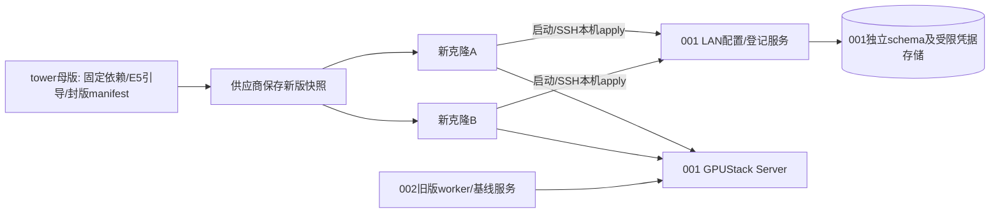

# E5测试环境部署与切换计划

2026-10-23，依据用户指定拓扑：001保留GPUStack Server、去除worker并部署LAN配置服务；tower增加E5引导能力后由供应商保存新版快照；启动独立新VM克隆验证。**本文件为部署计划；本轮仅只读核对001，未停worker、未改母版或创建快照。E5软件尚未实现。**

## 目标拓扑

001保持GPUStack Server、现有MaaS API/数据库/结果/监控等控制及业务服务，取消GPUStack worker角色。GPU不一定立即释放给其他用途：须确认原推理容器都已退出；无worker不是GPU空闲证明。002不升级镜像，不重启，作为上一版基线。tower不作为worker或配置服务，克隆不能依赖其在线；不为证明tower离线而自动关机，可在独立测试配置/网络中阻断克隆到tower的依赖来验证。

001/002永久禁止VM重启、还原或重建；切换失败只能采取有界容器/进程及模型配置恢复，不允许VM/Docker引擎重启作为捷径。容器/进程级控制须核对其影响，保留SSH、Server数据和原生凭据。

## 当前只读快照与影响

本轮查询：wta-gpustack-server和wta-gpustack-worker两个独立容器均运行；两者restart policy为unless-stopped。001与002原生worker均ready。

| 模型 | 期望副本 | 查询到的实例分布 |
|---|---|---|
| rapidocr-gpu（1） | 2 | 001两个running |
| maas-ocr-p2-r2（9） | 2 | 001一个、002一个running |

因此001上有3个OCR实例，不能假设所有模型在002已有副本。此快照不同于P4结束时的分布，是当前观察，不据此修改原验收证据或推断故障。002能否承载迁移后的实例数量、GPU显存和吞吐，须切换前实测；不能承诺原容量不变。

Server命令/env中未见disable_worker并不能证明一定有嵌入worker；v2.2.3已区分enable_worker与deprecated disable_worker。实施前核对完整生效配置中的角色开关（仅输出允许字段），确保移除的是worker能力而不是Server。实际变更命令以当时配置确认后生成，禁止按容器名称猜测或误删server绑定目录。

## 分阶段实施

| 阶段 | 工作 | 完成门槛 |
|---|---|---|
| D0 原生能力与软件准备 | 在隔离环境验证223注册凭据/绑定能力，完成E5最小配置/登记服务、签名manifest、本机boot/manual引导及本地测试 | 软件可运行，注册授权边界明确；服务不可用时已运行worker不受影响 |
| D1 001切换前备份 | 保存当前模型副本/选择条件、worker关联、部署配置及restart策略；备份GPUStack状态和MaaS独立数据，私有秘密不入Git；确定维护/回退步骤 | 备份与恢复材料核对，原Server服务目标明确；不声称未执行过的恢复已验证 |
| D2 处理现有模型与移除001 worker | 先用既有受控维护暂停并排空业务、核对UNKNOWN；明确各模型迁往002/暂降副本/暂停售卖的取舍，清理001实际模型实例及推理容器；确认Server不承担嵌入worker后停止独立worker并禁止其自动回归，再按原生能力处理旧worker记录 | 001无worker和推理残留，Server/API/数据正常；需要继续的OCR在002真实请求成功，容量边界记录 |
| D3 001部署配置服务 | 独立Compose/进程、数据库schema、最小权限与签名发布；仅LAN HTTPS开放登记/配置/结果入口，私有管理入口保留 | 新克隆网段可达；未暴露DB、管理员API、旧私有MaaS入口或整段推理端口 |
| D4 tower安装E5引导并封版 | 固定版本程序/依赖；不登记为worker；清点现有CyberCafe启动服务与管理入口，明确哪些保留/不再执行；生成image_id/manifest并检查实例身份和秘密污染 | 镜像不含有效会话/已注册worker数据；初始化责任明确，不破坏管理员SSH；依赖检查与容器GPU测试有证据 |
| D5 供应商保存镜像并启动新克隆 | 供应商提供准确快照ID/版本；新建可用于测试的克隆及连接方式，优先两台A/B | 能确认使用D4新版而非001/002旧版；有站点/批次共享注册码与限定测试cluster授权，独立会话和审计可验证 |
| D6 克隆场景验收 | 先加入独立无模型E5测试cluster，验证启动/手动apply/故障矩阵；绑定和边界通过后部署隔离测试模型 | 功能与安全证据齐全，原有002服务不被调度修改；模拟/真实GPU结果分别记录 |
| D7 交付收尾 | 镜像、配置及代码版本/摘要、注册时延、失败原因、回退手册、残留清理清单 | 声明已验证范围；不以旧P4通过推断拓扑调整后的服务已重新验收 |

D0的软件准备先于D2破坏性角色切换，避免001提前失去算力但E5尚不能测试。D1/D2可安排维护窗口；当前全局维护可能短暂停止002模型，此为既有能力限制，不借本计划提前实现E1逐worker排空。

移除worker分两步：先确保不再运行/自动重建及无推理残留，再决定原生记录保留离线还是删除。删除前核对模型实例、关联任务和凭据回收；本计划不承诺记录删除等于已撤销全部执行。实施完成后更新原维护工具中对001/002固定worker集合和副本分布的假设，避免后续维护把001 worker重新拉起；未适配的旧演练入口须阻止执行。

## 配置服务与网络

配置服务部署在001，不部署在tower。首版明确在新版母版独立本地配置文件中预置001固定IP 10.11.31.1，使用专用HTTPS监听和克隆预置信任的自签名服务端证书；端口在实施前检查占用再冻结。证书SAN包含10.11.31.1，未来切域名时再验证域名SAN，不复用仅适用于127.0.0.1的现有证书来假装新入口可用，也不关闭证书校验。

网络验证从实际新克隆执行：克隆→配置服务、克隆→原生GPUStack Server、Server→原生worker必要端口/接口。001当前18080既有访问限制不能简单扩成任意网段全放行；根据登记/原生协议配置最小必要路径，并测试未授权地址仍被拒绝。配置服务与GPUStack分别认证，Server注册通路不能被当成匿名公开加入。

云端公共配置备用仍属后续项，此部署不要求实现。NFS/内网镜像源可独立部署或提供固定离线包，若尚未具备则不让首次启动依赖不稳定的公网拉取。所有镜像固定摘要，镜像/公开TLS信任证书/发布验证公钥可预置母版，管理员凭据和worker token不得预置。

## 克隆测试清单

| 场景 | 验证点 |
|---|---|
| A首次启动 | 无需手工安装，引导检查→共享码授权登记→适用配置→原生worker注册；记录image/config/session/worker |
| B同一快照启动 | 会话/凭据/worker独立，快照machine-id或遗留marker不能冒用A |
| 管理员SSH手动apply | 同配置UNCHANGED；新配置按影响应用；需重启的变更返回NEEDS_MAINTENANCE，维护后可应用 |
| boot与manual并发 | 进程锁生效、不重复扣登记额度、不重复建worker |
| 配置/登记故障 | 错签名、不兼容image、未授权/过期/撤销共享码、响应丢失及原生注册不确定有稳定分类，无盲目重注册 |
| 资源冲突 | 本地模拟重复GPU UUID验证唯一约束；真实同卡顺序重绑定需外部资产锚点和独立获准环境，不把两张卡测试等价为同卡稳定 |
| GPU容器 | 新克隆驱动、NVML、容器内CUDA计算通过，再验证隔离模型；母版宿主探针不替代该项 |
| tower非运行依赖 | 克隆配置不引用tower；独立网络阻断到tower时引导仍成功，不用停止母版证明 |
| 配置服务离线 | 已注册worker继续服务；新克隆有限退避后失败，不使用镜像残留凭据 |
| 身份与网络 | 主机身份初始化责任清楚，秘密不出现在日志/公共配置；Server双向可达及未授权访问被拒绝 |

新克隆第一次就可验证自动首启；如需克隆重启/销毁/还原测试，应明确供应商对该独立环境的许可。永不将实验目标替换成001/002。

## 依赖与回退

需要供应商提供：保存新版快照与新建独立VM的操作、快照/镜像ID、克隆访问方式及可用测试范围。尚无这些平台API或权限，不把“保存镜像/启动克隆”写成已执行。

首版采用模块化共享注册码，无需等待供应商可信启动注入；仍需解决原生GPUStack注册凭据范围、允许的无业务模型测试cluster与网络端口。可以验证持有码克隆无人值守加入，但不称为可信物理设备认证或生产安全验收。一个新VM可验证基本启动，两个同时在线新VM更适合验证并发/身份独立；资源不足时拆阶段但明确证据不足。

回退仅在原生状态核对后进行：配置服务停用不影响原Server；恢复001 worker及原模型分布需按已保存配置、restart策略和既有维护流程执行，验证后恢复业务。不自动撤销已注册新克隆的秘密，不自动删除持久数据或重放UNKNOWN。母版失败按封版记录修正/交付前版快照，新克隆依供应商独立测试许可处理；不回滚001/002操作系统。

本计划实施后已有P4报告仍保留为旧拓扑证据。新的Server-only+配置服务+克隆拓扑需独立接入/服务回归；不自动安排新的8小时测试或云端备用部署。

## 共享码试点交付补充（2026-10-23）

D0实现可替换RegistrationAuthenticator和ClientCredentialProvider，首版SharedRegistrationCode；D4在新版测试快照的root-only文件预置本站点/批次共享码，明确镜像持有者可获取的风险。配置服务只存校验值，原生管理员/已注册worker凭据不写母版。D6加入共享码多VM、错scope、过期/撤销/轮换、额度并发、旧会话恢复与认证插件替换用例。供应商一次性注入转后续增强；共享码与GPUStack凭据分开，停码不等于下线已登记worker。详见 [认证模块契约](E5-DESIGN.md#首版共享注册码与可替换模块)。本次仍仅设计，未生成实际注册码、未改母版。

## 寻址决策补充（2026-10-23）

D3固定001的10.11.31.1及新配置服务HTTPS端口，D4在母版/etc/maas/bootstrap.json预置地址/自签名证书/独立凭据文件引用，D6验证自动启动与手动apply使用同一地址、端口不可达/证书不符时失败，以及管理员修改本地地址后无需VM重启即可重试。地址文件与注册码分开，不自动发现或扫描网络。稳定域名/LAN DNS和启动地址注入列为后续E5.F1，非首版阻塞。当前路径为设计草案，没有在服务器写入。

## HTTPS首版与正式交付（2026-10-23）

首版使用配置服务自签名证书，SAN覆盖10.11.31.1；母版仅预置公开证书，私钥只保存在001。克隆正常校验证书/地址/有效期，不建立单独CA服务，不申请第三方证书。正式上线迁到独立稳定LAN控制机时，制作正式镜像更新地址、信任证书和正式共享码，测试码停用；正式证书私钥不进母版。其他证书方案有实际扩展需求再评估。尚未签发/部署本项证书。

## 自签名证书有效期默认值（2026-10-23）

默认无限期：notAfter=9999-12-31T23:59:59Z，按RFC5280的无明确到期日约定编码；正常校验notBefore/信任/SAN及TLS，不禁用时间验证。D0/D4验证证书库和克隆客户端兼容，不安排周期续期，不改变共享码/会话凭据有效期。地址/密钥更换或正式环境交付仍需更新相应证书和信任文件。本轮没有签发或部署证书。
