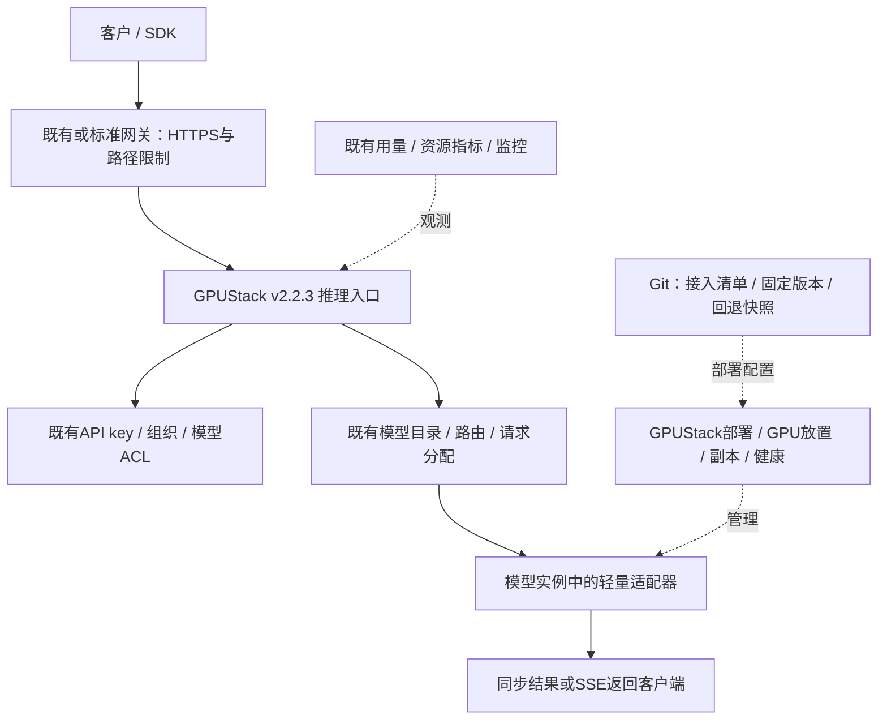

# 基于 GPUStack v2.2.3 的收敛方案

> **Superseded（已被替代），2026-10-20。** 本文“暂缓任务数据库、执行器和结果管理”的建议已撤回。当前采用 [DESIGN.md v0.2](DESIGN.md)、[实施计划](PLAN.md)及 [ROADMAP.md](ROADMAP.md)：固定GPUStack v2.2.3，同时保留最小持久任务层。本文仅供历史讨论追溯。

日期：2026-10-20 · 状态：范围调整提案，未修改线上部署。
依据：[源码复用分析](GPUSTACK-REUSE-REVIEW.md)、[版本化源码证据](GPUSTACK-SOURCE-EVIDENCE.json)。

## 1. 本轮范围解释与结论

将“依赖 v2.2.3 的功能”收敛为：优先使用固定版本现有的模型服务能力，通过部署配置和轻量模型适配器提供统一入口；首阶段不建设另一套完整 MaaS 平台，也不依赖 main 新功能、不 fork 上游增加内部能力。

当前基线为本地tag v2.2.3，commit `1cfcbbff02aacdb51f0a390378dd7bcddd9bf365`。线上记录为v2.2.3，但本次未重新探测远端镜像/依赖与本地tag的一致性，进入实施前需核对。上一轮引用main的LB、least-load、session-affinity、model revision回退、角色组drain全部从首期依赖中移除。

**近期交付目标：稳定的统一模型调用入口，而不是通用持久任务平台。** 新模型通过已有自定义backend、模型route、API key与模型适配器加入。同步和SSE优先使用GPUStack，必要时验证其generic proxy承接原生HTTP协议。

如果必须承诺任务接收后不丢失、节点随时退出后自动恢复、结果长期可查询，则仅依赖v2.2.3不够，应明确进入第二阶段；不把这些能力包装成已经具备。

## 2. 已有能力的使用方式

| 能力 | v2.2.3实现/配置 | 首期落地方式 | 不作出的承诺 |
|---|---|---|---|
| GPU资源与worker管理 | worker注册、心跳、状态、标签、资源采集 | GPUStack为唯一资源目录 | 不把心跳等同于网吧上机状态 |
| 模型部署和副本 | 自定义InferenceBackend、image、启动参数、health、worker selector、spread | 为每种模型登记backend及版本，GPUStack部署 | 不自写Docker调度，不声称显存硬隔离 |
| 稳定模型名称与路由 | ModelRoute、targets、权重、访问策略、meta | 模型别名/部署绑定统一在GPUStack维护 | 不创建第二套路由权威数据库 |
| 模型目录 | `/v1/models`及现有管理目录 | 客户使用已有目录，能力文档用route meta/配置补充 | meta不等于执行schema校验或完整能力协商 |
| 同步推理 | 既有OpenAI兼容转发 | 已兼容模型直接通过统一入口调用 | 无持久任务接受保证 |
| SSE | 既有流式代理 | 仅对后端确实支持的模型启用 | SSE不等于后台任务，不自动断点续传 |
| 原生HTTP | generic_proxy及模型代理路径 | 先验证 `/model/proxy/<route_id>/<path>`；通过才作为标准接入选项 | 源码存在不等于现网已启用，不假定所有协议可透明转发 |
| 客户身份和模型权限 | 用户/组织、API key、scope、模型白名单、route ACL | 直接使用GPUStack身份与权限 | 不新增客户身份服务，不给客户management key |
| 请求分配与fallback | Python入口RoundRobin；Higress有权重/fallback与重试配置 | 使用实际入口已有策略并验证 | 不宣称least-load、精确并发预留或任务恰好一次 |
| 监控与用量 | 资源指标、usage、gateway上报、Prometheus/Grafana路径 | 复用并核对已启用路径，补配置/看板 | OCR零token不等于零请求成本；自定义请求统计不保证天然完整 |
| 计划维护 | worker maintenance及离线实例清理/重调度 | 用现有维护模式管理部署侧资格 | maintenance不停止已有RUNNING实例接收推理 |
| 版本控制 | backend_version与镜像配置 | 固定镜像digest、模型版本、配置快照和人工回退脚本 | v2.2.3没有本次main中的model-revisions API |

## 3. 首期只补这些内容

### 3.1 轻量模型适配器规范

只规定部署与推理边界：健康接口、API类型、输入/输出格式、错误、图片/文件大小限制、运行超时、实际计量单位。OpenAI兼容、原生HTTP、SSE按后端能力选用，不强制每个模型支持所有模式。

规范可以先是配置清单+模板，不建设复杂SDK或动态插件系统。不要求修改GPUStack核心；参数语义验证留在模型适配器。对不兼容的后端写少量转换代码，直接复用现有OCR适配器作为样例。

### 3.2 部署与交付规范

按backend版本、模型权重版本、镜像digest固定运行环境；保留配置快照及回退脚本。两节点现阶段可以自动化预加载镜像，不把统一镜像仓库当作两节点验证的阻塞项；扩容前再落实仓库。

使用现有模型route和backend作为配置权威。Git保存模板和变更记录，不另外写部署控制器。模型能力扩展记录在route meta或Git文档中，避免维护一个独立在线目录服务。

### 3.3 外部入口与使用边界

需要对外试用时才配置HTTPS、请求体/连接上限、路径白名单及管理隔离；优先使用现有Higress或标准反向代理，不自写网关。

仅开放已验证的推理路径；`/v2`、`/auth`、Playground管理入口和worker私有端口不作为公网客户接口。客户key仅有inference scope并限定模型。具体Higress认证插件失效、key缓存撤销传播、限流规则需实际验证。

### 3.4 最小验收与运维流程

测试模型可见性、模型权限、同步/SSE/原生接口行为、无健康实例响应、超时、过载、节点离线窗口、版本回退、监控与用量覆盖。用现有OCR和轻量模拟HTTP后端测试框架，暂不以比较更多真实模型为关键路径。

记录计划维护步骤与限制。仅使用v2.2.3不能承诺“002切Windows时所有请求无损”。需要退出时先停止对应业务接单、等待在途后端工作结束，再维护/停机；如何隔离某节点流量及证明无在途执行须单独验证，现有OCR没有完整在途管理接口。做不到时采用受控维护窗口，不宣传已具备自动排空。

## 4. 暂缓建设的组件

| 原设计组件 | 本期处理 | 重新启动条件 |
|---|---|---|
| 自建模型目录/同步/流式API网关 | 取消重复实现，复用GPUStack | 现有协议/路由明确无法满足且已验证 |
| 自建用户、API key和组织体系 | 取消重复实现，复用GPUStack | 存在独立业务身份需求；另行设计安全桥接 |
| 独立MaaS PostgreSQL与业务迁移 | 暂不新增；不改变GPUStack自身数据库 | 需要持久任务/结果/账本 |
| 持久任务API、队列、执行器、租约/fencing | 第二阶段 | 长任务、接收后不丢失、故障续做 |
| 业务ArtifactStore、结果TTL与下载API | 第二阶段 | 需要worker离线后继续查询、长期结果保存 |
| 通用节点drain控制器/agent/双系统自动化 | 第二阶段 | 要求无人值守上线/退出且可验收 |
| 实例定向connector与自建请求调度 | 本期不默认采用 | GPUStack入口不满足已确认的业务需求，且愿承担鉴权/计量绕过成本 |
| 独立任务计费/配额/账本 | 第二阶段 | 有付费试单和明确计量需求 |
| main新LB/revision/drain插件 | 不依赖、不移植 | 独立升级评估与回归测试通过 |

结果语义需要特别说明：首期主要把结果随HTTP响应返回客户端，由客户端保存。现有OCR并不因部署在worker就自动持久保存结果。若保留worker缓存，也只是模型适配器自行实现的临时缓存，不具有统一结果查询或节点离线可读保证。原“worker暂存结果”设想不能作为已实现功能。

## 5. 一个新的源码发现：网关可能重试非幂等推理

v2.2.3 `gpustack/gateway/utils.py` 的 ingress 构造在约622–631行设置：

```text
retry_policies = "error,timeout,http_503,http_502,non_idempotent"
higress.io/proxy-next-upstream-tries = 2
```

这说明实际Higress路径可能对POST推理进行上游重试，不代表只有一次GPU执行；Python fallback与Higress路径行为也不同。是否生效取决于实际入口和运行配置，必须核对。第一版仍不承诺任务恰好一次，也不将每次尝试当成一次客户成功任务。

验证中要记录：单次请求是否产生多次实际推理、超时后后端是否继续工作、网关retry/fallback是否叠加。以后增加业务重试时先设总体尝试预算，避免多层重试放大成本。

## 6. 收敛后架构



物理结构仍为001控制端常在线且兼worker、002 worker。本地Mac仅开发与管理，不需要入站访问。首期没有新增通用任务执行器、数据库队列或结果服务；图中鉴权/路由等是GPUStack内部逻辑职责，不表示新增独立微服务。

## 7. 执行路线图（替代原F0–F6作为本期范围）

| 阶段 | 工作 | 交付与门槛 |
|---|---|---|
| V1 · 固定基线与能力验收 | 核对运行镜像/依赖、入口模式、key与组织权限、generic proxy、重试和统计 | 产出v2.2.3已验证能力矩阵；未知能力不得标成可用 |
| V2 · 接入模板与配置固化 | 提供一个轻量适配器模板、能力清单、backend/route配置、digest与回退快照 | OCR和模拟后端通过相同流程接入，不新增调度/鉴权核心 |
| V3 · 服务边界与稳定性 | 如需外部试用则配HTTPS/路径白名单；测超时、过载、离线与恢复、8小时运行 | 明确容量和失败窗口；无越权；监控/用量有证据 |
| V4 · 验收后决定补什么 | 根据真实请求类型、时长和可靠性目标评估任务层 | 只有确认异步/持久需求后才启动任务/结果/排空扩展 |

本期执行顺序：V1 → V2 → V3 → V4。未给出新的工期承诺，先用V1确认实际配置与源码一致性，再按探针结果估算。

## 8. 仍需明确的产品边界

- **统一模型服务不等于统一任务平台**：第一期统一调用入口、部署与权限，不承诺持久异步。
- **实时在线GPU服务不等于随时可退闲置池**：002可以故障离线，但请求可能失败；无损退出是下一阶段能力。
- **现有usage不等于商业账本**：先验证请求覆盖和单位，再决定按图片/任务计费；不伪造token。
- **模型配置版本不等于历史任务可复现**：首期固定镜像/权重及配置；没有历史任务pinning承诺。
- **当前单控制端不等于高可用**：001必须在线；第一期只验证重启恢复和配置可重建。

## 9. 与原设计文档的关系

本文件是2026-10-20对首期范围的收敛建议，实施时以此V1–V4为当前提案。原DESIGN.md/ROADMAP.md中的完整任务平台保留为后续扩展候选，不代表本期必须建设，也不意味着这些可靠性能力已由GPUStack替代。本次未自动重写历史设计图或部署任何组件。
