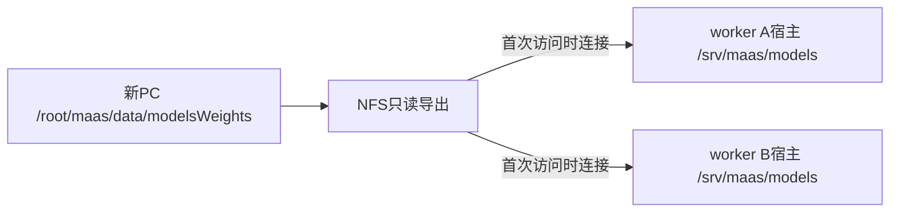

# worker VPC 启动时自动挂载只读 NFS 模型目录

2026-11-17 · 用户确认功能边界 · [E5 / Issue #6](https://github.com/WTaoGitHub/cybercafe-maas/issues/6)

状态：**新PC只读NFS、001隔离目录真实读取及故障试点、母版软件实际安装已完成；管理员新快照保存/应用、独立新VPC首启和推广待验。** 详见[实际部署及安装清单](../../results/maas-nfs-live-20261117/REPORT.md)。用户已指定新PC目录并要求尽量按需访问，交接见[宿主NFS按需挂载](../../deploy/bootstrap/clone/NFS.md)。此前计划中的容器映射、模型部署和推理验收不作为本功能的实施内容或完成条件。

## 目标与职责

**本功能在配置为NFS的worker VPC启动时，为宿主`/srv/maas/models`准备本地自动挂载入口；首次访问时才连接远程NFS并只读挂载。** 默认服务端目录为用户指定的新PC`/root/maas/data/modelsWeights`。启动不读取远端测试文件或权重；实际读取与来源/只读校验作为独立验收。交付边界到VPC宿主目录为止。



| 范围 | 责任与交付 |
| --- | --- |
| 服务端前置条件 | 管理员提供稳定可达的NFS地址、export、受控访问范围及已发布的只读模型目录 |
| 本功能 | VPC宿主挂载配置、启动顺序、真实挂载与读取校验、幂等和失败状态、母版及快照交付 |
| 模型部署业务 | 创建和配置模型服务副本容器、是否映射宿主目录及映射位置、模型路径/版本/缓存参数、GPUStack标签与选择器、模型服务请求验收 |
| 模型库管理 | 管理员导入、完整性校验、版本发布、回退和引用保护回收；独立于宿主自动挂载功能 |

本功能不新增管理员模型发布系统，不要求部署模型或启动服务副本来证明挂载成功。宿主挂载通过不代表容器已经能读取目录，也不代表模型已经可用；这些由模型部署业务配置和验收。

详细交付顺序见[实施与母版快照应用计划](MODEL-WEIGHTS-NFS-IMPLEMENTATION.md)：基线预检、独立试点、实际母版更新、管理员保存并应用快照、独立新VPC首启验收、小批推广与存量维护迁移、运维交付。母版安装、快照保存、应用和首启分别取证。

## 目录与服务端交接约定

新PC的建议目录如下，均为待部署路径，不代表服务已经创建：

```text
/root/maas/data/modelsWeights/      # 用户指定的模型目录，只读导出
    unlimited-ocr-2-0480966/
    <other-model>-<revision>/
```

管理员继续负责导入和文件校验；已发布版本不原地覆盖，旧版本回收检查现有引用及回退需要。暂存文件应放在该导出目录之外。本功能消费已提供的export，不实施这些管理工作流，也不以每个模型的revision/manifest登记作为宿主挂载前提。

NFS节点的宿主挂载点统一为`/srv/maas/models`。`/srv/maas/model-cache`保留为本地可写缓存目录；worker身份、注册材料、设备私钥、API Key和Docker数据目录不进入NFS。容器是否使用这些目录由部署业务决定。

## 挂载与启动契约

1. 核实服务端与worker之间的真实NFS数据通道、稳定寻址和受控网络范围；SSH跳板可达不能代替NFS可达。不向不受控公网客户端开放模型共享。
2. 服务端export与宿主挂载均只读，服务端拒写不能只靠客户端`ro`替代。导出只含已发布目录，不含staging或管理凭据；按实际宿主读取用户核对权限。`root_squash`不作为设备身份认证。参见[exports(5)](https://man7.org/linux/man-pages/man5/exports.5.html)。
3. 沿用现有系统基本启动、供应商命名完成后的延后准备链。配置为NFS的节点先准备并校验本地systemd automount，再继续现有worker启动流程；启动准备不要求实际连接NFS。未配置NFS的节点继续原流程。
4. 区分`automount`已准备与`mounted`已连接，前者只证明本地入口及受控单元正确，不证明远端可读。独立显式试读才核对实际NFS类型、服务端/export、ro及测试文件摘要；不能把空目录或autofs入口写成真实NFS读取成功。测试文件及预期摘要由管理员交接，不要求解析模型或加载权重。
5. 重复应用不重复挂载、不叠加挂载；已有错误挂载或目标目录中的本地文件需要明确处理，不直接遮蔽运行中使用的目录。NFS失败记录原因与尝试次数，停止本阶段，不自动切为本地模式或改用镜像内权重。
6. 复用现有受控配置与本地允许策略，只允许指定的服务端、export、目标和挂载选项，不下发任意shell命令，不放开容器任意`model_mounts`。GPU UUID身份及自动预登记、发证流程保持现行方式。
7. `storage.prepare()`的NFS分支只准备本地automount并检查本地元数据，不创建远端子目录、写marker或试读；本地缓存仍单独准备。本功能不改变worker或推理容器的挂载布局，也不新增存储标签/调度选择器。任何进程访问都可能触发挂载，不能把“按需”解释为识别模型业务意图。

挂载重试、超时和启动失败行为须在独立环境验证。NFS默认hard请求可能持续重试，应用超时或kill成功不能证明内核I/O已经释放；不能为快速返回直接改用soft而忽略完整性风险。首轮卡住时停止新尝试、保留现场，不加入VM自动重启。参见[nfs(5)](https://man7.org/linux/man-pages/man5/nfs.5.html)。

## 官方镜像内置权重的兼容

完整权重镜像与NFS外置文件继续作为两种正式部署方式。完整镜像保存在私有Registry，不要求管理员另行下载、提取权重到NFS，也不要求最终迁出镜像。仅镜像节点不依赖NFS。

当前Unlimited-OCR-2使用worker本地外置目录`/srv/maas/models/unlimited-ocr-2-0480966`，尚未迁入NFS；旧`maas-ocr`继续使用镜像内ONNX权重。本次宿主挂载功能不切换它们的加载来源，不修改镜像，也不安排副本迁移。

模型部署时的镜像digest、真实加载路径、容器映射、模型版本、缓存及调度约束由部署业务另行确定。GPUStack的`local_path`或API模型名不能替代实际加载入口证据；这些不作为本功能的验收门槛。

## 验收与运行边界

本功能的通过依据为：独立新VPC使用新版快照，首启无手动mount/apply或复制文件补救，自动准备正确的本地automount且未主动访问远端；随后独立首次访问触发正确export的只读NFS挂载，测试文件可读且摘要一致。入口准备、真实读取、重复应用幂等和网络/错误挂载异常分别取证；未配置NFS的节点不受影响。验收不启动推理容器、不发模型任务、不验证容器内路径或GPUStack调度。

首轮采用独立测试export及无业务VPC，不在运行中的`/srv/maas/models`上覆盖挂载。XZ-31-001/002禁止VM或等效重启；真实首启仅使用管理员提供的获准独立可销毁实例。没有首启证据时继续标记待验；001沿用普通worker角色，不恢复旧控制平面限制，不部署旧退役插件。

NFS提供远端文件，不要求worker持久保存完整权重副本；本功能不自动复制全库到本地，也不删除原本地文件或镜像层。服务端和网络是共享依赖，具体模型加载性能及推理时的故障影响属于部署业务验证，不将宿主挂载验收写成模型可用性、存储高可用或千节点性能已验证。
