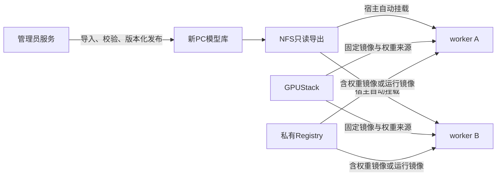

# 集中模型权重库与只读 NFS

2026-11-17 · 用户确认目标架构 · [E5 / Issue #6](https://github.com/WTaoGitHub/cybercafe-maas/issues/6)

状态：**目标已确认，方案已记录；NFS服务、管理员发布管理和worker自动挂载尚未实现或部署。** 本文补充[E5设计](E5-DESIGN.md)中模型分发部分，明确此前“可选NFS”的目标。当前模型服务的既有交付范围保持独立，不将单模型部署完成写成统一权重分发完成。

详细操作顺序见[实施与母版快照应用计划](MODEL-WEIGHTS-NFS-IMPLEMENTATION.md)。计划明确包含实际母版更新、管理员保存并应用新快照、独立VPC首启验收、小批推广和存量worker维护迁移；不能只更新软件就宣称完成。NFS节点的挂载等待加入现有延后准备链，不阻塞系统基本启动。

## 目标与职责

按用户补充的镜像交付流程，集中管理分为两条正式路径：**完整模型镜像由私有Registry保存，外置模型文件由新PC只读NFS提供**。管理员选择包含全部权重的固定官方镜像时，无需另行下载、提取或发布一份权重到NFS。管理员服务维护外置模型的权重、配置、tokenizer及必要模型代码；获准且NFS就绪的worker可只读访问完整的外置模型库。GPUStack按每个部署明确的来源启动实例，推理在worker本地CPU/GPU及内存中执行。



| 组件 | 责任 |
| --- | --- |
| 管理员服务 | 统一登记部署来源和版本；镜像模式保存完整镜像，外置模式导入/校验/发布模型文件，分别维护回退和引用保护 |
| 私有Registry | 保存固定digest的完整模型镜像或不含权重的运行镜像，提供受控拉取 |
| NFS服务 | 向获准worker网络只读导出已发布目录；暂存目录与管理凭据不导出 |
| worker引导 | 按节点存储配置准备；NFS节点先挂载校验，仅镜像节点不要求NFS；部署选择器与实际存储能力一致 |
| GPUStack | 原生worker管理、资源匹配、实例调度、运行镜像及推理容器生命周期 |
| 推理容器 | 按登记来源加载镜像内或NFS中的固定权重；编译、框架及运行缓存写入worker本地独立目录 |

GPUStack的Local Path部署要求目标worker能够读取模型路径，不自动同步这些模型文件；NFS符合这一机制。参见[GPUStack官方说明](https://github.com/gpustack/gpustack/blob/main/docs/user-guide/model-deployment-management.md)。能够读取全部模型不代表任意节点都有运行全部模型的CPU/GPU、内存或框架条件，仍由部署配置和GPUStack匹配资源。

## 目录与发布约定

建议新PC目录，均为待部署路径，不是已创建的服务：

```text
/srv/maas/model-repository/
  staging/                         # 仅管理端使用，不对worker导出
  releases/                        # NFS只读导出根目录
    unlimited-ocr-2-0480966/        # 固定模型revision；权重、配置、tokenizer、代码
    <other-model>-<revision>/
```

NFS节点统一挂载到`/srv/maas/models`，原生worker和推理容器继续只读看到同一路径。例如GPUStack引用`/srv/maas/models/unlimited-ocr-2-0480966`。CPU转换权重如GGUF或LiteRT与原BF16使用不同的发布版本目录，并分别固定转换recipe和摘要。

本地可写缓存继续使用`/srv/maas/model-cache`。worker身份、注册材料、设备私钥、API Key和Docker data-root不存入共享库。全库只读可见以用户指定的获准worker范围为准，不新增逐模型文件读取权限设计。

管理员先在staging准备完整版本，校验来源revision、文件清单、大小与SHA-256，再在同一文件系统内原子发布到releases。已发布版本不可原地覆盖；部署固定版本目录，升级/回退显式更改部署引用，不让运行中实例追随浮动latest。删除旧版本前核对现存模型、实例和回退引用，不能直接按文件时间清理。

镜像均从Registry获取；仅外置模式要求另行发布模型文件。旧`maas-ocr`的ONNX权重目前随镜像打包，可以保留此正式模式，不要求为了NFS建设而提取。当前Unlimited-OCR-2使用外置权重，是首个NFS迁移对象。管理员服务首版的管理入口和权限实现需复用现有受控机制，不向普通worker开放发布写接口。

## 官方镜像内置权重的兼容

镜像内置权重与NFS外置权重是并列的正式交付方式，不要求所有模型最终外置。每个部署必须明确实际权重来源，不能统一覆盖所有镜像的默认目录：

| 镜像行为 | 处理方式 | 验收重点 |
| --- | --- | --- |
| 不含权重，支持外部模型路径 | 从统一NFS路径加载固定版本 | 权重、配置、tokenizer及模型代码完整，真实加载路径正确 |
| 含完整权重，无论是否支持外部路径 | 默认固定官方镜像digest并保存到私有Registry，worker拉取后直接加载内置权重 | 不额外下载/提取权重，不依赖NFS；实际入口使用该镜像内版本，首次启动不另行下载模型 |
| 含权重，但管理员明确选择外置 | 独立安排完整文件导入和加载路径适配，验证后显式切换NFS；不作为默认步骤 | 入口确实使用外部参数，代码与权重兼容，未静默使用内置版本 |

每个部署记录固定镜像digest、实际权重来源（NFS或image-contained）、真实加载路径及兼容关系。外置文件另记revision/manifest/摘要；内置模式以镜像digest固定内容，可补官方模型版本，不要求为生成文件摘要而提取权重。GPUStack的`local_path`登记值或API中的模型名不等于实际加载路径，例如现有旧OCR的`--model`只是服务名称，权重仍由RapidOCR包加载。管理员分别核对“完整镜像已入Registry”“外置文件已入NFS库”和“实例真实加载来源”，内置模式不列为NFS迁移未完成。

部署或增加副本时，GPUStack沿用原生容器生命周期，在目标worker准备固定镜像并启动推理实例；Docker可复用本机已有镜像层，不能把每次扩副本写成重新完整下载。完整镜像模式不增加独立的权重分发步骤；镜像被清理或首次落到新worker时仍需可用的Registry、只读认证和足够本地磁盘。

NFS默认挂在独立的统一目录，优先通过参数/配置指定它。挂载到容器已有目录会遮蔽原内容，不合并文件；不覆盖`/app`、Python包根目录或不完整的模型目录来碰运气。若确需覆盖固定权重子目录，必须是明确审核的单模型挂载映射，包含完整配套文件，先验证后发布，不能绕过挂载允许策略。参见[Docker挂载遮蔽说明](https://docs.docker.com/engine/storage/bind-mounts/#bind-mounting-over-existing-data)。

只读NFS上的模型目录不得承担编译/缓存写入。若官方入口要求向权重目录写文件，应调整可写缓存路径或适配镜像；不能为兼容而把共享权重改为可写。配置为NFS来源的部署遇到路径缺失/版本不符时明确失败，不自动退回镜像内置权重，防止同一模型服务混用版本。

NFS挂载或覆盖不会删除OCI镜像层中的原权重，也不会缩小官方镜像下载量；同时使用带权重镜像与NFS可能保留两份数据。若需要减少镜像分发量，应寻找无权重运行镜像或不继承权重层的构建方式，另行验证。

节点存储配置与模型来源分别校验：仅镜像节点沿用本地存储准备，不把NFS作为注册/启动前置条件；配置为NFS节点者仍在worker启动前完成真实挂载，避免Docker后挂载不传播。复用GPUStack现有标签/选择器，将外置部署限定到已核验的NFS节点，不能仅因worker Ready就认为能读取NFS。首版不在NFS失败时自动切换节点模式，也不替模型更换权重来源；节点模式切换须同步配置、挂载布局及调度范围。此为待实现和验收的契约。

## 挂载与启动契约

1. 先核实新PC与各worker网络之间的NFS可达性、稳定寻址及访问范围。现有SSH跳板能执行命令不等于NFS数据通道已连通；不将模型共享服务直接暴露给不受控公网客户端。
2. 服务器export及worker挂载均只读；容器bind同样只读。服务端只读限制不能只靠客户端`ro`选项代替。导出仅包含已发布模型，权限按实际运行UID验证；`root_squash`不能作为设备身份认证。参见[exports(5)](https://man7.org/linux/man-pages/man5/exports.5.html)。
3. 对配置为NFS的节点，必须在worker容器启动前完成宿主挂载。Docker bind默认`rprivate`，不能假定后续宿主挂载会自动传播进已运行的worker/推理容器。迁移需核对宿主、worker容器、推理容器三个命名空间中的实际来源、只读属性和文件一致性。参见[Docker bind propagation](https://docs.docker.com/engine/storage/bind-mounts/#configure-bind-propagation)。
4. 引导校验实际NFS类型、允许的服务端/export、目标路径、只读状态及库/模型manifest；缺失或错误挂载不得以新建本地空目录冒充成功。新节点未通过时不进入相应模型的部署路径；已运行实例的处理按真实活动和存储依赖判断，不因一次检查失败自动终止计算。
5. 扩展现有签名配置与本地允许策略，增加受控的只读模型库契约；不绕过当前禁止任意`model_mounts`的校验，也不下发任意shell挂载命令。保留当前GPU UUID的worker name/external_id和自动预登记/发证方式。
6. NFS模式下worker只读校验，目录/manifest由管理员预先发布。当前`storage.prepare()`会尝试创建模型目录和公开marker，必须适配后再用于NFS，不直接在只读共享库上沿用本地发布逻辑。
7. 模型代码/框架的缓存写入本地可写目录；验证Transformers、SGLang及后续CPU运行时都不要求修改已发布模型目录。

挂载重试、超时和启动失败行为须明确验证。NFS默认hard请求会持续重试，应用超时不必然终止内核I/O；不能为追求快速返回直接套用soft并忽略完整性风险。参见[nfs(5)](https://man7.org/linux/man-pages/man5/nfs.5.html)。

## 当前差距与实施顺序

当前已有`model-storage-v1`：本地发布目录、缓存目录、只读/可写容器映射及身份卷排除。当前Unlimited-OCR-2读取worker本地模型目录；旧OCR读取镜像内权重。上述均不代表集中NFS分发已经完成。

| 顺序 | 工作 | 通过依据 |
| --- | --- | --- |
| 1 | 新PC存储/容量、NFS可导出文件系统、服务端能力和到worker的数据通道只读预检 | 明确发布根目录、网络方案、容量及权限边界 |
| 2 | 管理员版本发布与独立测试export | 完整模型及manifest校验，临时/不完整版本不可见，worker写入被服务端拒绝 |
| 3 | 受控挂载契约与boot/manual引导适配 | 来源/ro/版本校验、重复应用幂等、缺失挂载不进入新部署；凭据与身份不共享 |
| 4 | 独立worker实际启动一份固定模型 | 三层挂载一致、从NFS读取、原生调度Ready和真实请求成功；无手工复制权重到worker的前置条件 |
| 5 | 两worker同版本读取及有限并发加载 | 文件哈希一致，记录网络/磁盘/加载耗时、内存峰值、NFS依赖与失败处理 |
| 6 | 运维交付、备份恢复和来源登记 | 两类制品的发布/回退/回收可核对；外置实例按维护流程迁移，保留内置模型方式及回退材料 |

首轮验证采用独立目录和无业务worker，不在运行中的`/srv/maas/models`上直接覆盖挂载。XZ-31-001/002禁止VM或等效重启；启动顺序验证使用只读配置证据、进程/容器范围检查或另行获准的可销毁环境。没有实际首启证据时继续标记首启待验，不以手动挂载替代。001按当前普通worker角色校验，不恢复旧控制平面限制。

## 性能与可用性边界

集中权重库减少外置模型的逐节点维护和完整持久副本需求，但新PC成为这些模型的共享存储依赖。通常主要在加载时读取模型；mmap、懒加载、CPU offload或本地文件缓存未命中仍可能在运行中读取NFS，不能承诺启动后完全不依赖服务器。内置模式不读取NFS，但镜像层占用各worker的Docker本地存储，冷拉和缓存清理后的再次部署仍依赖Registry。

示例估算：Unlimited-OCR-2的两分片约6.69GB；若数据通道仅1Gbps，单次完整读取的理想下界约54秒，尚未计协议、磁盘、摘要校验和模型加载。此处没有测量当前带宽。多个worker同时加载共享同一出口与磁盘，应复用现有启动并发策略并实测；不直接外推千节点容量。

本地可写缓存与OS页缓存可以使用；首版目标仍是直接从只读NFS加载，不强制把全部模型复制到每个worker。是否增加固定版本的模型本地副本缓存，以及存储高可用、网络中断时的运行影响，依据首轮数据再决定；未实测前不写为已具备。
