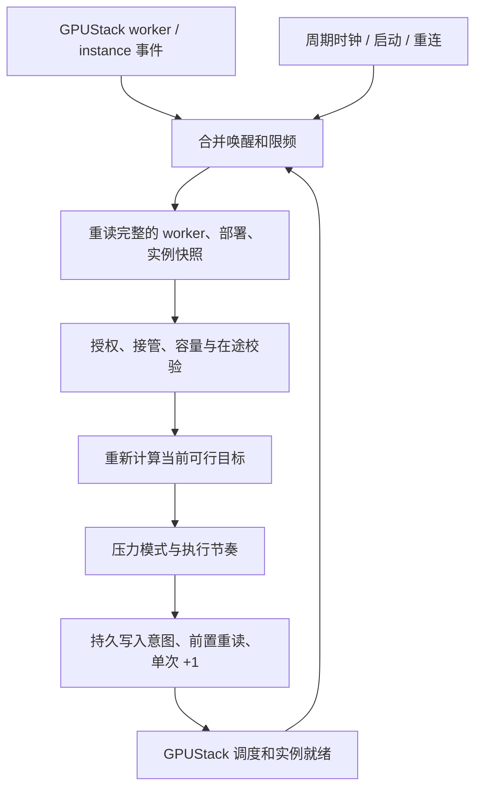

# 规模调节器：压力解耦与持续对账改进方案

> **2026-11-12 最新控制决议（候选已实现，未部署）**：新增运维全局暂停/恢复/查询 API。未暂停的 v2 Apply 根据当前策略和 GPU 容量纠正外部副本数量修改，支持受服务下限保护的逐个缩容；数量变化不再触发旧的人工漂移冻结。镜像等保护配置和未知写入仍阻止动作。接管不隐式解除暂停，恢复须显式 resume；新增模型事件唤醒。141 项调节/E17/插件回归与 18 项客户接口回归通过，3 项环境条件跳过。旧 R4 人工归零停写结果仅作历史证据；新语义尚待独立真实试点和 R5 发布。本轮未连接或修改服务器。[操作与设计](REPLICA-CONTROL-API.md) · [本地验收](../../results/maas-replica-control-20261112/REPORT.md) · [Issue #39](https://github.com/WTaoGitHub/cybercafe-maas/issues/39)。

> **2026-11-12 R1—R3 代码和 R4 只读前检完成，未发布**：102 项本地回归通过（Mac 缺原生 SDK 的 2 项另在固定 runtime 补验），GPUStack v2.2.3 内 34 项回归全部通过。真实两卡 Ready、原 OCR 仍 1/1；新版 Observe 稳定后计算目标 2，因未接管而保持零写入。已修复原生空 distributed_servers 默认对象导致误冻结的问题。独立实写/启动耗时比较、故障恢复试点及 R5 发布未完成，现网配置与人工目标不变。[实施与证据](../../results/maas-replica-v2-20261112/REPORT.md) · [并行边界](REPLICA-V2-PARALLEL.md) · [Issue #39](https://github.com/WTaoGitHub/cybercafe-maas/issues/39)。

2026-11-12 · 设计完成，待实现及验证 · [Issue #39](https://github.com/WTaoGitHub/cybercafe-maas/issues/39)

本方案只针对 MaaS 模型服务规模调节器。当前模型副本、策略修订、写入授权和采样服务均未改变；不能把本文建议视为已上线。历史事故与原始时间线见[排查报告](../../results/maas-replica-investigation-20261112/REPORT.md)。

## 1. 决策建议与范围

推荐以 **GPUStack 当前权威状态 + 持续对账 + 受预算控制的快速启用**作为正常工作路径，网络/写盘压力只作为可选节流输入；保守串行作为初始试点与降级路径。新节点的正常扩容不应依赖人工配置 SSH 采样名单，也不应因一次上线事件过期而永久失去调整机会。

用户进一步明确快速将闲置资源转为可服务容量也是核心使命。[启动效率补充设计](REPLICA-STARTUP-EFFICIENCY.md)规定正常事件快路径、首副本优先、可验证的并行预算、冷热缓存和两个就绪时间指标。下文单次 +1、在途 1、30/60 秒等待为保守候选，不作为长期全池性能上限。

| 问题 | 改进 |
| --- | --- |
| 注册名单自动变化，压力来源仍固定为旧 worker | 核心调节不依赖 SSH 来源配置；可选压力数据按当前原生身份匹配，旧节点失效数据不参与判断 |
| 缺少压力样本就无限期停写 | 新策略可显式选择 advisory：经过启动宽限后保守串行执行，并报告数据缺失；required 仍保持严格冻结 |
| 事件过期后不再规划 | 事件负责及时唤醒；周期读取完整现状重新计算目标，不重放旧事件或旧写请求 |
| 人工维护需要暂停自动控制 | 最新决议以显式全局暂停为准；未暂停时数量修改会被按当前策略和容量重新调节，受保护配置变化仍需重新确认 |
| active 被误认为采样正常 | 分开展示进程存活、样本新鲜度、节点覆盖与实际可执行状态 |

不新增模型分发调度器；GPUStack 继续负责具体选卡、启动/停止实例、健康恢复及 Higress 路由。首版仍只自动增加副本，不自动缩容、退役 worker、重启 VM，不独立开展 E5 身份接续验收。不恢复退役 collector，不引入逐节点 SSH 镜像预检门禁。

## 2. 扩容判断：强制门槛与可选压力

### 2.1 始终保留的强制门槛

- 集群、组织/所有者、部署及写入上限均明确授权，允许范围取 policy 与运行时授权的交集；策略声明越出授权范围时拒绝，不因策略设置而扩大授权。Observe 不写入。
- GPUStack 管理 API 分页读取完成、快照新鲜；Ready、可达、维护状态、GPU UUID 唯一性、选择器及显存预算均通过现有校验。订阅用于加速通知，不替代完整 API 对账；断线后丢弃缓存，独立完整读取和稳定观察通过才可降级为轮询继续执行。管理 API 也失败时必须冻结，不能凭旧缓存推测状态。
- 原生实例与在途资源占用可核对；已有 Pending/Starting/重建实例先计入预算，不能把“未就绪”再次当作新增副本需求。初始串行要求前序收敛，后续并行只有在预留可证明时释放额外名额。
- 单一写入方；全局/集群在途预算、每次增加量及副本上限保持生效。串行试点为 +1/在途 1，并行档另行显式授权和实测。
- 在发送前重新读取绑定、目标及容量，确认规划仍有效。写入前持久记录意图，发送后读回确认；结果不确定时保持隔离，禁止盲目重试。
- 调节器人工暂停、部署/worker 的维护锁、受保护配置修改或未知写入阻止新增动作。只暂停 MaaS 客户请求不自动等价于 GPU 维护锁；恢复前预热须明确授权，不能与维护停卡意图混淆。GPUStack 无完整比较后写入接口，仍需单写入方运维约定；前置读回不能消除所有并发竞态。

只改变压力数据的控制作用，不放松上述条件。与当前代码的差异必须分别实现到规划层、`ScaleUp.advance` 和实际 PUT 前的最终检查，不能只在外层返回一个 open。

### 2.2 可选压力模式

引入新版策略契约，显式设置以下模式；现有 schema_version=1 保持 required 语义，不自动迁移、不静默放开。

| 模式 | 新鲜正常数据 | 新鲜高压数据 | 缺失、过期、身份不匹配 |
| --- | --- | --- | --- |
| required | 保留低水位恢复观察后执行 | 暂缓 | 冻结并说明原因 |
| advisory（已有可选数据源） | 正常启动预算内执行 | 暂缓并持续对账 | 宽限后进入保守模式，告警但不永久冻结 |
| disabled（明确不部署数据源） | 不读取压力 | 不读取压力 | 不读取压力；依靠强制门槛和已验证启动预算，可显式授权并行 |

advisory 的首轮候选参数为：启动/缺失观察宽限 30 秒，容量稳定至少 10 秒，单次 +1，全局/集群在途各 1；压力未知时，相邻新增写入至少间隔 60 秒，且上一实例必须就绪。第一笔允许在宽限与其他门槛通过后执行，不额外补等一个写入间隔。参数是待验证候选，不作为生产容量结论。

压力未知必须标记 `pressure_unknown_degraded`，不能伪装为低压或把旧值当作 0。过期高压同样属于未知，不无限沿用为当前事实；宽限后是否保守执行由上述显式模式决定，这是 advisory 的可用性/启动压力取舍。required 始终保持冻结。连续高压且样本仍新鲜时不降级绕过。

网络接收/写入吞吐只是启动负荷的代理指标，不等同于链路或磁盘饱和。本阶段不宣称已找到准确的高低水位，也不据此修改当前部署门槛。

## 3. 事件唤醒 + 周期对账

周期对账首轮候选为每 30 秒一次，每个受管集群/策略作用域合并事件、增加抖动、避免并发重算。读取复用 MaaS/E17 的 GPUStack 客户端、订阅和分页接口；最终写入前仍独立核对新鲜状态，不用日报或历史数据替代实时资源。不是对每台 worker 每 30 秒另建 SSH 连接。千节点性能仍需 E7 验证。

每轮流程：

1. 优先恢复已有未确认写入，只读对账，未解决前不发新动作。
2. 完整读取当前状态，若管理 API 失败、分页失败、身份冲突或状态不完整则停止本轮。保留 dirty 标记、限速退避；数据恢复后重新完整读取。仅订阅断开时不能使用旧缓存，但可在完整 API 对账和稳定观察通过后走轮询降级路径。
3. 启动/重连/轮询降级时重建可信基线，等待稳定期。稳定性比较节点归属、可调度性、容量/已分配预算、部署配置和目标，不因心跳时间戳或瞬时利用率变化不断重置。已启用新版周期模式的受管部署，即使启动时 GPU 已在线，也应按现状规划，无需等待下一次重启或伪造上线事件。
4. 计算“实际目标已占用多少预算、已就绪多少、还有多少真实可放置容量”。初始串行下等待前序收敛；并行路径须先完整计入未就绪目标的预留，再判断是否有剩余启动名额。
5. 有授权目标缺口且允许执行时按有界批次增加（初始 +1）；保存确认结果，后续轮次重算，直到当前策略下没有可增加量。没有新增容量也不能无限增长。

旧的 600 秒上线事件有效期仅限制该事件及其特有覆盖规则，不再是整个控制器的存活期。周期对账使用当前基础策略，不沿用过期事件 override，不将 `periodic_reconcile` 伪装成 `capacity_restored` 来绕过旧门槛。基础策略与事件策略的不同结果须显示在预览中。

实现时将纯快照规划与旧 ARRIVAL_EVENTS 入口分离，保持旧插件/schema v1 的入口及历史测试不变。MaaS 新模式通过独立“对账意图”授权写入，替代该模式下“必须持有未过期上线事件”的限制；旧模式仍受旧事件约束。

### 3.1 接管、人工修改与持久状态

周期对账会持续执行策略，所以必须明确谁有权修改副本。每个作用域保存已接管的部署配置指纹、最后确认目标、控制代次、最近写入时间、人工暂停及最后确认动作；复用当前私有持久卷，状态文件放在独立 `state/` 子目录，不和 PendingWrite 的 `write.json` 混为一条日志，不新增数据库或监听端口；新增的运维 HTTP 路由复用 MaaS 入口。

- 初次 Apply 必须显式核对并采用当前原生目标，不从旧历史恢复目标。本环境人工设置的 1/1 在重新授权前保持不变。
- 已接管后，数量变化按当前策略和资源自动纠正，不作为暂停信号。受保护配置变更继续标记 `external_change` 并停写，等待管理员重新采用基线。人工维护先调用显式暂停；Ready 数和原生健康状态变化不当成人工改动。
- 确认写入时，先幂等保存确认回执和新基线，再清理 PendingWrite；崩溃后按动作标识恢复，不能因本机状态滞后将自身成功写入误当外部修改。状态文件不可读或版本不兼容时停写。
- 单写入方约定继续生效。不能声称仅靠指纹即可可靠区分所有并发人工操作。

### 3.2 对既有测试顺序的影响

周期模式是新的控制契约，不只是修补旧配置。若一张卡已能容纳两个副本、policy/授权上限为 2，持续对账可能在该卡上扩至 2，无需等第二张卡。单次 +1 不等于每张卡只放一个副本，也不保证具体落点。

因此新版先将独立试点上限设为 1 验证无新事件的 0→1，再按实际容量验证上限 2、在途限制和多节点资源变化。若业务要求“一卡一副本”，需单独明确并验证资源/放置约束，不能通过少发事件暗中实现。

## 4. 压力数据来源的后续优化

核心修复不依赖先做一套自动 SSH 管理系统。可选压力接口保持模块化，优先复用已证明可用的原生指标或既有监控；GPUStack v2.2.3 的 worker 状态不能直接假设提供本项目所需的主网卡接收速率、Docker 盘写入速率。具体指标、身份字段、时效需单独核对。

首轮 advisory 试点允许不配置压力 feed，由保守串行节奏保障基本扩容。发布时核对旧 SSH 采样服务是否还有其他消费者；没有时可按部署清单停止该可选服务，避免持续访问退役节点。不会仅为满足兼容检查保留一份伪造的低压数据。本轮尚未执行这些部署操作。

长期不部署压力数据源时建议显式使用 disabled 和实测启动预算，避免长期处于缺样降级；有数据源时才用 advisory 在异常期间降级。启动效率补充将上述“无 feed 可起步”与“长期高效运行”分开验证。

若后续保留当前受限 SSH 适配器：

- 动态发现期望采样对象，以集群 + GPU UUID + 当前 worker/session 绑定匹配，不能靠名称/IP猜测继承凭据。注册、退出 Ready、退役和地址变化均使旧映射失效。
- 固定主机公钥与授权必须经可信登记渠道交付；缺少可信映射就标记 missing，不自动接受 SSH 新公钥或复用旧密钥。E5 凭据分发属于适配前置项，不在调节器主线展开完整实现。
- 按 worker 分别发布采样时间、绑定和错误；一个来源失败不能使其他来源的新样本全不发布。仅汇总当前参与规划的合法对象，旧 not_ready/删除节点不再成为覆盖要求。
- 全局并发、单连接超时、退避、TTL 和连接复用有界；不采用“一节点一线程、每 3 秒一个新 SSH 连接”的规模方案。无可信映射时 advisory 走保守模式，不阻塞核心可用性。
- 不承诺只排除高压节点就能避免其被选中：GPUStack 最终决定落点；没有经验证的放置约束时，有效高压按受管部署范围保守延迟，逐节点隔离不在本轮承诺中。

这部分作为后续可选优化，不作为首轮调节器修复验收的前置条件。

## 5. 实施顺序与交付门槛

R1 的状态输出至少包含：控制模式/策略修订、当前与计算目标、触发来源、原生快照年龄和完整性、压力模式/样本年龄/缺失 worker ID、具体阻塞原因、是否处于保守执行、下一次检查时间、在途数和待确认写入。通过私有运维状态命令及现有 MaaS 监控暴露，不新开公网管理入口，不输出凭据或真实 SSH 连接信息。

| 阶段 | 优先级 / 依赖 | 交付及完成标志 |
| --- | --- | --- |
| R1 契约与原因诊断 | 最高；可独立开发 | 新旧策略兼容设计；输出 stale、missing_workers、identity_mismatch、pressure_high、unknown_write 等结构化原因、样本年龄和目标差距；旧策略仍严格冻结 |
| R2 对账与接管状态 | 最高；依赖 R1 | 周期/事件共用重算、持久基线、人工接管、启动重连、事件过期后重算；旧插件不受影响；仅 Observe 对照 |
| R3 压力解耦与启动执行 | 最高；依赖 R1/R2 | 分 feature 实现可用性/保守路径及可配置并行路径；压力模式贯穿加载、规划、advance、PUT 前；持久冷却、在途预留与未知隔离保持 |
| R4 独立试点与恢复/效率验证 | 高；依赖 R2/R3 | 独立 OCR 先 Observe 再 Apply；0→1、丢样/过期恢复、上限、串行与并行 2/4、冷热缓存、首副本和全目标就绪时间、真实 OCR/异步计量；异常最多两次有界诊断，仍失败则中断 |
| R5 发布和可选压力适配 | 核心发布高；数据源适配后续 | 锁定镜像/配置、私有备份及当前目标接管；先 Observe 后受控 Apply。核心通过后发布；动态采样适配按独立 feature 后续推进，不阻塞核心发布 |

每个独立 feature 适当验证后单独 commit 并立即 push，更新 Issue #39。R1—R3 不要求新母版、管理员新开 VM 或修改 worker 镜像；R4 所需实际可用 worker、试点写入授权及资源须先核对。优先使用已有在线节点和独立试点部署，尽量不依赖整机操作。

## 6. 验收矩阵

| 场景 | 预期 |
| --- | --- |
| 旧 worker 3 删除，新 worker 4/5 Ready，只有旧样本 | 无效旧样本不代表当前节点；advisory 宽限后保守 +1，required 保持明确原因冻结 |
| 完全无压力 feed / 模板无采样脚本 / SSH 不通 | advisory 不要求安装采样依赖；预算等通过后可执行，状态明确 degraded；原生状态仍正常读取 |
| 连续有效高压，之后连续低压 | 不写入；新鲜低水位稳定后自动重新规划，不要求重启节点 |
| 已经过去 600 秒才解除阻塞 | 使用当前基础策略重算并执行，不复用旧事件 override / 请求体 |
| 服务启动时已有 Ready GPU、目标 0 | 完整可信快照与稳定期后自动规划，上限 1 时自动 0→1 |
| 仅订阅断开；或 API 分页失败后恢复 | 丢弃旧缓存；仅订阅故障可在完整 API 对账和稳定期后轮询执行，API/完整性故障必须冻结，恢复后无需新 GPU 到达 |
| 事件风暴、重复 Ready、周期触发重叠 | 同作用域串行合并，无重复写入，无在途/上限突破 |
| 一副本 Pending/Starting/失败重建 | 保留原生处理空间，不因未就绪反复叠加目标；持续异常告警，不修改为假 Running |
| 显存不足、UUID 冲突、worker 维护、未授权策略 | 始终不写；advisory 不能绕过强制门槛 |
| 人工改目标 / Observe / 暂停或策略代次变化 | 不覆盖人工值；停写并要求显式采用新基线，旧意图不得继续发送 |
| PUT 超时读回旧值、Journal 未确认、状态损坏 | 保留隔离，不重发、不因周期触发重复扩容，不自动清除 UNKNOWN |
| 确认回执落盘前后崩溃、进程重建 | 幂等恢复确认和冷却，不重复增加、不错误认定自身写入为人工修改 |
| 一卡可放两副本、两卡、达到总上限 | 分别核对策略目标、显存和实际落点；不把每次 +1 误解成每 worker 一个副本 |
| 新旧策略兼容与可选适配器 | schema v1/旧插件继续原门槛；新版未知字段拒绝；单源失败不丢其他有效数据 |

受控环境下，API 健康、配置/容量稳定、上限 1、无在途/未知写入、已显式接管时，首个可执行副本目标写入候选验收界限为 90 秒；包括压力未知的 advisory 路径。模型拉取和引擎就绪时间另计，不把该界限写成生产 SLA。观察完整扩容/恢复过程及冷却，不能只断言最终副本数。

## 7. 部署、回退及本轮边界

部署前先保存同版镜像标识、原策略/授权/控制状态、私有配置和数据库恢复材料至 Mac。对当前人工维持的模型先 Observe，显示新方案可能计算出的目标及原因；未重新接管前不启动周期 Apply。

故障时先以递增修订切 Observe 或停写进程，保留当前原生副本和未确认日志。只读对账后才能切回兼容旧镜像/旧 schema 的 Observe 配置；不盲目恢复历史副本、凭据或清空日志。VM、Docker 引擎不作为恢复手段。XZ-31-001/002 禁止整机重启的约束保持；001 可作为普通 worker，不能因旧控制平面角色阻止其注册。

本轮只有设计和计划变更，没有部署上述模式、恢复采样、发起扩容或调整当前人工副本。方案不证明千节点容量、最优压力阈值或其他模型性能。
