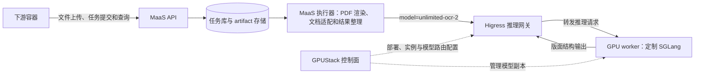

# Unlimited-OCR-2 检查、试点与发布计划

2026-11-16 · 状态：**M1及M2受控试点交付完成；中文场景质量失败保留，经用户明确豁免发布阻断后完成容量、恢复/回退与受控开放。** 最终试点1/1，通过Higress完成单页、2/10/11页及无在途实例替换；旧OCR回归、鉴权及独立CPU失败计数通过。详见[M1报告](../../results/unlimited-ocr-2/20261116-m1/REPORT.md)。原All models权限保留，服务端固定处理器并拒绝流式请求。历史UOCR2-INC-008两次处理及[停止检查点](../../results/unlimited-ocr-2/20261116-uocr2-inc-008-stop/REPORT.md)保留，本轮未进行第三次EnvoyFilter禁重试；SSE断连问题仍未修复。

主跟踪：[E10 / Issue #11](https://github.com/WTaoGitHub/cybercafe-maas/issues/11)。容量联动关联 [#60](https://github.com/WTaoGitHub/cybercafe-maas/issues/60)，部署与副本策略关联 [#39](https://github.com/WTaoGitHub/cybercafe-maas/issues/39)，文件契约沿用[文件能力计划](ARTIFACT-EVOLUTION-PLAN.md)，计量沿用 [E16](OCR-METERING.md)。不重复创建 OCR 选型 Issue。

执行故障统一使用 `UOCR2-INC-三位序号`，与增强项E10分别编号；旧编号映射及各项结论见[故障登记](UNLIMITED-OCR-2-INCIDENTS.md)。更名不重置处理次数或停止状态。

## 1. 交付目标与执行顺序

分两个里程碑交付，逐关取得证据，不把方案可行性当作已部署。

- **M1：GPUStack 模型服务试点。** 固定模型和定制 SGLang 环境，在独立 GPU 容量上运行，通过 Higress 鉴权路由完成真实单页、多页解析。交付可复现镜像、自定义后端定义、客户端示例及容量报告。此时尚未支持 MaaS PDF 任务。
- **M2：MaaS 文档异步服务。** 新逻辑模型、文档适配器、PDF 文件处理、结果与计量通过验收，从实际下游容器完成上传、建任务、查询、下载；具备受控发布和回退条件。

首轮选择 BF16、单 worker、单 GPU、单副本、一个在执行文档。量化、跨 worker 张量并行、自动扩副本和对下游提供 SSE 不列为首轮交付。多页文档作为一个请求送入模型，避免逐页独立推理丢失跨页能力。

M1 接续验收发现原始 SSE 断连残留跨窗口 KV。主代理第1次候选清理修复未通过真实请求验证，第2次处理按上述范围将服务端限定为 `stream=false`、完整 JSON 响应；正常请求、流式拒绝、客户端超时后资源收敛及不同文档隔离已通过。此项不宣称 SSE 问题已修复，不提供立即取消计算承诺。

执行顺序：`P0 现场预检 → P1 固定运行环境 → P2 独立 GPU 推理 → P3 GPUStack/Higress（M1）→ P4 MaaS 隔离实现 → P5 容量与下游验收 → P6 受控发布（M2）`。

首次制定本计划时仅授权文档与 Issue 更新；随后用户授权 GPT-6.1 Terra Light 子代理实施，并明确每项故障由子代理先处理一次、主代理最多两次，未解决停止。镜像供应及旧重试覆盖均保留当时停止记录；用户后续另行授权接续至M1，最终构建、部署及限定契约验收见M1报告。故障处理规则和下述生产隔离、VM约束继续有效，随后用户明确授权推进P4–P6交付M2，要求主代理直接执行并优先复用现有异步API；SSE仍不在本轮修复范围。

## 2. 架构与名称

| 对象 | 建议名称 | 说明 |
| --- | --- | --- |
| MaaS 逻辑模型 | `document.unlimited-ocr-2` | 新增，供业务授权、任务、能力查询与计量使用 |
| MaaS driver | `gpustack.document_ocr` | 待实现的标识；当前 registry 不接受它 |
| GPUStack 自定义后端 | `Unlimited-OCR-2-SGLang-custom` | 独立版本，不覆盖普通 SGLang 后端 |
| GPUStack 部署及 Higress 模型路由 | `unlimited-ocr-2` | 由 GPUStack 管理配置，Higress 执行转发 |
| SGLang served model | 使用 GPUStack 的 `{{model_name}}` | 防止路由名和引擎模型名不一致 |

这是一条推理流量链路，不额外增加一个“GPUStack 转发网关”。路由与后端映射的实际同步方式、端口和鉴权行为由 P0/P3 读取当前版本核对。

`ocr.default → maas-ocr` 的已有关联继续保留。不能将新模型套入旧 `gpustack.ocr` driver，不能直接复用旧模型的 2 GiB 显存声明，也不因模型名称类似而自动授予已有 Key 新模型权限。

## 3. 已有证据、限制与待核对项

| 项目 | 目前依据 | 本计划如何处理 |
| --- | --- | --- |
| SGLang 环境 | 官方模型配方使用专用 dev13 wheel；前次已检查 wheel 元数据 | P1 重新取得固定 revision、SHA-256 和依赖锁，执行安装及内核验证 |
| 依赖版本 | 前次元数据：torch 2.13.0、transformers 5.12.1、tokenizers 0.22.2、cuda-python ≥13.0、FlashInfer cu13 0.6.18、sglang-kernel 0.4.7；另声明 torchaudio 2.11.0 | 不是已通过的依赖组合；特别检查 torch/torchaudio 二进制关系，不混装 Transformers 快速测试配方 |
| GPU 容量 | 前次参数统计约 3.344B BF16，权重约 6.23 GiB；另发现官方仓库社区报告 12GB SGLang 长文档与 16GB Transformers 单页成功，详见下节 | 16GB 单副本低并发有可行性依据；初始化修复、配置差异及本机容量仍须复核，不能只按权重大小判断 |
| GPUStack | 仓库既有基线 v2.2.3，支持自定义容器后端 | 当前运行版本、插件、runtime 和路由配置仍须现场核对 |
| 文档输出 | 官方输出是版面标记文本，另提供 Markdown 后处理 | 保留原始输出，检查页关联、表格合并和 Markdown 图片引用完整性 |
| MaaS 接入 | 当前仅注册 `gpustack.ocr` 等已有 driver；PDF MIME 未开放 | 新 driver/schema 与受限 PDF 上传均需实现，不能靠 octet-stream 绕过 |
| 执行与计量 | 执行器只为旧 OCR driver 写成功 OCR 收据；usage 查询只有 images/tokens | 页级收据、查询及唯一提交需一起扩展，不把每份 PDF 算成一张图片 |
| 故障影响范围 | 现有准入/派发遇未知后端活动会全局阻断 | 初期使用独立试点任务库、artifact 根目录和执行器；共享生产任务库前单独评估此影响 |

代码核对位置：[driver registry](../../maas_platform/adapters.py)、[OCR schema](../../maas_platform/ocr_connector.py)、[任务与后端活动](../../maas_platform/service.py)、[执行器](../../maas_platform/worker.py)、[计量](../../maas_platform/metering.py)、[同步限制](../../maas_platform/sync_ingress.py)。这些是本地源码证据，不代表已核对现场部署字节。

### 3.1 显存资料补充与证据等级（2026-11-16）

官方资料有显存相关说明，但未给出适用于所有运行方式的 16GB 最低配置保证。此前仅写“16GB 待实测”遗漏了以下可行性证据，应按来源和条件分别使用：

| 来源 | 报告内容 | 适用边界 |
| --- | --- | --- |
| [官方模型卡](https://huggingface.co/baidu/Unlimited-OCR-2) | Transformers 示例注明在 A800-80GB 上测试；SGLang 部分说明内存参数与窗口取舍 | 80GB 是列出的测试环境，不是公布的最低显存要求 |
| [官方论文 §5.3.1 / Table 4](https://arxiv.org/html/2610.39308v1#S5.SS3.SSS1) | 百页基准中，单序列峰值 KV cache 从 47.00GB 降至 1.77GB | 是 KV cache 测量，不是引擎总显存；不能直接拿 1.77GB 作为 GPU 需求 |
| [官方仓库社区 Issue #116](https://github.com/baidu/Unlimited-OCR/issues/116)及[作者补充](https://github.com/baidu/Unlimited-OCR/issues/116#issuecomment-6885407712) | RTX 3060 12GB、dev13 wheel（模型 revision 0480966）、torch 2.13.0+cu130、CUDA 13.0、驱动 580；修复后报告 98 页文档成功，采用 gundam 与 3 页窗口，decode graph 开启。后续补充报告加载约 6.38GB、峰值约 10.1GB | 社区原始报告，不是官方最低配置承诺或本项目复现；按报告原单位 GB 保留，不当作精确 GiB 或可用余量 |
| [官方仓库社区 Issue #117](https://github.com/baidu/Unlimited-OCR/issues/117) | RTX 5060 Ti 16GB，Transformers 路径下整页推理成功 | 支持 16GB 单页可运行的判断，但不能代替 SGLang 多页容量验收；该 Issue 同时报告外部区域裁剪导致空文本 |

#116 指出的额外风险在**模型构造阶段**：父类先建立 v1 language tower，构造 v2 tower 时旧对象尚未释放，可能出现重复占用。作者最初只加 `del self.model`，随后发现循环引用使该修复不稳定，补充 `gc.collect()` 后重新报告结果。截至本次核对该 Issue 仍 Open；没有在本项目验证补丁，也未据此修改运行镜像。

据此，试点优先评估现有 16GB GPU，先确认初始化问题和低内存配置，再测目标页数与并发。若一次启动 OOM，先区分构造峰值、运行峰值及其他业务占用，不立即推断“16GB 无法运行”。

以上为调研时快照；后续初始化补丁、多次加载和16GB固定配置实测已经完成，详见[P2](../../results/unlimited-ocr-2/20261116-p2/REPORT.md)与[M1](../../results/unlimited-ocr-2/20261116-m1/REPORT.md)。仍未验证业务质量、冷缓存完整峰值或多文档并发。

## 4. P0：现场只读预检与试点范围冻结

### 操作清单

- [ ] 从私有配置读取当前跳板机入口及新 PC 路径；公网映射会变化，执行前重新确认，不写进脚本、报告或 Issue。口令仅从本地受控文件读取，不回显。
- [ ] 识别新 PC、GPUStack Server、embedded Higress、MaaS API/执行器、registry 和实际下游容器；登记运行版本、镜像 digest、源码版本及回退点。
- [ ] 读取集群/部署/路由/实例及调节器授权范围，确认原 `ocr.default` 对应的服务和容量。记录 Ready 与可路由状态，不沿用历史 worker ID 或副本数。
- [ ] 按 GPU UUID 核对试点 worker 的 name/external_id、显卡型号、显存、compute capability、驱动、可用 CUDA runtime、Docker GPU runtime、CPU/RAM、磁盘、模型存储和 `/dev/shm`。`nvidia-smi` 显示的 CUDA 上限不等于容器实际库版本。
- [ ] 核对 worker 到私有 registry 的 TLS/拉取能力、控制端到模型端口的既有访问边界；不向下游暴露 worker 直连端口。
- [ ] 选择与正式 OCR 隔离的 GPU、模型目录和容器。若只能共享同一卡，先给出显存/CPU/RAM/磁盘预算及影响范围，在执行窗口前不安排并跑；不停止现有业务换取容量。
- [ ] 备份试点将修改的配置，保存模型/路由/后端、策略及权限的只读快照，脱敏报告与私有原始证据分开。

**通过门槛：** 目标身份与配置一致，有明确的隔离容量、驱动兼容候选、磁盘/RAM 预算及回退材料。没有适用 GPU 时停在“等待容量”；驱动不满足时转独立合适环境，不将升级驱动、重启 VM 当作现场补救。

**产物：** 环境清单、试点范围与资源预算、阻塞列表。P0 不安装软件，不修改副本或运行推理。

## 5. P1：固定模型、wheel 与容器构建

- [ ] 固定 ModelScope 或 HF 的模型 revision；核对配置、tokenizer、权重分片、模型代码、许可证及文件哈希。若两端混用，逐文件证明兼容，不能只因仓库名称相近即混合。
- [ ] 固定官方代码、后处理代码和定制 wheel。当前候选为 `sglang-0.5.20.dev13+g75b9b06b02-py3-none-any.whl`；上游更新时显式评审，不自动漂移到新版本。
- [ ] 使用匹配依赖与驱动的 CUDA 基础镜像，锁定 Python 和所有依赖，检查 `pip check`、torch/CUDA/FlashInfer/自定义算子可导入。记录 torch/torchaudio 等解析冲突；不通过 `--no-deps` 静默绕过冲突。
- [ ] 在独立 Linux 构建环境构建镜像；目标 GPU 上才进行 CUDA 运算核验。Mac 构建或 import 成功不能证明 NVIDIA kernel 可运行。
- [ ] 将运行依赖固化进镜像，模型只读、缓存/临时输出可写；首次 worker 启动不做在线 pip 安装。按当前存储机制选择显式模型挂载或经验证的镜像内模型布局，记录下载与缓存去向。
- [ ] 从固定 wheel 的 `--help` 和代码确认启动参数及默认值，特别是 chat template、custom logit processor、streaming session、radix cache 和图像预处理；编制实际完整命令和环境变量清单。
- [ ] 按上游 #116 核对该 wheel 是否仍会重复构造 language tower，及循环引用是否及时释放；若需修补，仅在候选镜像保存可审查 diff、原 wheel/补丁哈希与独立版本，验证多次进程启动、权重加载和输出回归。不能只抄 `del self.model` 或只调低 KV 比例掩盖构造峰值。
- [ ] 初期限制一个在执行请求；CUDA graph 先采取该 wheel 支持的低内存配置或关闭，再与开启配置对照。显存分配比例、prefill、页窗口、输出预算按 GPU 预算冻结，不直接照搬官方 64 并发配置。
- [ ] 将镜像推入已有受控 registry，固定 digest 并核对 worker 拉取结果。不把口令、访问 token、SSH 私钥或正式业务图片加入镜像。

基础镜像供应已在独立步骤验证：[CUDA 基础镜像报告](../../results/unlimited-ocr-2/20261116-base-image/REPORT.md)。后续使用新 PC registry 的 `maas/base-cuda@sha256:00fde7d4b087eb46c66aecebba22543c978f9071fbd0270a7a4c54d7da756dcb`，authority 从受控配置取得。离线包重建后仓库 manifest 与上游 digest 不同，config/image ID 相同；不能混用两个 digest。最终服务镜像仍须独立构建、发布和验收。

**通过门槛：** 依赖可解、检查通过，固定 wheel 识别模型架构和参数，镜像与模型摘要可复现。CUDA kernel 支持在 P2 取得实测后才确认；若失败，先保存日志定位，不在生产环境不停尝试换包。

**产物：** Dockerfile、锁定依赖/模型清单、构建说明、后端模板及未验证项。模板明确标注未部署；镜像体积、拉取和构建空间预算一起交付。

启动配置至少逐项核对以下专用开关，具体值在 P2 以目标 GPU 实测冻结：

| 配置 | 检查重点 |
| --- | --- |
| `--chat-template unlimited-ocr`、`--enable-custom-logit-processor` | 与固定客户端的请求构造一致；processor 来自同版 wheel |
| `--enable-streaming-session`、`--disable-radix-cache` | 保留专用调度要求，验证是否实际产生跨 HTTP 请求的会话 |
| `SGLANG_UOCR_EANABLE_DOC_LIMIT` | 按官方拼写核对，不擅自改为 ENABLE；决定窗口模式 |
| `SGLANG_UOCR_DOC_GUNDAM_PAGE_WINDOW`、`SGLANG_UOCR_DOC_BASE_PAGE_WINDOW` | 两种图像模式分别核对；小显存先验证社区报告的 3 页窗口，再与官方 10 页窗口候选对照，分别记录质量与峰值 |
| `SGLANG_UOCR_MAX_PAGE_TOKENS`、请求的 `max_tokens` | 页级与整文档预算分别限制；核对截断检测和页结束行为 |
| `SGLANG_UOCR_SHM_WRAP_MODEL_DATA`、`SGLANG_UOCR_SHM_WRAP_MIN_MB` | 同时验证真实容器共享内存与 RAM 预算，不只设置变量 |
| `SGLANG_OPT_UOCR_SAM_REL_POS_BIAS_MB`、prefill 与 CUDA graph 参数 | 先采用低峰值配置，实际支持的参数以固定 wheel 为准 |

页标记与结束 token ID 从同版模型配置核对，不把历史示例中的 ID 当作永远不变的常量。

## 6. P2：独立 GPU 上验证引擎

只在已选隔离容量中启动候选引擎，使用测试图片和文档。PDF 渲染在有资源约束的客户端/执行器内进行，暂不要求新 PC 控制端承担渲染。

| 顺序 | 检查与执行 | 必须取得的证据 |
| --- | --- | --- |
| 1 | 单副本启动、健康检查、模型枚举，执行一次真实图片解析 | GPU 实际可见、权重加载成功、CUDA 推理成功、原始响应有效；健康 200 单独不足 |
| 2 | 中英单页、空白页、旋转/密集文字、表格与公式 | 文本与结构正确性，空白页不丢页；不要求生成旧 OCR 的置信度字段 |
| 3 | 2 页、10 页、11 页跨窗口文档 | 输入顺序、输出页数和页关联、跨页段落/表格，是否出现重复或截断 |
| 4 | 在预算允许时试验 30/100 页 | 标记为实验能力，不自动扩大首版公开限额；逐档证明内存/显存与时限可控 |
| 5 | `crop_mode`、DPI、页窗口与图捕获对照 | 质量和峰值开销的取舍；参数更改保留独立版本，不拼接不同配置的最好成绩 |
| 6 | 串行多份独立文档、长短请求交错 | 无跨请求内容/会话泄漏，临时文件和共享内存释放，显存与宿主内存无持续增长 |

固定客户端按官方专用协议构造多图片请求和页标记，处理输出预算、页级终止及重复片段；自定义 logit processor 由受信服务固定生成，不让普通下游提交任意序列化处理器。验证 `finish_reason` 和文档完整性，HTTP 200 或读到 SSE 结束不自动代表所有页解析完成。

记录冷启动与同内容热启动：镜像、权重是否命中分别举证；不清理正式服务共享缓存、不启动第二 Docker daemon，不把新 tag 当成无缓存。无法提供独立冷环境时该项保留未验。

**通过门槛：** 至少单页、2 页、10 页、11 页真实样本通过，解析质量达到预先冻结标准，显存/RAM 留有预算余量。若 16 GiB 在单请求或目标页数下不稳定，则降低试点范围或换合适 GPU；不承诺“无限页数/恒定总资源”。

**产物：** 固定样本清单、原始输出、后处理对照、性能与资源曲线、失败边界和单副本参数。原始业务文档仅私有保存。

## 7. P3：GPUStack 管理与 Higress 路由（M1）

先准备独立后端和零副本部署，记录实际ID，不能写死历史集群或部署ID。用户已将既有下游Key设为All models，不得为试点再次收窄它；新路由进入该用户可见范围后，按All models预期验收。发布前须在服务端固定或限制原始SGLang处理器反序列化，不能只用客户端固定值或旧Key模型范围作为安全边界。

### 发布清单

- [x] 当前GPUStack schema及实际创建验证独立后端名、版本、镜像digest、framework、健康路径、entrypoint和参数。
- [x] 资源守卫在实际cgroup限额确认后exec `python -m sglang.launch_server`，参数使用GPUStack占位符。原生限额/无人值守恢复仍未闭环。
- [x] 实际容器参数、环境、GPU可见性、只读模型挂载和4 GiB shm核对通过。
- [x] 使用12 GiB调度claim；M1观测GPU最大10816 MiB，不是精确初始化峰值或硬限额，只运行单个模型副本。
- [x] 零副本准备后受控激活，独立调节范围，未停止正式OCR的调节器。
- [x] Higress实际目标、匿名/错误Key/无scope拒绝及原All models允许均通过。
- [x] JSON单/多页、专用参数和模型名透传通过，同协议直连/网关双页逐字节一致；服务端拒绝流式请求。
- [x] 记录route/per-try timeout为0；通过部分响应断连、短客户端期限和真实文档资源收敛测试，不盲目重放。SSE idle、任意大请求/响应边界及服务端有限总期限未验证或未提供，进入后续发布能力范围，不能从当前固定样本外推。
- [x] 复用P0契约，并用独立CPU后端实测相同路由策略：正常1次，持续502/503及响应头前断连3次，部分响应和短客户端超时1次。只发送一次业务请求，不承诺GPU恰好一次；新文档任务的唯一收据/UNKNOWN自动处置属于M2，M1以人工核实和暂停派发执行该边界。
- [x] 正常无活动实例替换、旧后端移除、新目标健康及再次真实JSON通过；未操作VM、Docker引擎或worker进程。

**通过门槛：** 单副本 Running、实际 GPU 推理、Higress 路由与鉴权、参数/输出透传、无在途时的实例替换均通过；原 `ocr.default` 基线回归通过。若模型的窗口调度仅为单次请求内行为，记录证据；只有确需多个 HTTP 请求复用同一 session 时才设计副本亲和与失效处理。未证明前不扩至多副本。

**M1 交付：** 可复现模型服务、后端与路由定义、固定请求生成器、无密钥的 curl 用法、兼容性和资源报告。GPUStack Playground 不作为专用请求契约的唯一验收入口。

## 8. P4：MaaS 文档适配与隔离联调

### 8.1 首版契约

首版优先一个 PDF artifact 对应一个异步任务，继续使用现有 artifact 和 tasks 公共路径。单图接入可复用新 driver；多张独立图片的公共批量提交后置，避免首版绕过多输入引用与 GC 保护设计。

- 新逻辑模型为 `document.unlimited-ocr-2`，建议 driver 为 `gpustack.document_ocr`，代码、能力登记、许可、版本指纹和 OpenAPI 一起交付。
- 输入引用同 project 的 artifact；明确开启 `application/pdf` 的格式验证和上传路径。PNG/JPEG 沿用现有限额。拒绝损坏、加密/需密码、超页数和资源超预算 PDF，不接受伪装成 octet-stream 的绕过方式。
- 初始试点预算：PDF 不超过 10 MiB、公开页数最多 10 页、默认 150 DPI、最高 300 DPI、每页不超过 10MP、总渲染不超过 50MP；超过任一预算明确拒绝，不静默丢页或缩放。以上是待 P2/P5 校准的计划上限，不代表已支持，不提高旧图片的 10 MiB/20MP 限额。
- 渲染、图像编码、SGLang 传输与响应解析都计入资源和任务时间预算。逐页有界处理与及时清理；即使逐页渲染，发送前仍须评估整份文档 base64/JSON/多图片张量峰值，不能将“逐页”当作恒定内存保证。
- 初始候选：模型执行预算 600 秒，任务总期限 900 秒（含排队），`max_attempts=1`。根据 P2 证据在首次联调前冻结；不得只改同步超时绕过现有保护。单独核对各代理、客户端、lease/心跳、取消轮询和进程停止预算。
- 结果为有 schema 版本的 JSON：记录模型 revision、处理参数、页码、页尺寸、真实支持的版面块、原始标记输出及 Markdown/文件引用。坐标单位与映射必须明确，不凭空补行级置信度。Markdown 产生图片链接时，实际生成并登记裁剪图或关闭该输出能力，不能交付悬空路径。
- 首版仅在所有请求页完整通过解析后成功；不新增“部分成功”任务状态。失败诊断保留已完成范围供定位，不作为最终成功计量；模型截断不能伪装完整成功。部分成功业务规则及金额计算留给后续独立需求。

### 8.2 实现工作包

| 工作包 | 实现范围 | 适当验证 |
| --- | --- | --- |
| W1 文件与渲染 | PDF MIME/真实格式、页数/像素/RAM/CPU/磁盘/时间预算、临时文件与清理 | 合法、伪造、损坏、加密、超预算、取消和异常退出；保留图片旧契约 |
| W2 文档 driver | 输入/参数 schema、可信请求构造、固定 processor、引擎输出与后处理、版本指纹 | 固定样本、页关联/截断/缺页、错误响应、流断连；不加载外部任意处理器 |
| W3 生命周期 | 新 driver 显式 `replay_safe=False`，backend_activity、长执行心跳、取消/超时、result artifact 和全部派生文件关联 | 发送前/发送后失败分别验证；取消不等于远端已终止；未确认完成维持隔离且不自动重放 |
| W4 计量 | 新增真实 `successful_pages` 收据与查询，旧 images/tokens 查询兼容 | 任务成功、结果关联和唯一收据原子提交；重复查询、幂等提交不重复计量；内部渲染/裁切不重复算页 |
| W5 API/授权/文档 | catalog、模型权限、能力查询、OpenAPI、示例及拒绝行为 | 新旧 Key 授权范围、project 隔离、任务/结果下载、旧 OCR 回归 |

首版 token 数仅使用可核验的上游报告；若窗口/会话的 token 汇总语义未验证，返回不可用及原因，不能用字符估算，也不能套用旧模型的“一张图”收据。

先使用独立试点任务库、artifact 根目录、Key 与执行器；模拟依赖故障及真实断连仅在此环境执行。新 driver 的后端活动跟踪和计量必须接入公共执行闭环，不能只在结果 JSON 中写一个页数就宣称计量完成。

**通过门槛：** W1–W5 及旧图片 OCR 回归通过；同一任务最多一条最终成功收据；异常恢复不重放未知推理；派生文件的 project 权限、配额、TTL、GC 和引用完整性通过。

## 9. P5：容量、质量与真实下游验收

### 质量与性能

开测前冻结版本、样本与标注、质量容差、P95 上限、GPU/RAM/磁盘余量，以及遇 OOM 或错误后的停止条件。没有冻结数值时只可做功能探针，不运行容量压测。

- 对中英扫描、原生 PDF、密集页、表格、公式、跨页内容和空白页分别统计；保留未参与调参的业务留出集。
- 质量指标至少包括文字 CER/漏字、页数与页序、阅读顺序、表格/跨页合并正确性。普通图片与原 `ocr.default` 比较，文档指标单列，不混成一个“准确率”。
- 从并发 1 开始，稳定后测试 2、4；每档先预热，再对相同样本交错跑至少三轮。出现 OOM、持续内存增长、截断、异常升高或资源预算不足，停止加压并保留失败档证据。
- 记录合格页/秒、合格文档/小时、P50/P95、排队时间、首输出与总耗时、失败/截断率、显存峰值及宿主 RAM/CPU/磁盘/共享内存；冷/热启动分开。
- 单 GPU 预算包含现有业务及下载/初始化峰值。副本数、在执行文档数、HTTP 并发和 token batch 不混为同一容量。

### 容量联动

M1/M2 首轮可使用已验证的固定单副本、单文档上限，动态并发能力不作为首次功能验证的必需前置。扩容前接入 #60：按实际健康且可路由的副本及其经过验证的单副本容量计算预算，同步与异步共享，继续受全局/项目预算约束；别名共享同一池，陈旧容量保守处理。

副本调节器 #39 控制模型实例数量，#60 控制请求执行并发，SGLang 控制副本内部调度；三个层次分别配置。新增模型只有显式纳入调节器授权后才能自动调节，不擅自切换正式 OCR 的策略。

多副本阶段再验证分发、session 亲和（若需要）、实例退出与在途文档、容量下降后只限制新派发、共享 GPU 下的公平性及短 OCR 延迟。MaaS 当前全局 UNKNOWN 可能阻断旧模型；必须在隔离联调证明恢复流程，生产共库前记录影响范围及所选隔离/发布方案，不能声称“新模型名意味着故障隔离”。

### 下游端到端

从执行时实际存在的 `kc-e2e-aliyun-slave3-server` 容器确认网络、工具与凭据来源，再执行：上传 PDF → 以新逻辑模型建任务 → 持续查询 → 下载结果及派生产物 → 查询页级收据。核对内容、页码、权限及唯一计量，不只验收 HTTP 202。

交付可在该容器执行的 curl/请求文件、预期响应、成功 task ID 和版本。Key 通过已有受控文件或环境变量引用；新模型需要显式许可，既有 Key 是否新增许可由发布配置决定，不复制旧环境 Key 或打印密钥。实际下游业务流程与前端展示由下游团队联调验收。

**通过门槛：** 目标样本、限额与并发档满足冻结门槛，下游完整链路成功，旧 OCR 质量/延迟与鉴权回归通过，异常实验只影响试点，未完成项列入交付限制。

## 10. P6：受控发布、观测与回退（M2）

### 发布前

- [x] 汇总 M1/M2 证据和实际支持范围，选定首版页数、DPI、超时、并发、显存与宿主内存预算。
- [x] 确认发布版本、镜像 digest、模型/后处理哈希、DB 迁移、catalog/bindings、Higress 路由及调节器授权范围，备份且校验恢复材料。
- [x] 以实现得到的机制限制新文档入口，确认旧任务和未知活动可追踪；不能以现有全局 pause 冒充单模型暂停或提交拦截。
- [x] 初始只授权试点项目和单副本，功能探针通过后按已约定的观察窗口逐步开放；不自动把 `ocr.default` 流量切入新模型。

### 观察项

网关成功/拒绝/超时、实际模型后端、文档排队与执行时长、页数/截断、GPU/RAM/磁盘/共享内存、失败与 UNKNOWN、收据一致性，以及旧 OCR 的 P95/成功率。日志保留 task/request/model revision 关联，不落真实 Key 或整份文档正文。

### 回退顺序

1. 先阻止新文档提交与新派发，保留已有任务查询和结果下载。若尚无单模型控制，使用预先验证的试点入口提交拦截/独立实例隔离方案，不临时全局停机影响旧 OCR；不要直接撤销仍供查询下载的 Key。
2. 核对排队、在途、session 和后端活动。结果不明时保持隔离，人工读取引擎/网关证据；不重新提交同一文档，也不自动解除 UNKNOWN。
3. 确认试点可排空后停止新副本；恢复对应镜像、后端、路由和 catalog 版本。变更后的模型配置指纹与旧任务兼容性先检查，不改写历史 revision 或任务归属。
4. 保留输入、结果、计量及关联文件，按兼容方案回退代码；不要为回退删除历史任务、降级破坏性 DB schema 或清理正式共享缓存。
5. 核对旧 `ocr.default`、鉴权、队列、监控和数据一致性，再报告恢复。新模型的重试发布是新的操作，不将失败实验改写为通过。

## 11. 统一停止条件与运行约束

- P0/P1 失败、资源不足、模型不识别、kernel 不支持、单请求 OOM、路由错误、鉴权绕过、缺页/输出截断、无唯一计量证据时，不进入下一关。
- 故障注入、进程停止、冷缓存和多副本恢复试验均在隔离范围；不制造生产 UNKNOWN，不将客户端断连当作取消完成，也不盲目重放。
- 永久遵守 XZ-31-001、XZ-31-002 禁止 VM 重启及等效操作的约束；本计划不安排重启任何现有 VM、Docker 引擎或还原系统镜像。
- worker 默认沿用 GPU UUID 作为 name/external_id、MaaS 自动预登记/发证/接续；母版保护保留。不得安装或部署旧 `maas-gpustack-worker-retirement` 插件，不以模型试点为由改动注册机制。
- 本计划不新增公网推理监听，不恢复自建 collector，不在 Git/Issue 中发布连接信息、凭据、业务文档或私有原始日志。

## 12. 提交、证据与接续

每个独立实现工作包适当验证后单独提交并立即 push，只包含已审查改动；不将本地无关文件带入提交。报告记录真实已运行的检查及未验边界，不能将文档校验、健康 200、接口受理或单次成功写成容量验收。

后续建议证据目录为 `results/unlimited-ocr-2/<日期-阶段>/`，仅提交脱敏报告和最小机器证据；私有材料保存在受控目录。每关交付包含：源码提交、模型/wheel/镜像哈希、目标角色与范围、完整生效配置、样本与请求摘要、预期/实际结果、资源峰值、失败记录、回退点及下一步。

| 阶段 | 当前状态 | 下一项 |
| --- | --- | --- |
| 计划与源码差距核对 | 已形成文档；不是运行验收 | 由 Git 提交和 #11 更新记录发布状态 |
| P0 现场预检 | [只读快照](../../results/unlimited-ocr-2/20261116-p0/REPORT.md)及本轮fresh复核完成，实例替换见M1；未做VM重启或独立冷环境恢复 | 后续接续重新核验现场，不外推持久性 |
| P1 / M1 准备 | 最终固定镜像已发布并经worker reader拉取，CUDA/Triton及实际模型加载通过 | 后续镜像/配置变更须重新核验 |
| P2–P3 / M1 | [受控JSON试点验收完成](../../results/unlimited-ocr-2/20261116-m1/REPORT.md)，保留1/1及新路由；临时探针/负向Key清理，原All models保留 | M1保持固定JSON模型服务；SSE不支持，M2独立接入见下行 |
| P4–P6 / M2 | 用户豁免中文质量阻断后[受控交付完成](../../results/unlimited-ocr-2/20261116-m2-release/REPORT.md)：容量24任务/38页，恢复与回退、180秒开放观察及registry reader验证通过 | 独立文档入口开放、执行预算1；历史与本轮累计45任务/91页唯一计量，中文质量失败及未验边界保留 |

本轮按用户后续授权推进M2；主代理直接执行，不再使用子代理。用户已指定使用仓库现有evaluation样本完成试点。接续先核对现场；不重放未知推理，不进行第三次SSE修复，不把旧阶段证据当作新配置已验证。

## 官方依据

- [ModelScope 模型入口](https://www.modelscope.cn/models/PaddlePaddle/Unlimited-OCR-2)。
- [官方模型卡](https://huggingface.co/baidu/Unlimited-OCR-2)及[定制 wheel 目录](https://huggingface.co/baidu/Unlimited-OCR-2/tree/main/wheel)。依赖元数据来自此前对 wheel 实物的读取，P1 仍须固定内容并复核。
- [官方 SGLang 配方](https://github.com/baidu/Unlimited-OCR#sglang)：作为运行配置的来源，不能以普通镜像模板替代专用配方。
- [官方后处理说明](https://github.com/baidu/Unlimited-OCR/blob/main/utils/README.md)：版面标记输出、跨页合并与 Markdown 转换；生成图片引用不等于已生成对应图片文件。
- [GPUStack v2.2.3 后端管理](https://github.com/gpustack/gpustack/blob/v2.2.3/docs/user-guide/inference-backend-management.md)及[自定义后端教程](https://github.com/gpustack/gpustack/blob/v2.2.3/docs/tutorials/using-custom-backends.md)：作为已有版本配置路径的依据，不代表新模型已通过兼容验证。

历史M2停止点：`UOCR2-INC-019` 主代理两次处理额度已用完，不继续第三次处理或自动恢复发布。8个evaluation样本和质量门槛已在GPU试验前冻结；当时业务留出集、容量及恢复演练未完成。后续接续保留失败成绩、原成功任务与页收据，不通过换样本或放宽门槛改写本次结论。

2026-11-16续行授权与交付：用户要求忽略中文场景质量未达标的阻断，未授权第三次质量修复。保留原停止点及UOCR2-INC-019额度，按[续行验收范围](../../results/unlimited-ocr-2/20261116-m2-release/acceptance.json)完成P5/P6；受控M2已开放，容量执行仍固定1，不提高GPU执行并发、不切换旧OCR入口。独立恢复、排队接续、持久探针及原生curl交付已通过；业务留出集、长期容量、真实跨页表格专项和无人值守GPU恢复仍未认证。
