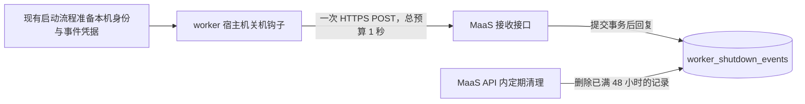

# worker 关机事件：设计与开发实施方案

2026-11-18 · **设计已制定，开发与部署未开始** · [Issue #2](https://github.com/WTaoGitHub/cybercafe-maas/issues/2)

## 1. 范围与完成标准

本模块只有三项职责：worker VPC 关机时发送一次事件，MaaS 保存事件，MaaS 删除超过 48 小时的事件。客户端通知新增的等待预算最多 1 秒，失败或超时照常关机，不重试。每次关机生成一个新事件 ID；同一 VPC 相隔 8 小时的两次关机保存为两条记录，各自保留 48 小时。

事件不改变 worker/模型副本状态，不参与注册接续、恢复、路由、排空或容量决策。VPC 重新开机后，旧事件只是待到期删除的历史。事件查询页面、公开查询 API、事件消费框架和消息队列均不在本次范围。

完成标准为：认证来源的一次事件能持久入库；发送端在故障场景下按预算结束；未到期记录保留、到期记录自动删除；上述过程不写入其他模块数据。设计审核、代码测试、隔离环境验证与正式部署分别记录，不能互相代替。

## 2. 复用现有代码与落点

| 已有能力 | 本次复用方式 |
|---|---|
| `maas_platform/api.py`、`db.py`、数字编号 SQL 迁移 | 在现有 MaaS API 内增加专用 POST 路由和一张事件表，沿用事务与迁移校验 |
| `maas_platform/limits.py`、`errors.py` | 为该路径增加 4 KiB 请求限制，复用结构化错误与请求 ID |
| `maas_bootstrap/enrollment.py`、`handoff.py`、`worker.py` | 在现有启动响应中附加事件上报凭据；启动时准备本机通知配置，关机时直接使用 |
| `maas_bootstrap/client.py` 的私有文件、HTTPS 和原子写入规则 | 复用不跟随重定向、不读取代理环境、TLS 校验和 0600 文件约束 |
| `prepare_worker_image.py`、worker bundle 构建/校验脚本 | 同步交付发送器与独立 systemd 单元，检查清单与镜像内容一致 |
| 现有 PostgreSQL、API 容器与 TLS 入口 | 增加接收和清理，不新增常驻服务或依赖包 |

现有业务 `AuthConnector.authenticate()` 会检查消费者绑定并请求 GPUStack，不能用作关机通知认证。现有执行器的周期清理服务于 artifact，且依赖执行器循环，不能作为事件保留期的唯一保障。



## 3. 消息与接收接口

拟定接口：`POST /maas/internal/worker-shutdown-events`。它是节点专用入口，使用 `Authorization: Bearer <节点事件凭据>`；不经过消费者推理鉴权，不向 GPUStack 发认证或实例查询请求。接收端校验、插入事务完成后返回 `201 Created`，不在回复前执行清理。

请求字段固定，未知字段拒绝；整数不接受布尔值，UUID、GPU UUID 与带时区时间按字段校验：

| 字段 | 类型与含义 |
|---|---|
| `event_id` | 本次发送新生成的 UUID v4，事件唯一标识 |
| `event_type` | 固定为 `worker.shutdown.requested`，表达预告而非已关机证明 |
| `cluster_id`、`worker_id` | 正整数，来自已有启动身份 |
| `gpu_uuid` | GPU UUID；与节点事件凭据的范围一致 |
| `boot_id`、`session_id` | 本次已有启动/接续 UUID，仅记录归属，不切换当前会话 |
| `occurred_at` | 客户端生成事件时的 RFC 3339 时间；只作描述，不控制保留期 |

示例使用虚构身份，时间统一序列化为 UTC：

```json
{
  "event_id": "658a8d5c-d85e-4d89-8f1b-ffbb5d4c82e6",
  "event_type": "worker.shutdown.requested",
  "cluster_id": 1,
  "worker_id": 42,
  "gpu_uuid": "GPU-aaaaaaaa-bbbb-cccc-dddd-eeeeeeeeeeee",
  "boot_id": "f591ba40-e440-4ede-9659-9ad92cdeba2b",
  "session_id": "ee15cb4c-0886-4ad7-a7ef-3802965d340e",
  "occurred_at": "2026-11-18T02:00:00Z"
}
```

成功回复只包含 `event_id`、`received_at`、`expires_at`。客户端不需要再次查询确认；等待超时后，服务端仍可能已经提交记录。

| HTTP 状态 | 语义 |
|---|---|
| 201 | 已提交事件记录 |
| 401 / 403 | 凭据无效 / 凭据与上报节点范围不符，不入库 |
| 404 | 未启用接收入口 |
| 409 | 相同 `event_id` 已存在，不覆盖旧记录或刷新到期时间 |
| 413 / 422 | 请求超过 4 KiB / 字段或 JSON 不合法，不入库 |
| 503 | 已配置模块暂不可用或存储未能确认提交；客户端仍不重试 |

数据库事件主键仅为 `event_id`，**不对 worker ID、GPU UUID、boot ID 或它们的组合加唯一约束**。例如同一 VPC 在服务端时间 T 和 T+8 小时收到的两次新事件，分别在 T+48 小时、T+56 小时到期。仅保留主键冲突处理，不增加幂等账本、按 VPC 去重或永久“见过的事件”集合。

## 4. 节点认证与启动时准备

采用专用于本模块的**带节点范围的签名凭据**，随现有启动响应下发；不在关机时申请凭据，不复用消费者 key、集群注册 token、批次共享引导码或发布签名私钥。范围签名只负责事件入口认证，不引入节点生命周期状态或额外登记表。

具体约定：

1. Bootstrap 服务与 MaaS 接收端各自只读装载同一份专用随机 32 字节 HMAC 密钥，按各服务 UID 配置私有文件权限；密钥不进入客户端、母版、Git 或日志。实现使用标准库 `hmac`/`hashlib`，比较使用 `compare_digest`。
2. Bootstrap 在现有许可核对完成后签发事件凭据，范围为精确的 `cluster_id/worker_id/gpu_uuid/boot_id/session_id`。凭据格式固定为 `mse1.<base64url范围JSON>.<base64url HMAC-SHA256>`；范围 JSON 使用 UTF-8、排序键和紧凑分隔符，base64url 去掉填充。签名输入为 `ASCII("maas-worker-shutdown-v1") + 0x00 + 范围JSON字节`；发行/验证用同一测试向量核对。接收端限制总长度为 1024 字节，先验证签名，再严格解析范围并与消息逐字段核对。
3. Bootstrap 的自动启动请求已有 `boot_id`；人工许可路径为新客户端兼容增加可选 `boot_id`。旧请求/响应继续可用，无事件配置或缺少该字段时不附加凭据；不改变原 worker 许可及注册校验。新字段放在独立可选 `shutdown_event_credential` 中，不混用原生 `registration_token`。
4. 客户端启动成功后，将已有身份、事件凭据及本地受信的 MaaS HTTPS 地址/证书路径原子写入 `state_dir/shutdown-event.json`，目录 0700、文件 0600；默认无盘目录位于 `/run`。通知 URL 只能来自本地受控配置，不能跟随响应重定向。模板只包含程序、公开信任材料和配置结构，不带任何节点凭据。
5. 48 小时是事件保留期，**不是凭据有效期**。凭据按签名密钥启用期间验证，限定只能报告所签的启动身份，支持节点连续开机超过 48 小时；迟到的旧启动事件可作为历史保存，不影响当前状态。密钥由运维明确轮换，不增加续期服务或自动轮换框架；轮换会使旧凭据失效，须纳入节点交付安排。
6. 未启用、无身份、缺少凭据或通知准备失败时，通知路径直接跳过/记录固定错误码，不能阻止原 worker 正常启动。发布验收必须检查试点的凭据准备实际成功，不能把“worker 注册成功”当成通知已启用。

存量节点补装时，由相同签发 helper 的私有运维入口读取已核对的现有绑定，向对应宿主机交付该范围凭据；只读核对本机 boot/session，不调用 enrollment/handoff 写接口、不换 worker 身份、不通过重启补齐。正常新启动仍使用原有 Bootstrap 响应交付，不新增公开发证接口。

本次安全边界是“验证谁有权上报哪些节点信息”，不是证明客户端真的已经断电。凭据继承现有 Bootstrap 授权的信任程度，不把共享批次授权提升表述为硬件身份认证。接收端不读取 GPUStack 当前健康状态，不把凭据当作旧进程已退出的证据。记录不包含 bearer、签名密钥、请求原始日志或真实连接配置。

首版只增加以下启用配置；1 秒、48 小时、60 秒周期和 500 条批量是固定值，不增加调节选项：

| 位置 | 配置 |
|---|---|
| MaaS API | 可选 `MAAS_SHUTDOWN_EVENT_KEY_FILE`，指向 0600 的专用密钥文件；内容为 64 个小写十六进制字符，解析为 32 字节 |
| Bootstrap 服务 | 可选 `MAAS_BOOTSTRAP_SHUTDOWN_EVENT_KEY_FILE`，由运维配置为相同密钥；不使用发布签名私钥 |
| worker 本地 Bootstrap JSON | 可选 `shutdown_events` 对象，含固定 `url` 及绝对路径 `tls_certificate_file`；只有 HTTPS、无用户信息/查询/片段，路径必须精确匹配接收端点 |
| worker 运行期 | `state_dir/shutdown-event.json`，只由准备流程/私有交付写入，包含本次绑定和凭据；不把它打入镜像或挂载给模型容器 |

## 5. worker 发送与正常关机识别

拟增加独立 `maas-worker-shutdown-notify.service`，启动时只进入 armed 状态，关机时运行发送器，不依赖推理 worker 是否正在运行。候选单元骨架如下，**本文件不安装或启用单元**：

```ini
[Unit]
Description=Send one bounded worker shutdown event
After=network.target docker.service

[Service]
Type=oneshot
RemainAfterExit=yes
Environment=PYTHONPATH=/opt/maas/lib
ExecStart=/usr/bin/true
ExecStop=-/usr/bin/python3 -m maas_bootstrap.shutdown_events
TimeoutStopSec=1s
TimeoutStopFailureMode=kill
KillMode=control-group
UMask=0077

[Install]
WantedBy=multi-user.target
```

`After=` 在停止时反向排序，因此通知要先于网络/Docker 停止；实际网络管理单元与依赖链需在目标 Ubuntu 只读核对及独立环境验证。不要给该单元加 `After=maas-worker-bootstrap.service`：现有 bootstrap 自身排在 `multi-user.target` 之后，而通知单元由该 target 拉起，可能构成启动顺序环。依据：[systemd 顺序规则](https://www.freedesktop.org/software/systemd/man/latest/systemd.unit.html#Before=)。

正常服务停止和重启也会执行 `ExecStop`，所以仅靠它不能认定整机关机。发送器先以不超过 100ms、且计入同一 1 秒总预算的本地查询，检查 systemd 作业中是否有 `poweroff.target` 或 `halt.target` 的 start 作业；候选使用 `systemctl list-jobs --plain --no-legend --no-pager`，固定 `LC_ALL=C`、不经 shell，严格识别 unit/type 列。没有对应作业、查询超时或不可读时跳过；首版不将 reboot/suspend、单个服务/容器停止解释为关机。该守卫须在独立 Ubuntu 关机事务中验证，若作业时序不成立，不准以删除守卫的方式发布。[作业接口依据](https://www.freedesktop.org/software/systemd/man/latest/org.freedesktop.systemd1.html)。

触发后每次新建 UUID v4 和发生时间，读取准备文件，发一次 HTTPS POST。与本机已有身份/boot 不符、文件权限不安全或模板保护命中时跳过；不能按 XZ-31-001 的旧控制端角色阻止正常 worker 使用。

1 秒从 systemd 停止动作开始计，包含 Python 启动、本地守卫/读取、DNS、连接、TLS、发送、响应与退出。发送器用 monotonic 截止时间和 Linux 进程级计时限制等待，网络调用只获剩余预算；systemd 超时直接结束整个通知进程组。仅设置 `urlopen(timeout=1)` 不是整个流程的总期限，不能据此验收。[Python 超时语义](https://docs.python.org/3.11/library/urllib.request.html#urllib.request.urlopen)、[Ubuntu 24.04 超时失败处理](https://manpages.ubuntu.com/manpages/noble/man5/systemd.service.5.html)。

不跟随重定向，不读代理环境，不重试，不开后台发送进程，不申请延迟锁、不等待排空，不增加停止后的恢复动作。成功可提前结束；所有普通错误按固定代码结束，关机继续。进程被超时终止也不能引起系统级恢复或重启。实际等待需报告调度误差，不能宣称实时系统式的绝对 1000ms 保证。

## 6. MaaS 存储与 48 小时清理

### 事件表

新增一份 SQL 迁移，暂记 `NNN_worker_shutdown_events.sql`；当前最大已跟踪编号为 010，开发提交前重新取下一个空闲编号，不改历史迁移。表名 `worker_shutdown_events`，字段对应请求加服务端 `received_at/expires_at`：

- `event_id uuid PRIMARY KEY`；事件类型限定一个值，标识字段非空并做基本范围约束。
- `received_at` 使用入库语句的数据库服务端时间；`expires_at` 用同一时间值加 `interval '48 hours'`，两者存为 `timestamptz`。客户端不能提交或覆盖这两个字段。
- 只新增 `(expires_at, event_id)` 清理索引。不连接 GPUStack 表、不设 worker 外键或级联删除，不把节点变更写入本数据库其他表。

通过现有 `Database.transaction()` 提交；该模块局部缩短语句/锁等待上限，不改变其他 API 的全局数据库超时。存储异常返回脱敏错误。网络慢或提交回复丢失允许导致客户端未拿到 201，但服务端已经留有记录，客户端不重发。

### 定期删除

复用 MaaS API lifespan，在进程启动后先执行一批，再每 **60 秒**执行一批；每批最多 **500 条**，按 `expires_at,event_id` 选出 `expires_at <= 数据库当前时间` 的记录，用同一事务 `FOR UPDATE SKIP LOCKED` 后删除。设置局部锁等待 100ms、语句超时 500ms，失败只记录固定错误码，下一轮再清理。多 API 进程可各自执行，行锁跳过冲突，不引入新的领导选举或 artifact 文件锁。

清理放在 API 独立的后台任务，以线程执行同步 DB 操作，不等待客户请求，也不依赖推理执行器存在、队列为空或服务已恢复接单。迁移建表后，即使关闭事件接收入口，清理仍继续，直到到期记录删除；增加私有清理命令供受控手工执行一批并返回删除数量。

48 小时是逻辑保留期。无积压且服务健康时，物理删除在到期后下一分钟清理；停机、数据库不可用或存在积压时会延后，恢复后按批补清理，不另做永久归档。保留期不因进程重启、客户端时间偏差或冲突请求延长。

## 7. 开发工作包与文件范围

按以下顺序实施。每个独立工作包完成相应验证后立即单独提交并 push，Issue 同步状态；不得把未完成的后续包写成已交付。

| 顺序 | 工作包与交付 | 主要文件（拟新增标 +） | 完成门槛 |
|---|---|---|---|
| SD01 | 冻结字段、签发/验签与启动响应兼容 | `+maas_bootstrap/shutdown_auth.py`、`+maas_platform/shutdown_events.py`；`enrollment.py`、`handoff.py` | 身份范围不能被修改；无外部认证请求；旧启动协议和无模块配置仍通过 |
| SD02 | MaaS 接收、事件表和自动/手工清理 | `+migrations/NNN_worker_shutdown_events.sql`、`api.py`、`limits.py`、`cli.py`、`shutdown_events.py`、`config.py` | 独立 PostgreSQL 中提交/错误/48 小时边界/并行清理及 API 进程恢复通过 |
| SD03 | 关机发送器与独立单元 | `+maas_bootstrap/shutdown_events.py`、`+deploy/bootstrap/clone/maas-worker-shutdown-notify.service` | 一次发送；守卫不误报；总预算、错误后继续、进程组无遗留有测量证据 |
| SD04 | 凭据准备、离线镜像与 bundle 交付 | `worker.py`、`client.py`、`service.py`；`prepare_worker_image.py`、`build_worker_bundle.py`、`verify_worker_bundle.py` | 根文件权限/原子写入/模板无凭据；启动不被通知失败阻塞；安装清单及 enable 链接完整，无依赖环 |
| SD05 | 入口和部署材料、独立环境联调 | `deploy/maas/compose.yaml`、实际 TLS 入口模板、bootstrap 服务配置模板、两端 README、测试与脱敏报告 | HTTPS/身份/入库/清理连通；消费者入口回归、回退流程及运维步骤完整 |

说明：签发和验签逻辑各自只实现固定用途的小函数，使用同一协议测试向量核对；不为跨包复用把整套 bootstrap 装进 MaaS 镜像。当前 Dockerfile 已整体复制 `maas_platform`，但仍须验证新 Python/SQL 文件实际进入运行镜像；bootstrap bundle 采用显式清单，必须逐项加入新增文件。

拟新增测试分别放在 `tests/bootstrap/test_shutdown_auth.py`、`test_shutdown_events.py` 与 `tests/maas/test_shutdown_events.py`、`test_shutdown_events_integration.py`。与现有 `tests/bootstrap/test_worker.py`、`test_auto_enrollment.py`、`test_handoff.py`、`test_startup.py`、`test_image.py`、`test_bundle.py`，以及 `tests/maas/test_migration_assets.py`、入口大小限制相关测试一起执行；不改现有推理选择、任务派发与计量逻辑。数据库回归沿用 `MAAS_TEST_DATABASE_URL` 且库名必须以 `_test` 结尾；不把“未设置数据库而跳过”算作数据库通过。

## 8. 验证矩阵

| 范围 | 必须覆盖的场景 | 通过证据 |
|---|---|---|
| 节点与事件身份 | 同一 VPC 两次正常新事件，相隔 8 小时；同一 boot 两个新事件；不同 boot/session；意外相同 event ID | 不同 UUID 都入库；各自到期时间独立；相同 UUID 409且旧行不变，不按 worker 去重 |
| 认证与输入 | 篡改五个范围字段、错误签名/用途、消费者 key、超长凭据、超大/分块请求、错误类型和未知字段 | 拒绝且零写入，不访问 GPUStack，不泄露凭据 |
| 启动兼容 | 原人工/自动请求、未启用、通知凭据缺失、事件文件写入失败、长期开机超过 48 小时 | 既有 worker 启动结果不变；通知可明确显示准备成功/跳过；保留期不被误作凭据期限 |
| 发送失败与时间 | 成功、连接拒绝、DNS 卡住、TLS 错误/停滞、响应延迟/丢失、不可退出进程 | 每次至多一个 POST；测量从停止动作起的总时长与调度误差；失败继续停止，无额外宽限期/后台遗留 |
| 关机守卫 | 正常 poweroff/halt 作业、普通 stop/restart、容器停止、reboot/suspend、systemd 查询失败 | 仅批准的正常关机场景发送；目标 Ubuntu 作业时序与依赖顺序有实证 |
| 48 小时存储 | 到期前 1ms、恰好到期、到期后；客户端时钟前后偏移；无 executor；API 重建；关闭接收入口 | 未到期不删，到期可删，进程恢复继续；不读取客户端时间计算 TTL |
| 有界与并发清理 | 超过 500 条到期记录、两个清理者、锁竞争/DB 错误、混合未到期记录 | 单批至多 500，后续批最终清完，其他行/业务表保持，入口请求不等待清理 |
| 模块边界与打包 | 旧事件晚到、新会话上线；生产镜像 SQL/Python、模板和 bundle；客户 API/计量回归 | 只增删事件表，不触发状态更新/注册/路由/副本操作；镜像完整且无节点密钥 |

单元测试使用本地 HTTPS 替身和可注入时钟；数据库测试使用独立 PostgreSQL，不实际等待 48 小时。先验证数据库语义，再在独立 Ubuntu systemd 环境测试守卫、实际停止计时与进程回收，最后才做获准的可销毁 VM 正常关机联调。XZ-31-001/002 只读取证，不关机、重启或用等效方式验证。

## 9. 发布、回退和交接

1. **只读前检**：确认实际 Ubuntu/systemd、网络管理器、管理工具是否走正常关机路径、现有 boot/session、MaaS TLS 地址与证书信任；检查 worker 出站允许列表。已有目的地址/端口可复用则不改，否则只在既有策略中增加精确的 MaaS HTTPS 目的范围并验证原隔离。真实地址/凭据仅进私有部署配置。
2. **服务端先行**：备份配置和数据库，发布候选 API/迁移，配置专用签名密钥；TLS 入口只新增精确的 POST 路径，4 KiB 限制且关闭上游自动重试。只放行批准 worker 的访问来源，不扩大后台管理或推理直连权限。未配置接收密钥时路由 404；配置损坏时脱敏报错。清理独立于接收开关运行。
3. **Bootstrap 与客户端**：部署可选凭据签发，安装新程序、单元和本地受信配置；先在独立节点核对私有准备文件与 `systemd-analyze verify`，再 arm。存量补装按第 4 节私有交付步骤，不通过改身份/整机重启触发准备；未来新镜像使用新清单正常交付。回归没有通知配置的旧客户端。
4. **独立联调**：在获准的可销毁环境验证一次正常关机、重开后的另一次新事件，以及请求失败后继续关机；比对事件 UUID、接收/到期时间、数据库行数和系统时间测量。001/002 不做这项实验。正式服务只做获准的合成接收和查询数据库取证，不把它标为真实关机验收。
5. **回退**：先停用客户端通知单元，再关闭接收入口及可选签发配置；正常运行中的单元停止因无 poweroff/halt 作业不得发出伪事件。保留事件表和服务端清理，原记录满 48 小时后自动删除。若必须回退到不含清理代码的旧 API 镜像，先用候选镜像的私有清理命令安排按分钟清理，直至表空，再撤去临时清理；不以回退为由提前删除未到期记录或无限保留。
6. **交接材料**：给出源码/镜像提交、迁移号、两端启用配置结构、单元状态、凭据权限检查、测试计数、清理批次/删除数量与回退步骤。报告仅保留脱敏摘要；不提交真实地址、bearer、密钥或私有日志。

当前未确认的发布前条件只有实际管理工具关机路径、目标 systemd 作业时序/网络停止顺序与 TLS/允许列表部署参数；它们不阻止先完成本地开发，但必须在发布前关闭。下一步从 **SD01** 开始实施，本次设计交付不自动执行开发或现网变更。
