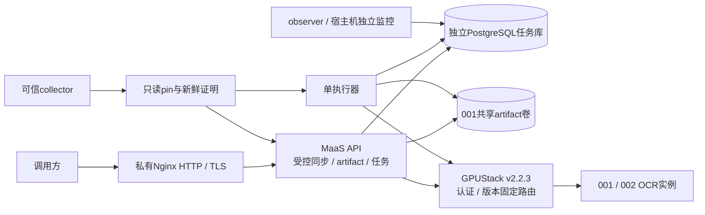

# 开发人员手册

基线：2026-10-21当前P0–P4实现，不包括E1候选代码。本手册解释已实现行为；未通过的实机验收不因文档存在而视为完成。

## 1. 系统职责与架构

目标是在可信网吧GPU节点上提供统一模型服务，当前实际接入GPU OCR。GPUStack负责模型部署、GPU调度、原生鉴权和推理路由；MaaS增加逻辑能力授权、持久任务、输入/结果、并发/存储限制、维护准入与成功用量。OCR使用OpenAI兼容协议传输，不是语言模型，不产生真实token用量。



API同步请求等待上游完成；异步任务以202受理，单执行器逐个领取并等待OCR响应。执行器当前没有并发调度，多worker不等于异步执行器同时发出多次请求。同步与异步仍共享全局/project额度。

## 2. 代码地图

| 位置 | 职责 |
|---|---|
| `maas_platform/api.py`、`schemas.py`、`limits.py` | HTTP接口、公开协议、解析前请求体限制 |
| `auth.py`、`config.py` | 登记key、project/模型授权、配置与私有文件校验 |
| `service.py`、`worker.py` | 任务接纳/领取、租约、取消、提交、恢复、清理 |
| `adapters.py`、`ocr_connector.py`、`sync_ingress.py` | 驱动注册、OCR格式、受控网络调用、同步准入 |
| `versioning.py`、`collector.py`、`inventory.py` | 不可变版本pin、完整控制面校验、精简证明、镜像清单 |
| `maintenance.py`、`node_maintenance.py`、`operator_config.py` | 全局维护、节点停止/恢复、每窗口配置和审计 |
| `artifacts.py` | 文件原子写入、共享生命周期锁、路径约束 |
| `db.py`、`migrations/001…004*.sql` | 独立PostgreSQL、迁移与校验和 |
| `observability.py`、`observe.py`、`cli.py` | 私有指标/告警/成功用量、宿主机管理命令 |
| `gpu-ocr/` | RapidOCR GPU镜像、图像与Chat协议、方向保护；独立于任务API镜像 |
| `deploy/maas/` | Compose、依赖锁定镜像、目录/绑定示例、Nginx与systemd单元 |
| `scripts/maas/runtime/` | 001/002专用部署、边界、维护、备份、回退与耐久工具 |
| `tests/maas/` | API、鉴权、租约、版本、维护、存储与边界测试 |

`maas_platform/e1/`是未接入当前服务的候选，不作为本手册接口。`scripts/maas/runtime/`多数脚本固定正式路径/节点；不能当通用本地测试脚本运行。H3实验文件不属于当前服务。

## 3. 开发环境与验证

应用基准为Python3.11、PostgreSQL16；本地也已用Python3.12验证非数据库测试。Python3.9不能运行当前包。仓库根目录示例：

```sh
python3.11 -m venv .venv-maas
.venv-maas/bin/python -m pip install -r requirements-maas.txt -c requirements-maas-tested-lock.txt
.venv-maas/bin/python -m pytest tests/maas -q --ignore=tests/maas/test_e1_topology.py --ignore=tests/maas/test_e1_control.py --ignore=tests/maas/test_e1_gateway.py
```

未设置 `MAAS_TEST_DATABASE_URL` 时数据库测试会跳过，不能称为完整集成回归。需要完整回归时由开发者在**本地或独立环境**准备可销毁的PostgreSQL16，库名以 `_test` 结尾，通过私有环境文件设置此变量，再执行上述pytest。测试会 `DROP SCHEMA public CASCADE`，绝不能指向正式任务库或GPUStack库。

本地数据库示例（需本机Docker，完全独立端口；不是在001执行）：

```sh
# 私有env由自己准备：POSTGRES_USER=maas、POSTGRES_DB=maas_dev_test、随机POSTGRES_PASSWORD。
# 文件放 .maas/dev-db.env，chmod 600；不要打印内容。
docker run -d --name maas-dev-db --env-file .maas/dev-db.env -p 127.0.0.1:15432:5432 postgres:16-alpine
# 将匹配的 MAAS_TEST_DATABASE_URL 安全写入 .maas/dev-test.env，chmod 600。
# 该文件只能包含自己审核过的变量赋值；不要source下载来的配置。
set -a
. .maas/dev-test.env
set +a
.venv-maas/bin/python -m pytest tests/maas -q --ignore=tests/maas/test_e1_topology.py --ignore=tests/maas/test_e1_control.py --ignore=tests/maas/test_e1_gateway.py
```

代码中的 `start_test_db.py` 为001历史专项工具，会操作远程固定测试容器。当前正式服务占用18830，旧的 `runtime/test_maintenance.py` 等临时API验收入口不能与正式服务混跑。不要为了本地测试新增远程worker、Docker daemon或复用正式端口。

仓库约定：每个独立feature适当验证后单独Git提交，说明具体行为；不要把密钥、数据集原图、运行卷或数据库归档入Git。

## 4. 配置契约

`Settings.from_env()`要求 `MAAS_DATABASE_URL`、`MAAS_GPUSTACK_URL`、`MAAS_ARTIFACT_ROOT`、`MAAS_BINDINGS_FILE`、`MAAS_CATALOG_FILE`、`MAAS_PEPPER_FILE`。Compose从私有app.env组装这些值，不应输出完整展开配置。

- `bindings.json`每条包含 `id/project/enabled/secret_file/models`，模型列表是MaaS逻辑名。一个有效key只能映射一个明确身份；同project不同key可访问该project资源，没有project内个人资源隔离。
- `catalog.json`映射逻辑模型到 `driver/revision/max_runtime_s`。OCR还需要 `upstream_model/pin_file/preflight_file`。正式目录为 `ocr.default`，运行预算25秒；示例中的revision和route占位符不能直接上线。
- `mock`、`local.sha256`为本地受控驱动，不是当前已交付客户模型。不要把示例mock授权复制成正式OCR权限。
- secret文件要求普通私有文件、无group/other权限；正式挂载UID10001可读。collector完整配置与管理凭据不能挂入应用，consumer证明为只读。

主要默认限制及运维调参见 [运维手册](OPERATIONS.md)。API、执行器、observer与CLI必须一致，不能按进程分别扩大额度。

## 5. HTTP协议

所有业务接口使用 `Authorization: Bearer <已登记推理key>`；错误体含 `error.code/message/retryable/request_id`，响应通常带 `X-Request-ID`。Nginx自己拒绝的请求可能返回普通HTTP错误页，应先检查Content-Type。

| 方法与路径 | 行为 |
|---|---|
| `POST /maas/v1/artifacts` | 原始文件字节上传，201，非multipart；Content-Type指定图片类型 |
| `GET /maas/v1/artifacts/{ident}` | 同project下载输入/结果，过期410，Cache-Control no-store |
| `POST /maas/v1/tasks` | 必须Idempotency-Key；新任务202，相同内容复用200，不同内容409 |
| `GET /maas/v1/tasks/{ident}` | 查询已知任务ID；没有公开任务列表接口 |
| `POST /maas/v1/tasks/{ident}/cancel` | 排队直接取消；运行中只标记取消请求 |
| `GET /maas/v1/models/{name}/capabilities` | 输入/参数schema、revision与预算；当前返回execution_modes仅async，不能据此否定另有受控同步接口 |
| `POST /v1/chat/completions` | 当前仅OCR逻辑模型、stream=false，图片用base64 data URL |
| `GET /healthz` | 应用/DB轻量健康检查；不等于GPU/collector健康 |

Swagger `/docs`、`/openapi.json`与 `/healthz`仅可经API私有18830访问，当前Nginx路径白名单不转发它们。无客户 `/v1/models`、管理员HTTP接口、`/metrics`、批次/ZIP/视频接口。

TaskCreate有 `model/input/parameters/timeout_seconds/max_attempts`；默认总截止120秒（1–3600），最多attempt默认3（1–3）。排队时间计入总截止，不是“开始推理后再计时”。OCR输入为 `{"image":{"artifact_id":"art_..."}}`，参数必须为空对象。

异步结果artifact外层为 `outputs/model_revision/attempt/usage`；OCR的outputs含text、lines、elapsed_ms、node。同步外层为Chat completion，`choices[0].message.content`是需要再次JSON解析的OCR对象。两者不是同一层级。

## 6. 任务与远端执行状态

```text
QUEUED → RUNNING → SUCCEEDED / FAILED / RETRY_WAIT
QUEUED / RETRY_WAIT → CANCELLED
RUNNING → CANCEL_REQUESTED → CANCELLED（远端仍须确认结束）
RETRY_WAIT → RUNNING；等待超总截止 → FAILED
```

任务表没有UNKNOWN终态。UNKNOWN在 `backend_activity` 或 `sync_activity` 中，表示远端可能还在执行；对应任务可已FAILED，但隔离仍生效。

领取使用maintenance行锁串行化配额/暂停判断，再按任务行锁和SKIP LOCKED领取；随机token与租约形成fencing。心跳默认5秒、租约30秒。旧token、过期租约不能提交新结果。恢复扫描区分未发送的本地失败、已确认完成但结果未提交、远端未知活动；不会因为HTTP超时无限重试。

OCR发送前先提交backend_activity intent；提交确认不确定时不发送。应用HTTP客户端没有重试/跳转/环境代理，但GPUStack网关仍可能有最多3次尝试，因此当前无法可靠定位实际worker，UNKNOWN全局隔离。不得把 `node` 返回值当作失败/超时请求的可靠落点证据。

成功状态、结果元数据和 `task_usage_events`在同一事务提交，每task最多一次。取消不是GPU中断承诺；task max_attempts也不是OCR不确定执行的重放许可。API断连不代表服务端事务未提交。

## 7. 数据与文件一致性

| 表 | 用途 |
|---|---|
| tasks / task_attempts | 幂等请求、输入引用、attempt token/租约与终态 |
| artifacts | project、输入/结果、大小/哈希、TTL及软删除 |
| backend_activity / sync_activity | 持久发送与远端结束确认 |
| task_usage_events / sync_usage_events | 唯一成功用量；无商业账单 |
| maintenance / maintenance_events | 全局暂停、generation及恢复审计 |
| maas_migrations | 已应用SQL文件及SHA256 |

文件先原子写入，再提交元数据；生命周期flock覆盖写入到提交确认，所有进程共用同一POSIX卷。读取核对大小/SHA256。活动任务保护输入，即使上传TTL已到；未提交的孤儿文件保留宽限期后有界回收，不擅自删除提交确认不明的文件。

输入TTL从上传开始，结果TTL从结果创建开始，默认各24小时。下载接口到期即410，不依赖物理清理是否完成。数据库任务/事件尚无自动历史归档，不能假定24小时后所有历史记录消失。

迁移按文件名顺序执行，advisory lock避免并发应用，已应用迁移校验和变化会拒绝启动。新增迁移必须新编号，不能编辑既有SQL“修复线上”。当前没有通用down migration，兼容镜像回退不代表任意schema可降级。

## 8. 固定版本、方向保护与扩展

版本pin绑定GPUStack v2.2.3、模型/路由/目标/后端配置指纹、内容镜像ID和既定worker集合。完整collector约每5秒校验，失败撤销证明；应用要求30秒内新鲜证明和匹配pin摘要。一个worker异常可能使整个既定集合证明失效，不提供局部降级。

GPU OCR启动检查检测/分类/识别会话均启用CUDAExecutionProvider；不承诺每个算子均在GPU执行。每实例锁串行。方向保护在文本行首次识别后，对低置信度或分类提示倒置的候选尝试180°重识别，只有分数足够提高才替换；不是任意角度旋转、文档结构理解或百分之百纠错。

新增驱动需要：严格输入/参数schema、artifact引用规则、预算与输出限额、可信版本校验、发送前intent、明确远端结束判定、无盲目重试、恢复探针、项目权限/额度/成功计量验证。`adapter_for`只接受显式注册driver，不能从客户输入动态加载类或shell。

实现网络驱动前同时评估受控同步入口和 `recovery.py`，否则恢复将返回RECOVERY_UNSUPPORTED。模型目录变更会改变已接纳任务的fingerprint，未排空就改目录可能使排队任务失败；发布前按维护流程处理。

## 9. 排查与交付

先判断API/DB、鉴权、目录/pin、collector、网关、GPU实例哪一层失败；日志只留request/task/attempt标识，不增加正文/密钥/连接串打印。变更必须说明验证范围和跳过项；真实服务可用、吞吐、8小时耐久分别提供证据，不互相替代。

开发完成后交付：独立commit、配置/迁移说明、回退限制、测试结果和手册更新。正式操作见 [运维手册](OPERATIONS.md)，业务权限见 [管理员手册](ADMIN.md)。
